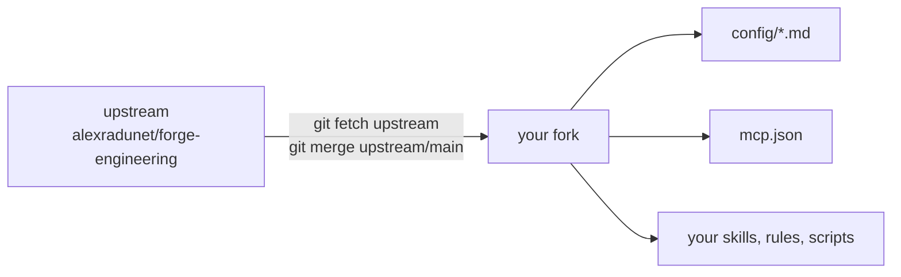

# 🍴 Fork forge for your team

forge is built to be forked. The upstream repository holds the generic workflow.
Your fork holds your tools, your rules, and your config.



## 1️⃣ Create the fork

A public fork: use **Fork** on GitHub.

A private fork (for example for a company), or a fork on GitLab:

```powershell
git clone https://github.com/alexradunet/forge-engineering.git my-forge
cd my-forge
git remote rename origin upstream
git remote add origin <url of your private repository>
git push -u origin main
```

## 2️⃣ What to change

Edit only these places. Then upstream updates merge without conflicts.

| Place | Change |
|---|---|
| `plugins/forge/config/tracker.md`, `repo.md`, `ci.md` | Your tools. Say "configure forge" to seed them from `templates/config/`. See [docs/config.md](docs/config.md). |
| `plugins/forge/config/policy.md` | Policy values and the company sections: Toolkit, Data rules, Start, Investigate, Resume, Implement, Evidence Testing, QA handover, Close |
| `plugins/forge/mcp.json` | Your MCP servers, only for tools without a CLI or REST API |
| `plugins/forge/skills/<company>-*` | New skills of your company. Use a prefix, so that names do not clash with upstream. |
| `plugins/forge/com.github.copilot/rules/<company>.instructions.md` | New always-on rules |
| `plugins/forge/scripts/<company>/` | Your scripts, for example credential scripts |

Avoid edits to the core skills (`ticket`, `agents`, `wiki`, `daily-recap`, `forge-setup`)
and to the `forge` rule. When you need a change there, open an issue or a pull request upstream.

## 🔐 CLI first, then MCP servers and credentials

- Prefer a CLI (for example `gh`, `glab`, `acli`, `az`) in the capability rows. Use the REST API with `curl.exe` when no CLI exists. Add an MCP server only as the last choice (see the `forge` rule, "Tool choice: CLI first").
- Agent Plugins forbid `${ENV}` in an MCP `url` or `headers`. When you need an MCP server, use one of these:
  - a server with OAuth sign-in,
  - a CLI (for example `gh`, `glab`, `acli`) in the capability rows instead of an MCP server,
  - a stdio server that reads the token from a user variable or from a credential store.
- Never commit a secret. Credentials stay in user variables, in a CLI login, or in DPAPI files under `%LOCALAPPDATA%\forge`.
- A stdio server must run without `npm install`. Commit a bundled file, and start it with `${PLUGIN_ROOT}`.

## 🔄 Take upstream updates

```powershell
git fetch upstream
git merge upstream/main
& .\plugins\forge\scripts\Install-Forge.ps1
```

Restart VS Code fully after the merge. Then run `Test-ForgeSetup.ps1`.

## ✅ Check your fork

1. `Test-ForgeSetup.ps1` reports no `fail` line.
2. Run one S-track work item end to end: start, plan, implement, open the change request, close.
3. Search the fork for secrets before every push.
