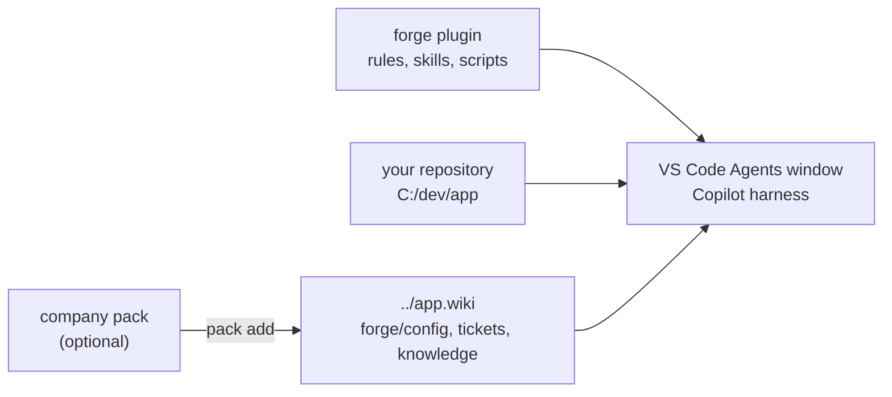

# 🧭 forge-engineering

`forge` is an agent plugin for the [VS Code Agents window](https://code.visualstudio.com/docs/agents/run/agents-window).
It gives every Copilot session a ticket workflow with review gates, a team wiki,
daily recaps, and coordinated agent sessions.

forge does not depend on one tracker, repository host, or CI. Each repository describes
its tools in four Markdown files in its wiki. Templates exist for GitHub, GitLab, Jira,
Jenkins, Azure Pipelines, and local Markdown work items.

**CLI first.** forge calls your tools through their official CLI (`gh`, `glab`, `acli`, `az`),
then through their REST API. It uses an MCP server only when no CLI or API can do the job.
CLI calls are visible, reproducible, and cost no context for tool lists.

## 🚀 Start

1. In VS Code, run **Chat: Install Plugin from Source**.
2. Enter `https://github.com/alexradunet/forge-engineering`.
3. Open your repository in the Agents window.
4. In a chat, say "set up forge".
5. Answer the setup form. The chat creates `../<repo>.wiki`, seeds the config, and checks each tool.

Needs: Node.js 20 or later, Git, and VS Code with agent plugins enabled (`chat.plugins.enabled`).
forge runs on Windows, macOS, and Linux.

forge targets the VS Code Agents window. VS Code changes each month. So the `forge` rule tells the agent
to read the current [VS Code documentation](https://code.visualstudio.com/docs/agents/run/agents-window) and the
[release notes](https://code.visualstudio.com/updates) before it advises on a VS Code feature.

## 📦 Where things live

| Path | Content |
|---|---|
| `<repo>/../<repo>.wiki/` | The wiki: one Git repository for each code repository |
| `<wiki>/forge/config/` | Team config: `tracker.md`, `repo.md`, `ci.md`, `policy.md` |
| `<wiki>/forge/scripts/` | Company scripts from a pack (optional) |
| `<wiki>/raw/tickets/<key>/` | Ticket folders |
| OS credential store | Secrets (`cred.mjs set <name>`). Never in a file. |

A public repository never gets its wiki on its own host. Setup offers a separate private
`<repo>-wiki` repository, or a local-only wiki.

## 🧩 Plugin layout

| Path | Content |
|---|---|
| `plugins/forge/plugin.json` | Plugin manifest ([Agent Plugins 1.0](https://agent-plugins.org)) |
| `plugins/forge/com.github.copilot/rules/` | Always-on rules: `forge` (paths, capabilities, write rules), `style` (response style, memory, sessions) |
| `plugins/forge/skills/` | `ticket`, `agents`, `wiki`, `daily-recap`, `forge-setup` |
| `plugins/forge/templates/config/` | Config templates |
| `plugins/forge/scripts/` | `forge.mjs` (setup, config, trust, packs), `cred.mjs`, `jenkins.mjs` |
| `docs/` | [config.md](docs/config.md) (config format) and [packs.md](docs/packs.md) (company packs) |

## 🧩 Skills

| Skill | Use |
|---|---|
| `ticket` | One folder per work item in `<wiki>/raw/tickets/<key>`, size tracks S/M/L, review gates, code map, evidence, outbox |
| `agents` | Implementer sessions in worktrees, reviewer subagents, hand-off, session status |
| `wiki` | Query, record, and lint the team wiki |
| `daily-recap` | "Prepare my daily" (done, plan, blockers), with or without a daily meeting, and "record the daily outcome" |
| `forge-setup` | "set up forge", "check forge", "repair forge" |

## 🎫 Ticket work

1. Say "start APP-42" or "resume APP-42".
2. Confirm the proposed track:
   - **S** small: plan, code, and close gates only.
   - **M** medium (default): one combined context and scope gate (`Briefed?`), then plan, code, and close.
   - **L** large: the full flow with the visual briefing.
3. Read gate documents, and comment with VS Code comment threads. Approve a gate in the approval form.
4. At Implement, the `agents` skill starts a session with **New Worktree**.
5. Say "close APP-42" to distill the folder into wiki pages.

The agent never merges. It asks before every write to the tracker, the repository host, or the CI.

## 📋 Ticket overview

Say "show the board" or "my tickets". The agent reads the README frontmatter of each ticket
and groups the open tickets by who must act: you, the agent, a colleague, or nobody (blocked).

## 🏢 Company packs

A company keeps its config, policy rules, and helper scripts in a pack: a Git repository
or a folder with `pack.json`. `forge.mjs pack add <source>` copies it into `<wiki>/forge`.
`pack update` merges new pack versions with your local edits. forge runs pack files only
after you approve their SHA-256 hash. See [packs.md](docs/packs.md).

## 🛠️ Develop

- `npm test` runs the tests.
- Clone your company pack into `packs/<name>`. Git ignores that folder. See [packs.md](docs/packs.md).
- To test a local checkout, run **Chat: Install Plugin from Source** with the `plugins/forge` folder.
- Check the loaded rules and skills in **Chat: Open Customizations**.

## 📄 License

[MIT](LICENSE)
