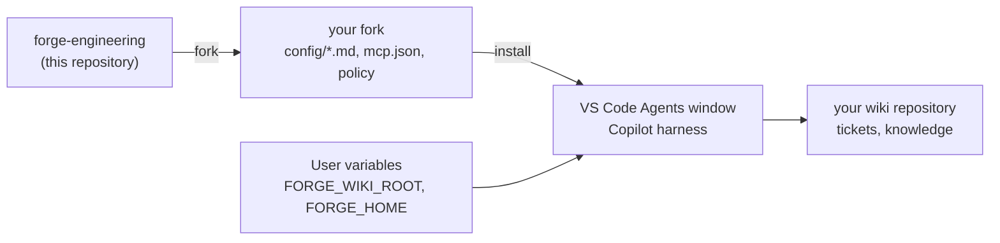

# 🧭 forge-engineering

`forge` is an agent plugin for the [VS Code Agents window](https://code.visualstudio.com/docs/agents/run/agents-window).
It gives every Copilot session a ticket workflow with review gates, a team wiki,
meeting briefs, and coordinated agent sessions.

forge does not depend on one tracker, repository host, or CI. Your team forks this
repository and describes its tools in four Markdown files. Templates exist for
GitHub, GitLab, Jira, Jenkins, Azure Pipelines, and local Markdown work items.

**CLI first.** forge calls your tools through their official CLI (`gh`, `glab`, `acli`, `az`),
then through their REST API. It uses an MCP server only when no CLI or API can do the job.
CLI calls are visible, reproducible, and cost no context for tool lists.



## 🚀 Start

1. Fork this repository. See [FORKING.md](FORKING.md).
2. Clone your fork and a wiki repository (an empty Git repository is enough).
3. Run the installer from the clone with PowerShell 7:

   ```powershell
   & .\plugins\forge\scripts\Install-Forge.ps1 -ForgeHome <clone> -WikiRoot <wiki> -WhatIf
   ```

   Remove `-WhatIf` when the plan is correct.
4. Restart VS Code fully.
5. In a chat, say "configure forge". The `forge-setup` skill asks for your tools and fills in the config.
6. Run `& .\plugins\forge\scripts\Test-ForgeSetup.ps1`.

Needs: Windows, PowerShell 7, Node.js 20 or later, and VS Code with Agent Plugins enabled.

## 📦 Layout

| Path | Content |
|---|---|
| `plugins\forge\plugin.json` | Plugin manifest ([Agent Plugins 1.0](https://agent-plugins.org)) |
| `plugins\forge\com.github.copilot\rules\` | Always-on rules: `forge` (paths, capabilities, write rules), `style` (response style and shape, memory, sessions) |
| `plugins\forge\skills\` | `ticket`, `agents`, `wiki`, `meeting`, `forge-setup`, `i-have-adhd` |
| `plugins\forge\config\` | Team config: `tracker.md`, `repo.md`, `ci.md`, `policy.md` (your fork edits these) |
| `plugins\forge\templates\config\` | Config templates |
| `plugins\forge\mcp.json` | MCP servers (none in the core; a fork adds one only when no CLI covers the tool) |
| `plugins\forge\scripts\` | Installer, setup check, config reader, ticket board launcher |
| `plugins\forge\board\` | Bundled ticket board (built file, committed) |
| `apps\ticket-board\` | Ticket board source and tests |
| `docs\config.md` | Config format, capabilities, and policy sections |

## 🧩 Skills

| Skill | Use |
|---|---|
| `ticket` | One folder per work item in `<wiki>\raw\tickets\<key>`, size tracks S/M/L, review gates, code map, evidence, outbox |
| `agents` | Implementer sessions in worktrees, reviewer subagents, hand-off, session status |
| `wiki` | Query, record, and lint the team wiki |
| `meeting` | "Prepare my daily" and "record the daily outcome" |
| `forge-setup` | Script paths, setup check, team config from templates |
| `i-have-adhd` | Full guidance for the ADHD response shape (the short form is always on in the `style` rule) |

## 🎫 Ticket work

1. Say "start APP-42" or "resume APP-42".
2. Confirm the proposed track:
   - **S** small: plan, code, and close gates only.
   - **M** medium (default): one combined context and scope gate (`Briefed?`), then plan, code, and close.
   - **L** large: the full flow with the visual briefing.
3. Read gate documents, and comment with VS Code comment threads. Approve a gate in the approval form.
4. At Implement, the `agents` skill starts a session with **New Worktree**.
5. Say "show the board". The agent starts the local board on `http://127.0.0.1:4517`.
6. Say "close APP-42" to distill the folder into wiki pages.

The agent never merges. It asks before every write to the tracker, the repository host, or the CI.

## 🛩️ Ticket board

`Start-TicketBoard.ps1` starts a small read-only Node server on `127.0.0.1:4517`. It reads `<wiki>\raw\tickets` live:

- `#/`: open tickets in lanes by who must act, and the newest done tickets.
- `#/<KEY>`: the ticket page (next step, gates, change requests, log).
- `#/<KEY>/briefing`: the visual briefing.

`Start-TicketBoard.ps1 -Check` validates the frontmatter of the ticket documents.

## 🛠️ Develop

- `Install-Forge.ps1` adds `plugins\forge` to the VS Code setting `chat.pluginLocations`.
- VS Code runs a copy of the plugin. It makes a new copy only when the time of the `plugins\forge` folder changes.
- After you edit plugin files, run `Install-Forge.ps1` again, then restart VS Code fully. `Test-ForgeSetup.ps1` warns when the copy is out of date.
- Config edits in `<FORGE_HOME>\plugins\forge\config` count at once. They need no new copy.
- Board: `cd apps\ticket-board; npm test; npm run build`. Commit the rebuilt bundle.
- Check the loaded rules and skills in **Chat: Open Customizations**.

## 📄 License

[MIT](LICENSE)
