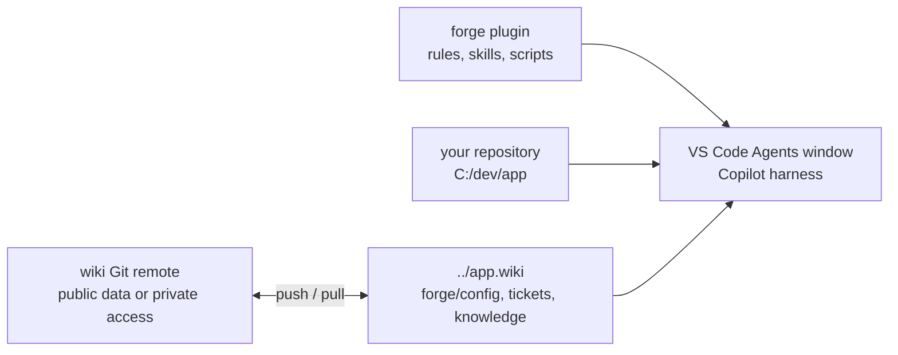

# 🧭 forge-engineering

`forge` is an agent plugin for the [VS Code Agents window](https://code.visualstudio.com/docs/agents/run/agents-window).
It gives every Copilot session a ticket workflow with review gates, a team wiki,
daily recaps, and coordinated agent sessions.

forge does not depend on one tracker, repository host, or CI. Each repository describes
its tools in four Markdown files in its wiki. Templates exist for GitHub, GitLab, Jira,
Jenkins, Azure Pipelines, and local Markdown work items.

**CLI first.** forge calls your tools through their official CLI (`gh`, `glab`, `acli`, `az`),
then through their REST API. It uses an MCP server only when no CLI or API can do the job.
CLI calls are visible, reproducible, and cost no context for tool lists.



## 🚀 Start

1. In VS Code, run **Chat: Install Plugin from Source**.
2. Enter `https://github.com/alexradunet/forge-engineering`.
3. Open your repository in the Agents window.
4. In a chat, say "set up forge".
5. Answer the setup form. The chat creates `../<repo>.wiki`, seeds the config, and checks each tool.

Needs: Node.js 20 or later, Git, and VS Code with agent plugins enabled (`chat.plugins.enabled`).
forge runs on Windows, macOS, and Linux.

forge targets the VS Code Agents window. VS Code changes each month. So the `forge` rule tells the agent
to read the current [VS Code documentation](https://code.visualstudio.com/docs/agents/run/agents-window) and the
[release notes](https://code.visualstudio.com/updates) before it advises on a VS Code feature.

### 🔄 Update forge

VS Code has no update action for a plugin installed from a URL or local folder.
To update `forge`:

1. If you installed from a Git clone (`~/.vscode/agent-plugins/github.com/alexradunet/forge-engineering` or `~/.copilot/installed-plugins/_direct/forge`), pull the latest `main` in that folder, or uninstall and reinstall the plugin.
2. Reload extensions in the session (`extensions_reload`) or run **Developer: Reload Window** so `%APPDATA%/Code/agentPlugins` picks up the new snapshot.

"check forge" reports when the installed plugin is behind its remote.

### 🏢 Company config

The plugin holds no company config. Each repository wiki holds its config and helper scripts.
Say "set up forge" to create them, or clone the team's existing wiki.
Commit and push the wiki to share changes. See [wiki.md](docs/wiki.md).

## 📦 Where things live

| Path | Content |
|---|---|
| `<repo>/../<repo>.wiki/` | The wiki: one Git repository for each code repository |
| `<wiki>/forge/config/` | Team config: `tracker.md`, `repo.md`, `ci.md`, `policy.md` |
| `<wiki>/forge/scripts/` | Optional helper scripts |
| `<wiki>/raw/tickets/<key>/` | Ticket folders |
| OS credential store | Secrets (`cred.mjs set <name>`). Never in a file. |

A public repository can use its native wiki when all tracked files and Git history contain public data.
Setup also offers a separate private `<repo>-wiki` repository, or a local-only wiki.

## 🧩 Plugin layout

| Path | Content |
|---|---|
| `plugins/forge/plugin.json` | Plugin manifest ([Agent Plugins 1.0](https://agent-plugins.org)) |
| `plugins/forge/com.github.copilot/rules/` | Always-on rules: `forge` (paths, capabilities, write rules), `style` (response style, memory, sessions) |
| `plugins/forge/skills/` | `ticket`, `agents`, `wiki`, `daily-recap`, `forge-setup`, `learning-mode` |
| `plugins/forge/com.github.copilot/extensions/` | Read-only ticket dashboard canvas |
| `plugins/forge/templates/config/` | Config templates |
| `plugins/forge/scripts/` | `forge.mjs` (setup, config, trust, lint, wiki scripts), `cred.mjs`, `jenkins.mjs` |
| `docs/` | [config.md](docs/config.md) (config format) and [wiki.md](docs/wiki.md) (sharing and scripts) |

## 🧩 Skills

| Skill | Use |
|---|---|
| `ticket` | One folder per work item in `<wiki>/raw/tickets/<key>`, full research and investigation, review gates, code map, evidence, outbox |
| `agents` | Implementer sessions in worktrees, reviewer subagents, hand-off, session status |
| `wiki` | Query, record, and lint the team wiki |
| `daily-recap` | "Prepare my daily" (done, plan, blockers), with or without a daily meeting, and "record the daily outcome" |
| `forge-setup` | "set up forge", "check forge", "repair forge" |
| `learning-mode` | Optional 15-minute lessons from artifact questions, saved in the repository wiki |

## 🎫 Ticket work

1. Say "start APP-42" or "resume APP-42".
2. Every new ticket uses `workflow: full-v1`, with no sizing question or `track` field:
   research → **Understood?** → visual briefing → scope interview → **Agreed?** →
   investigation → mandatory **Diagnosed?** → plan → **Designed?**.
3. Read and comment on the gate documents. One explicit user approval covers the
   displayed file/revision set, recorded in a SHA-256 manifest. Small fixes follow
   the same phases; unavailable sources and test gaps are recorded, not treated as safety evidence.
4. At Implement, the `agents` skill starts a session with **New Worktree**.
5. Complete **Shippable?**, **Sendable?** for each external write, and Evidence Testing.
   QA handover runs only when configured. Say "close APP-42"; **Learned?** approves
   distillation into wiki pages and archive.

Existing S/M/L and trackless tickets retain their original phases, gates, and skips,
including recommended rather than mandatory Diagnosed?. Briefed? remains legacy-only.
Missing `track` never identifies the new workflow. Resume reports missing or stale
approval evidence and blocks only the affected action, not unrelated read-only work.
See the [ticket workflow contract](plugins/forge/skills/ticket/SKILL.md#-workflow).

The agent never merges. It asks before every write to the tracker, the repository host, or the CI.

## Learning mode

Learning mode helps you understand an artifact before you approve it. It is off by default.

1. Say "enable learning mode". Review the proposed `learningMode: true` policy edit and approve the changed config through trust.
2. Comment on an artifact: "What does idempotency mean here?" or "learn: why is this queue needed?"
3. Submit the feedback, or say "review my comments". Choose whether to create the offered bite.
4. Read the linked lesson in `<wiki>/learning/`. It explains the concept, its purpose, and the design reason.
5. Say "disable learning mode" to turn off offers. Existing lessons stay in the wiki.

Each bite includes a repository example, a small exercise, and a self-check within a 15-minute learning budget.
You can skip or defer it without blocking approval. Lessons never approve a gate or prove understanding.
The existing `Learned?` close gate stays unchanged.

The switch is `policy.learningMode` in the wiki config, not a VS Code switch.
Older configs default to `false` without reseeding.
There is no background watcher: the agent handles comments when you submit feedback or request review.
See [config.md](docs/config.md#learning-mode) for the setting and trust flow.

## 📋 Ticket overview

Say "show the board" or "my tickets". The agent reads the README frontmatter of each ticket
and groups the open tickets by who must act: you, the agent, a colleague, or nobody (blocked).

### 🖼️ Ticket dashboard

Forge also bundles a read-only canvas. Say **"open the Forge ticket dashboard"**.
The agent supplies the repository wiki path from `forge.mjs where --json`.

- Start on a clean overview grid with 4 KPI cards, state filter pills, search, and segmented gate progress bars; recorded tracks appear only as legacy context.
- Switch between **🎫 Tickets** and **📚 Wiki & Concepts** in the top bar to browse canonical wiki knowledge shelves (**🎓 Concepts & Learning**, **🏗️ Architecture & Areas**, **🛠️ Tooling & Gotchas**, **🧭 Decisions**, **🎫 Closed Ticket Summaries**, and **📚 Index & Log**).
- Click any ticket card to open its full-screen **Ticket Cockpit**: phase stepper, hero focus, categorized document shelves, review gates, and change requests.
- Browse ticket documents by category (**Core & Map**, **Gate Docs**, **Evidence & Spikes**, **Outbox Drafts**, **Logs & Decisions**) and read both ticket and wiki pages inside the canvas with rendered **Mermaid diagrams**, collapsible `📂` detail sections, and verified source lists.
- Follow Markdown links seamlessly across ticket files, canonical wiki pages, and concept lessons with a built-in `↩ Previous view` history stack.
- The dashboard reads ticket and wiki files every 5 seconds. **Refresh** reads them immediately.
- Empty ticket folders show an empty board. Invalid files show errors without hiding valid tickets.

Ticket README files remain the source of truth. The dashboard never edits files, approves gates,
or calls a tracker. It stores no private data and needs no credentials.

Enable `chat.canvases.enabled`, then start a new local desktop session with the Copilot harness.
Other harnesses, remote sessions, and browser clients do not support canvases.
See [VS Code canvases](https://code.visualstudio.com/docs/agents/run/canvases).
Forge uses Agent Plugins 1.0. Canvas files live under `com.github.copilot/extensions/`.
The manifest declares their path in `extensions["com.github.copilot"].extensions`.
A top-level `"extensions": "extensions/"` belongs to the older Copilot format and does not work here.
If the canvas is missing, check the installed source folder for these files and this manifest entry.
For local development, install the source plugin as described below.

The canvas ID is `forge-ticket-dashboard`. Its open input is `{ "wikiPath": "<absolute wiki path>" }`.
Its `refresh` action returns current tickets and read errors. Reopening the same instance reuses
its server and rereads the same wiki. Separate instances can show separate repositories.
Each server binds only to `127.0.0.1` on a free port and stops when the canvas instance closes.
The panel needs no database; ticket files preserve its data across sessions.

The reader supports the [ticket template](plugins/forge/skills/ticket/templates/README.md):
scalar fields, comments, quoted strings, folded text (`>`), literal text (`|`), and flat object lists
for `gates` and `changes`. Text blocks support strip (`-`) and keep (`+`) chomping.
Lists can use inline arrays, inline objects, or indented fields.
YAML anchors, tags, and explicit block indentation indicators are not supported;
the dashboard reports them as read errors. Existing tickets need no rewrite for supported YAML forms.
New `full-v1` tickets have no track badge or missing-track warning. Existing trackless
tickets remain visible without an inferred workflow or size. Recorded S/M/L labels
are legacy context only. An unknown track value still produces a read error.
CLI validation and the dashboard use the shared parser in
[`scripts/lib/ticket.mjs`](plugins/forge/scripts/lib/ticket.mjs).

## 🔎 Local validation

```sh
node "<plugin>/scripts/forge.mjs" lint [--wiki "<path>"] [--json] [--fix]
```

Default lint is read-only. It checks ticket metadata, workflow/gate agreement,
approval revisions, and canonical wiki metadata without inferring workflow, state,
or approval. Findings name the file, line when available, code, severity, and remedy.
Invalid input fails without hiding valid files.
Errors exit 1; warnings alone exit 0.
Index membership, semantic contradictions, HTTP retrieval, and claim truth remain
manual checks; lint does not prove them.

Explicit `--fix` only adds a missing final newline in an **unapproved** `*.draft.md`
whose metadata explicitly says `status: draft`,
preserving all other bytes and line-ending style. Direct and combined approval
references protect drafts from repair. Each repair is reported and appended to the
ticket's `repair-log.jsonl` with `started`/`applied` rows and before/after hashes;
a second pass changes nothing. It never repairs stale
approvals, migrates workflows, deletes pages, or publishes content.
See [validation and source limits](docs/wiki.md#local-validation-and-source-limits).

## 📚 Shared wiki

Edit config and helper scripts directly in `<wiki>/forge`. Git handles versioning and shared updates.
Each teammate reviews and approves the files by SHA-256 hash before forge uses them.
Trust approvals and credentials stay outside the wiki. See [wiki.md](docs/wiki.md).

## 🛠️ Develop

- `npm test` runs the tests.
- [Behavioral evaluation](docs/evaluation.md) describes manual runs through the
  supported harness, trace evidence, and execution approval. Deterministic fixtures
  and document checks do not establish model compliance; do not claim a behavioral
  pass without the required harness run evidence.
- To test a local checkout, run **Chat: Install Plugin from Source** with the `plugins/forge` folder.
  First uninstall or disable the forge plugin from the GitHub URL. With both installed, VS Code loads two plugins named `forge`, and the
  rules and skills appear two times. To go back, remove the local folder in **Chat: Open Customizations**, **Plugins**
  (or its `chat.pluginLocations` entry in the user settings), and enable the URL install again.
- Check the loaded rules and skills in **Chat: Open Customizations**.

## 📄 License

[MIT](LICENSE)
