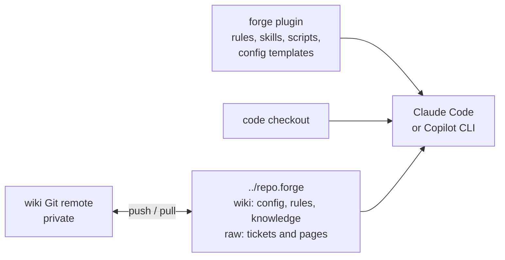
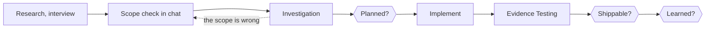
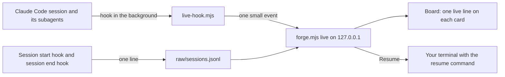

# 🧭 forge-engineering

`forge` is an agent plugin for Claude Code and GitHub Copilot CLI (see Hosts).
One plugin folder runs in both.
It gives every agent session a ticket workflow with review gates, a small set of plain ticket documents,
a repository wiki, coordinated agent sessions, and a ticket board that any session can show.

forge calls no external tool: no tracker, no change request host, and no CI.
A ticket lives only in `<forge>/raw/tickets/<key>`. Its README has an `item:` line with the link to the work item in any tracker (GitHub, Azure DevOps, Jira, and others).
You paste the text of the work item into the chat. The agent writes paste texts for you in `outbox/` of the ticket, and you send them yourself.



## 🚀 Start

1. Clone `https://github.com/alexradunet/forge-engineering`.
2. Install the plugin from the clone:
   - Claude Code: `claude plugin marketplace add <clone>`, then `claude plugin install forge@forge`. Or start a session with `claude --plugin-dir <clone>/plugins/forge`.
   - Copilot CLI: `copilot plugin install <clone>/plugins/forge`, or start a session with `copilot --plugin-dir <clone>/plugins/forge`.
3. Open a session in your code checkout.
4. In the chat, say "set up forge".
5. Answer the setup form: your branch pattern (`users/<your name>/{KEY}-{slug}`) and the path of your clone.

Needs: Node.js 20 or later and Git.
forge runs on Windows, macOS, and Linux.

Setup reads the repository first, so most answers are prefilled:

- the default branch and the branch pattern of your local branches, for example `users/alex/{KEY}-{slug}`,
- the path and the remote of your clone.

Then it creates the Forge folder `../<repo>.forge` with its wiki, seeds the config and rule pages, writes your values with a validated command,
and asks you to approve the files by hash.
It asks for the team size (small or large) and the response style, and writes the policy values for them. At the end, it offers the optional extras: the other policy values.

| Say | Result |
|---|---|
| "set up forge" | First-time setup, or resume at the first open step |
| "check forge" | `doctor`, plugin version, and the changelog of the current host |
| "refresh the forge config" | Copy the new config templates after an update, and keep your personal values |
| "finish forge setup" | Resume after a stop |

`forge.mjs doctor` warns while `<user>` remains in `repo.branchPattern` or while the main checkout path is missing. It also checks whether a session start hook ran (`hook`) and whether the plugin clone is behind its remote (`plugin:version`). It names each file that Forge 14.0.0 does not use. Each `warn` line gives one exact fix command. `forge.mjs doctor --fetch` runs `git fetch` in the plugin clone first.

### 🔌 Hosts

The rules and the skills name host verbs, for example `host.title` (set the session title) or `host.spawn`
(start a session). The `sessionStart` hook finds the host and adds its table from `plugins/forge/hosts/`,
which gives the tool or the manual step for each verb. Each host gets the same features. When a host has no tool
for a verb, the agent tells you the manual step.

| Host | Start | Host found by | Notes |
|---|---|---|---|
| GitHub Copilot CLI | `copilot plugin install <clone>/plugins/forge` or `copilot --plugin-dir <clone>/plugins/forge` | no `CLAUDECODE` | You run `/rename` and `/cwd`. The board is the session overview. |
| Claude Code | `claude plugin marketplace add <clone>`, then `claude plugin install forge@forge`. Or `claude --plugin-dir <clone>/plugins/forge` | `CLAUDECODE=1` | The hooks set the title. The context comes in numbered parts. |

`forge.mjs context --host <copilot-cli|claude>` prints the context of a host, for a check or for a host without the hook.

Forge 13.0.0 removed the VS Code Agents window host. Forge 12.4.0 is the last version with it.

### 🔄 Update forge

To update `forge`:

1. Claude Code: pull the latest `main` in your clone. A marketplace that you added from a folder reads the plugin from that folder, so the pull is the update. In an open session, run `/reload-plugins`.
   For a plugin that you installed from a marketplace with its own copy, run `claude plugin update forge@forge`.
2. Copilot CLI: if you installed from a Git clone (`~/.copilot/installed-plugins/_direct/forge`), pull the latest `main` in that folder, or uninstall and reinstall the plugin.
3. When the update changed `plugins/forge/templates/config/`, say "refresh the forge config".

"check forge" reports when the installed plugin is behind its remote.

### ⬆️ Upgrade to 14.1.0

Forge 14.1.0 removes the hash trust and `forge.mjs run`. There is nothing to approve: delete the old `trust` folder in the user data folder if you want, it is not read. Two changes can need your action:

- A `policy.gateGuard: off` in a wiki acts as `deny` now, and `doctor` warns. To turn the guard off, set `FORGE_GATE_GUARD=off` in your environment (it also accepts `deny` and `ask`, and wins over the wiki value).
- A rule page of the wiki (`rules/*.md`) goes into each session with no approval. When a page changes between two sessions, the agent tells you (the commit and its author, or "not committed"). Review a rule change in the `git log` of the wiki.

### ⬆️ Upgrade to 14.0.0

Forge 14.0.0 removes the profiles, the tracker and CI config, the credentials, and every call to an external tool. To upgrade a wiki:

1. Run `forge.mjs doctor`. It names each file that Forge does not use any more: `tracker.md`, `ci.md`, `rules/toolkit.md`, and a `profile` key in `forge/repo.json`.
2. Remove the files that it names, and the `profile` key.
3. Strip `repo.md` to its 3 keys (`changeName`, `branchPattern`, `baseBranch`) and the **Checkouts** table.
4. If `doctor` says that `policy.md` names a removed part, edit its sections, or run `forge.mjs seed --force` for `policy.md` (it replaces your edits).
5. Optional: add the native Claude Code deny rule `Bash(gh pr merge:*)` to your user settings.

The wiki holds only the config copy and your personal values. To share the wiki, commit and push it. See [wiki.md](docs/wiki.md).

## 📦 Where things live

| Path | Content |
|---|---|
| `<repo>/../<repo>.forge/` | The Forge folder (`<forge>`) of a code repository: the wiki, the tickets, the pages, and the launcher |
| `<forge>/wiki/` | The wiki (`<wiki>`): one Git repository for each code repository |
| `<forge>/raw/`, `<forge>/archive/` | Local folders: the open tickets and the pages, and the closed ticket folders. They are not in the wiki repository |
| `<forge>/forge`, `<forge>/forge.cmd` | The launcher: `../<repo>.forge/forge open` |
| `<wiki>/rules/` | Rules for each session: data rules. A change shows as a notice at the next session start |
| `<wiki>/forge/config/` | Config: `repo.md`, `policy.md` |
| `<forge>/raw/tickets/<key>/` | Ticket folders |

Use a private wiki: a wiki can hold internal names and company rules.
Setup offers the native wiki of the private repository, a separate private `<repo>-wiki` repository, or a local-only wiki.

## 🧩 Plugin layout

| Path | Content |
|---|---|
| `plugins/forge/plugin.json` | Plugin manifest ([Agent Plugins 1.0](https://agent-plugins.org)) for both hosts. Claude Code takes the name from the folder and the version from its marketplace. |
| `.github/plugin/marketplace.json`, `.claude-plugin/marketplace.json` | The marketplaces for Copilot CLI and for Claude Code. `tests/packaging.test.mjs` keeps the name, the version, and the source the same in each manifest, and runs each hook command. |
| `plugins/forge/context/` | The session rules, in a short form: `forge` (paths, ticket sessions, host verbs, the Never rules, memory) and `style` (response style, "No AI tells", response shape). The `sessionStart` hook gives them to each session. `tests/context-budget.test.mjs` keeps the sizes. |
| `plugins/forge/hosts/` | One verb table for each host: `copilot-cli.md` and `claude.md`. The hook adds the verb table of the current host to the context. The other parts of the file (the pages, the feature documentation) stay in the file, and the agent reads them at the step. |
| `plugins/forge/com.github.copilot/hooks/` | `hooks.json`: the `sessionStart` hook. It gives each session the paths, the ticket context, the `forge` and `style` rules, and the approved company rules of `<wiki>/rules/`. The `preToolUse` hook is the guard (`forge.mjs hook pre-tool`, see Review gates). Forge 9.1 adds the `sessionEnd` hook: with `sessionStart`, it writes the session list of a Copilot CLI session (see [Live view](#-live-view)). |
| `plugins/forge/hooks/` | `hooks.json`: the same context for Claude Code (spike). `SessionStart` gives it in parts of at most 9,000 characters (2 parts for a session without company rules), `UserPromptSubmit` sets the ticket title, and `PreToolUse` is the gate guard. See `Claude Code host` in [baseline.md](docs/baseline.md). Forge 7.6 adds the live reporter (`scripts/live-hook.mjs`) as a background hook on the activity events of a session: see [Live view](#-live-view). Forge 9.1 adds the session list: part 1 of `SessionStart` writes the start of a session, and `forge.mjs hook session-end` at `SessionEnd` writes its end. |
| `plugins/forge/skills/` | `ticket`, `agents`, `board`, `wiki`, `forge-setup`, `writing` |
| `plugins/forge/templates/` | The config templates (`config/`) and the rule pages (`rules/`) |
| `plugins/forge/scripts/` | `forge.mjs` (init, config, lint, board, local-key, worktree, live, open, gate-open, gate-approve, hook), `live-hook.mjs` (the reporter of the live view) |
| `plugins/forge/vendor/mermaid/` | The only third-party program of the plugin: the small Mermaid build that draws the diagrams of the wiki page, with its license and a [notice](plugins/forge/vendor/mermaid/NOTICE.md) (version, hash, update steps) |
| `docs/` | [config.md](docs/config.md) (config format), [wiki.md](docs/wiki.md) (sharing and scripts), [evaluation.md](docs/evaluation.md) (behavioral runs: `npm run eval` gives the cases of `tests/evals/` to a real agent session), and [baseline.md](docs/baseline.md) (the host features that forge uses) |
| `AGENTS.md` | [Rules for agents that develop forge](AGENTS.md): docs-first checks, tests, and file format |

## 🧩 Skills

| Skill | Use |
|---|---|
| `ticket` | One folder per work item in `<forge>/raw/tickets/<key>`, full research and investigation, review gates, code map, evidence, paste texts. `SKILL.md` is short, and the steps of each phase are in `phases/`. |
| `agents` | Implementer sessions in worktrees, reviewer subagents, the cold read of gate documents, hand-off, session status |
| `board` | "Show the board" in any session: ticket status and session titles |
| `wiki` | Query, record, and lint the repository wiki |
| `forge-setup` | "set up forge", "check forge", "repair forge", "finish forge setup", "refresh the forge config" |
| `writing` | One source for the writing rules: modes, precedence, and the AI writing pattern catalog. Say "humanize this" or "check the writing". |

## ✍️ Writing rules

forge combines three rule sets:

- ASD-STE100 Simplified Technical English for all text.
- An ADHD response shape for chat ([i-have-adhd](https://github.com/ayghri/i-have-adhd), MIT).
- 26 AI writing patterns ([humanizer](https://github.com/blader/humanizer) 3.1.0, MIT), for example "not X but Y", one-line closers, and em dashes.

The [`writing` skill](plugins/forge/skills/writing/SKILL.md) decides which rules apply to each kind of text:

| Text | AI pattern check | Formatting |
|---|---|---|
| Chat replies | Short list in the `style` rule | Emoji headings |
| Ticket documents, config | Strong tells | Plain ticket style: emoji only for a state, no bold labels |
| Wiki pages and lessons | Full pass | Plain: no emoji, no bold labels |
| Paste texts, change request text, tracker comments | Full pass | Target format, plain |

No mode allows em dashes or en dashes in prose. License texts are in [NOTICE.md](plugins/forge/skills/writing/NOTICE.md).

## 🎫 Ticket work

1. Open a new session. Give a key and the link of the work item, with the pasted text, for example "start APP-42 https://example.com/APP-42" and the text of the item. Or say "resume APP-42".
   The session gets its title first (see Session titles below).
   The key is what you type. When you give none, say "new local ticket": `forge.mjs local-key` gives the key `L-<n>`.
   The link goes to `item:` in the ticket README. Forge never opens it.
2. Forge names the worktree and the branch. `forge.mjs worktree APP-42 --summary "<goal>"` gives the branch
   from `repo.branchPattern` and the folder `<repo>.worktrees/<key>-<slug>`:
   - Session on the main checkout: after one "yes", the agent creates the worktree and moves the session there (`EnterWorktree` in Claude Code, `/cwd` in Copilot CLI).
   - When a worktree of the ticket exists, the agent continues there.
3. Every new ticket uses `workflow: full-v4`, with no sizing question:
   research → scope interview → scope check in chat →
   investigation (🛑 diagnosis stop) → plan → **Planned?** → implement → Evidence Testing → **Shippable?**.
   When `policy.evidenceOnDeployedEnv` is `true`, Evidence Testing runs after the push.
   A small fix has the same phases and gates. Its documents are shorter.
4. Read the gate document, and add your comments in the chat. One explicit user approval covers the
   displayed file and revision set, recorded in a SHA-256 manifest. `forge.mjs gate-open <key> <gate>` builds that set, writes the manifest and the snapshot, sets the gate to `in-review`, and prints the form text. `forge.mjs gate-approve <key> <gate> --answer "<your exact answer>" --method form|chat`
   accepts only `approve` in the form or the whole text `approve <gate>` in chat, and refuses a changed document or manifest. It checks the manifest and the documents, then records the approval in the README and in `approvals/history.md`. When a write fails, it restores both files.
   Unavailable sources and test gaps are recorded, not treated as safety evidence.
5. At Implement, the `agents` skill reuses a suitable current worktree. It starts another session only when needed.
6. After the **Shippable?** GO, the agent pushes the branch. You open the pull request in your host and paste its URL into the chat. The agent records it in `changes` of the README. QA handover runs only when configured.
   Say "close APP-42"; **Learned?** approves distillation into wiki pages and archive.



| Gate | You approve | It holds |
|---|---|---|
| **Planned?** | `story.md` and `plan.md` | The problem, the scope, the acceptance checks, your interview answers, the history, and the open questions; the diagnosis, the steps with their files, the tests, the deployed checks, the risks, and the decisions |
| **Shippable?** | `review.md` | What changed, the tests that ran, and the findings of the adversarial review |
| **Learned?** | `close.md` | What you now know, and the wiki changes |

A manifest can also list `evidence/` files that you must see in an exact revision.
Before a gate opens, a subagent without the session history reads the gate document (the cold read).
It gives a paraphrase and the terms that it cannot resolve, and the session corrects the document before you see it.

The gate guard is a `preToolUse` hook. Before a `git push` in a ticket worktree, it checks the approvals of Planned? and Shippable?. For a ticket with a branch, it also checks that the code of the push is the code of the Shippable? approval (the patch-id in the manifest). It always asks you before `forge.mjs gate-approve`, also with the guard off.
When one is missing or stale, it stops the command and names each finding. `policy.gateGuard` selects `deny` (default) or `ask` (the host asks you). The environment variable `FORGE_GATE_GUARD` (`deny`, `ask`, or `off`) wins over it, and it is the only way to turn the guard off.
The guard reads the words of a shell command, so it is a net and not a wall: the written rules stay in force.
When the README of the ticket cannot be read, the guard stops a push.

Plan checks: `forge.mjs lint` checks the paths of a plan (`plan-path`), its Baseline and Control lines (`plan-baseline`), and the plan review (`plan-review`). `gate-open` runs them before Planned?.
`policy.planReview` (`off`, `attacker`, or `panel`) sets the review of the plan by subagents before Planned?. `policy.styleRules` adds the response style rules to each session. A missing key means `true`.

### 🕰️ Older tickets

Forge 12 reads only `workflow: full-v4`. It has no convert code. `forge.mjs lint` reports a ticket with another layout as a read error.
The session-start hook shows the error, and the gate guard denies a push for that ticket.
Finish a `full-v3` ticket with Forge 10.1 before you update. Finish or archive an older ticket with Forge 7.6.
Resume reports missing or stale approval evidence and blocks only the affected action, not unrelated read-only work.
See the [ticket workflow contract](plugins/forge/skills/ticket/SKILL.md#-workflow).

Before edits, builds, or fixtures, Forge checks the actual worktree and resolves its baseline.
An explicit required commit takes priority over the ticket branch and the configured base branch.
Exact-commit proofs require HEAD equality. Resumed implementation can retain verified task changes above its baseline.
Forge never resets a branch or changes approved documents to repair a mismatch.
See the [worktree selection checks](plugins/forge/skills/agents/SKILL.md#select-the-execution-worktree).

The agent never merges. It calls no tracker, no change request host, and no CI. It gives you paste texts, and you send them. A native Claude Code deny rule `Bash(gh pr merge:*)` in your user settings adds a hard stop for a merge.

### 📄 Ticket documents

A ticket has about 7 Markdown files, and each fact has one home. A file starts to exist when its phase starts.

| File | Content |
|---|---|
| `README.md` | The state: frontmatter and the Now card |
| `story.md` | Planned?: problem, scope, acceptance checks, answers, history, open questions |
| `plan.md` | Planned? (with `story.md`): diagnosis, steps, tests, checks, risks, decisions |
| `review.md` | Shippable?: changes, tests run, review findings |
| `proof.md` | Evidence Testing: one check for each changed behavior, with its result (in the Shippable? set by default) |
| `journal.md` | The dated log: work, decisions, problems, and finished steps |
| `map.md` | The code map: components with their layer, flow, data, tests, terms |
| `close.md` | Learned?: what you now know, and the wiki changes |

- A ticket document is plain: no emoji in a heading, no bold labels, and no section without content.
  An emoji shows only a state: 🟡 🔴 🟢 for the ticket and a risk, and 🟢 🔴 ⚪ for a check result.
- A gate document starts with a summary of at most 150 words: the key fact, the change, what the agent needs from you,
  and at most 3 decisions with a recommended answer. The whole document has at most 1,500 words. Longer material goes to `evidence/`.
- The approval form shows only the summary. At a later review, it shows only the changes since your last review
  (`forge.mjs gate-open` prints them and saves the version that you saw; `--dry-run` writes nothing).
- `forge.mjs lint` warns when a summary is missing or too long, a document is over its budget, or a section is empty.
- `proof.md` is not in `review.md`. By default, Evidence Testing finishes before Shippable? opens, `gate-open` needs `proof.md` with no `open` and no `failed` check, and a changed `proof.md` makes Shippable? stale. With `policy.evidenceOnDeployedEnv: true`, Evidence Testing runs after the push, and `proof.md` stays outside the manifests.

### 📍 Where a ticket is

- The Now card at the top of each ticket README shows the state, the phase, the open gate, the next step,
  who the ticket waits on, what is done, and the date. `forge.mjs lint` warns when the card
  does not agree with the frontmatter.

### 🏷️ Session titles

Each ticket session has the title `<KEY> - <state> - <goal>`, for example `APP-4211 - 🟡 - Review invoice export fix`.
The title has less than 60 characters. Keys of one project have the same width, so the goals line up in the sessions list.

| State | Meaning |
|---|---|
| 🟡 | A gate or a question waits for you |
| 🔴 | A failure stops the work |
| 🟢 | The last gate is approved, and no gate is open |
| ▶️ | The agent works |
| ⏳ | The work waits for an outside event, for example a review or a build |
| ✅ | The ticket is closed |

The plugin has a `sessionStart` [hook](plugins/forge/com.github.copilot/hooks/hooks.json).
When a session starts, `forge.mjs hook session-start` finds the ticket from the session folder, the branch,
or the key in the first prompt. It gives the agent the title, the Now card, and the worktree step.
The context ends with the line `End of Forge context.`. When that line is missing, each skill runs
`forge.mjs context`, which prints the same context. In Claude Code, the hooks set the title with `sessionTitle`.
In Copilot CLI, the agent gives you the `/rename` command.

### 👥 People on a ticket

The ticket README keeps a `people:` list of everyone you work with on the ticket.
Each entry has a name or handle, a role, the ask, and one status:
`to-contact` → `drafted` → `waiting` → `reply-in` → `done`, plus `follow-up`.
The agent updates the list when you add a colleague question, draft a message, send it, or get a reply.
After more than 3 working days in `waiting`, it suggests a follow-up but changes the status only when you agree.
The board (`raw/board.md` and `board --json`) lists these long waits.
The list is outside approval manifests, so a status change never reopens a gate.
See [People](plugins/forge/skills/ticket/SKILL.md#-people).

## 📋 Ticket overview

Say "show the board" or "my tickets". The agent reads the README frontmatter of each ticket
and groups the tickets by state: 🟡 Needs me, 🔴 Blocked, 🟢 Go, ▶️ Active, ⏳ Waiting, ✅ Done.
`forge.mjs board` writes the same view to `<forge>/raw/board.md`.
Each row shows the session title, the open gate, the next step, who the ticket waits on, and the days since the update.

The same command writes the board page, `<forge>/raw/board.html`, and the wiki page. Open the page in a browser tab.

- The look is a forge: square frames, hard shadows, a pixel anvil, pixel headings, and gate ingots. Text that you read keeps the system font. The pages say "needs you" for a ticket that waits for you. `raw/board.md` keeps "Needs me".
- A strip at the top names the next step for you: the ticket with a gate in review first, then another ticket that needs you, a blocked ticket, or a ticket that can start. **Open** goes to its document.
- The tab of the board says `(2) Forge board` when 2 tickets need you, and its icon has a hot spot. Each page has a pixel anvil as its tab icon.
- The tickets that wait for you are first, in a lane with the full width. The other open states are side by side, and **Done** is a closed list.
- A card shows the key, the title, the gates as steps, the next step, who the ticket waits on, and the change request link. A click on the card opens the document of the gate that is in review, or the `README.md` of the ticket. The link is a file link. On the live server, a link gives the file as text.
- The filter (key `/`) hides tickets by their words. A state chip or a number key shows one state. The keys `j` and `k` go from ticket to ticket, and `t` opens the list of all tickets.
- An open ticket without an update for 7 days has a mark. Long waits for people and read errors have their own lists.
- The page loads nothing from a network, and it is in `raw/`, so it is never committed. [design-system.md](docs/design-system.md) gives the tokens, the components, and the UX cases of the pages.
`forge.mjs board --json` gives the same data to agents. Ticket README files remain the source of truth.

The reader supports the [ticket template](plugins/forge/skills/ticket/templates/README.md):
scalar fields, comments, quoted strings, folded text (`>`), literal text (`|`), and flat object lists
for `gates`, `changes`, and `people`. Text blocks support strip (`-`) and keep (`+`) chomping.
Lists can use inline arrays, inline objects, or indented fields.
YAML anchors, tags, and explicit block indentation indicators are not supported;
lint reports them as read errors. Existing tickets need no rewrite for supported YAML forms.
A ticket without `workflow: full-v4`, or with a `track` value, produces a read error.
CLI validation and the board use the shared parser in
[`scripts/lib/ticket.mjs`](plugins/forge/scripts/lib/ticket.mjs).

## 🧭 Board

Say "show the board" in any session: a session in the main checkout, a ticket session, in Claude Code or in Copilot CLI.
The `board` skill answers questions about your tickets and the other sessions, so you do not have to open each session.
A question that names a key does not start or resume that ticket.

| Say | Result |
|---|---|
| "Show the board" | The count for each state, then the tickets that need you |
| "What did we do on APP-42?" | The Now card, the latest journal entries, and the session link |
| "What must I approve on APP-42?" | The summary of the open gate document |
| "Fix the session titles" | Renames stale ticket session titles |

The board does not edit code, ticket documents, or wiki pages. It writes only `raw/board.md` and the pages (`raw/board.html`, and `raw/wiki.html`).
It never approves a gate and never answers a question of a session for you,
because an approval covers the exact revision that the ticket session shows.
It never merges, pushes, or calls an external tool.
To start a ticket, send its key and link in a new session. To tell a ticket session something, type it in that session.
See the [board skill](plugins/forge/skills/board/SKILL.md).

The board is a skill, not a custom agent: a skill is portable and runs in any session.

## 📖 Wiki page

`forge.mjs board` also writes `raw/wiki.html`: one page for the wiki of the repository. The board page has a link to it (key `w`).

- The page lists each wiki page by folder, and a filter finds a page by the words of its text.
- A page shows its status, its date, its sources, and **Used by**: the open tickets and the other pages that name it.
- The board lists the closed tickets. Each one opens its summary page (`tickets/<key>.md`), not its archive folder.
- A Mermaid block of a wiki page shows as a drawing. Forge has the small Mermaid build for this (`plugins/forge/vendor/mermaid/`, MIT), and the page loads it from your disk or from the Forge server, never from a network.
- The live server shows the wiki page at `/wiki`.

The page is a view. It shows no file of `raw/` and `archive/`, and it changes no wiki page.

## 🚪 Open Forge

Each repository has a launcher in its Forge folder. Run it in a terminal, from the repository or from another folder:

```bash
../<repo>.forge/forge open
```

- It starts the live server of that repository in the background, prints the links of the board and the wiki, and opens the board in your browser.
- A second run starts no second server. `forge open --status` prints the links again, `forge open --stop` stops the server, and `forge open --list` shows the server of each repository that runs.
- Each repository has its own server and port, so more than one repository can be open at the same time.
- The link of the board stays the same after a restart, so a bookmark or a favorite works. The page token is in a key file in the forge data folder, which only you can read. The link is a secret of this machine: it is in your browser history. When a link leaks, run `forge open --new-link`. It stops a server that runs, makes a new link, starts the server again, and prints the new links. Each older link stops.
- The server stops after 8 hours with no session event and no page view. A page that is open in a visible tab counts as a view. A page in a hidden tab does not.
- The launcher runs each other `forge.mjs` command too, for example `../<repo>.forge/forge board`.
- The path of the installed plugin changes at each plugin update. The session start of an agent session writes the current path into the Forge folder, so the launcher needs no change.

## 📡 Live view

`forge.mjs open` starts the live server of a repository in the background, prints the links of the board and the wiki, and opens the board in your browser.
The server (`forge.mjs live`) shows the board page on `http://127.0.0.1`, with what each agent session does now.
Forge stays a plugin, and it has no terminal. Your sessions run where you start them, for example in Orca or in a terminal.
A page has one action for a session: **Resume** opens your terminal with the command that continues a closed session.



- A board card shows the state of its session (working, needs you, idle, or ended), the tool that runs now, and the count of subagents that run. A session of the repository without a ticket is in the list **Other sessions**.
- A session that is not live any more shows as **closed**, with the buttons **Resume** and **Copy command**. It is on the card of its ticket or in **Other sessions**.
- **Resume** opens a new tab or window of your terminal in the folder of the session, with `claude --resume <id>` or `copilot --resume=<id>`. When no terminal opens, the page puts the command on the clipboard.
- The session list is `<forge>/raw/sessions.jsonl`. The session start hook and the session end hook of Claude Code and of Copilot CLI write it, also when no server runs.
- A session with a start and no end in the list shows as **no end seen**: it can be open in a terminal, so its **Resume** needs a second click. A Copilot CLI session that runs shows in this way.
- The terminal is the first one of this list that starts. Windows: Windows Terminal, then a console window. Linux: Orca (when the server runs in Orca), `$TERMINAL`, `xdg-terminal-exec`, `x-terminal-emulator`, then `ghostty`, `gnome-terminal`, `konsole`, `kitty`, `alacritty`, `wezterm`, and `foot`. On macOS, use **Copy command**.
- To name the terminal that Forge tries first, set `FORGE_TERMINAL` to a name of that list (`wt`, `cmd`, `orca`, or a Linux terminal), or write `{"terminal": "<name>"}` to `settings.json` in the forge data folder.
- A session shows on a ticket when it runs in the worktree of the ticket, or when its title starts with the ticket key.
- The server has no route that sends text or a permission answer to a session. The route of **Resume** takes only the id of a session of the list, and only from a page of this server. The folder and the command come from the list and from the harness table (`scripts/lib/harness.mjs`).
- The reporter sends only short text: the prompt (at most 1,000 characters), the tool name with a short label (the first 80 characters of a command, a file path, or a search pattern), and the text of a notice, for example a permission request. It never sends a tool result or a file. It puts a mask on the value after a word such as `token` or `password`.
- The events stay in the memory of the server. The server writes its state file in the forge data folder, which only you can read: it holds the port and the token for the reporter. The token of the reporter is new at each start. The token of the page link is in a key file next to the state file, and it stays (see **Open Forge**). It also adds lines to the session list.
- When no live server runs, the reporter stops at once, and a session gets no delay and no message.
- A page tells you when its server changes. When the server stops, a notice shows the command that starts it (**Copy command**) and **Try again**, and it goes away when the server runs again. When the link is old, the notice says so and shows the command for a new link. When the board changes, the notice says "The board changed." with **Reload** and **Later**. The page never loads again by itself. A wrong address gives an error page with a link to the board, not plain text.
- One server runs for each repository, each on its own port, so more than one repository can be open at the same time. A session reports to the server of its repository: its folder is in the main checkout, in `<repo>.worktrees`, in the wiki folder, or in the worktree of a ticket. A session in another folder reports to no server.
- `forge.mjs open --status` prints the links of the server of this repository, `forge.mjs open --list` prints each server that runs, and `forge.mjs open --stop` stops the server of this repository. The server also stops after 8 hours with no event and no page view.

The live activity comes from Claude Code sessions. Copilot CLI sessions send no activity yet: its hooks have no background option, so a reporter can slow each tool call (see the [baseline](docs/baseline.md)).
A Copilot CLI session shows with its start and its end only, and with **Resume**.

## 🔎 Local validation

```sh
node "<plugin>/scripts/forge.mjs" lint [--wiki "<path>"] [--json] [--fix]
```

Default lint is read-only. It checks ticket metadata, workflow/gate agreement,
approval revisions, and canonical wiki metadata without inferring workflow, state,
or approval. Findings name the file, line when available, code, severity, and remedy.
Invalid input fails without hiding valid files.
Errors exit 1; warnings alone exit 0.
Index membership, semantic contradictions, HTTP retrieval, and claim truth remain
manual checks; lint does not prove them.

Explicit `--fix` only adds a missing final newline in an **unapproved** `*.draft.md`
whose metadata explicitly says `status: draft`,
preserving all other bytes and line-ending style. Direct and combined approval
references protect drafts from repair. Each repair is reported and appended to the
ticket's `repair-log.jsonl` with `started`/`applied` rows and before/after hashes;
a second pass changes nothing. It never repairs stale
approvals, changes a workflow, deletes pages, or publishes content.
See [validation and source limits](docs/wiki.md#local-validation-and-source-limits).

## 📚 Shared wiki

Edit config directly in `<wiki>/forge`. Git handles versioning and shared updates.
The `git log` of the wiki is the review record. A change of a rule page shows as a notice at the next session start. See [wiki.md](docs/wiki.md).

## 🛠️ Develop

- Read [AGENTS.md](AGENTS.md) first. Before you change how forge uses a host feature, read the changelogs
  of Claude Code and Copilot CLI since the [baseline](docs/baseline.md), and the feature page. Use a native feature when one exists.
- `npm test` runs the tests.
- The pages use one UI kit, `plugins/forge/scripts/lib/ui/`. [design-system.md](docs/design-system.md) is its document: read it before a page change.
- `node plugins/forge/scripts/forge.mjs styleguide` writes `<forge>/raw/styleguide.html`: each token, sprite, letter, and component in both themes.
- `npm run shots` shoots each page in the light and the dark theme at 620 px and at 1500 px, in headless Chromium (`FORGE_CHROMIUM` names the program, Node 22 or later), with invented demo data and its own live server. It is not part of `npm test`.
- [Behavioral evaluation](docs/evaluation.md) describes manual runs through the
  supported harness, trace evidence, and execution approval. Deterministic fixtures
  and document checks do not establish model compliance; do not claim a behavioral
  pass without the required harness run evidence.
- To test a local checkout, run `claude --plugin-dir plugins/forge` or `copilot --plugin-dir plugins/forge`.
  First disable an installed forge plugin, so that the session loads only the local copy.

## 📄 License

[MIT](LICENSE)
