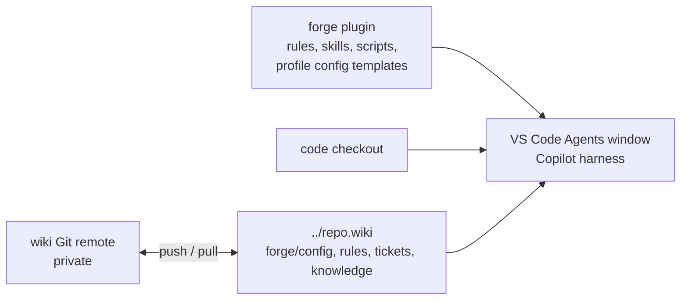
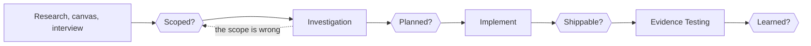
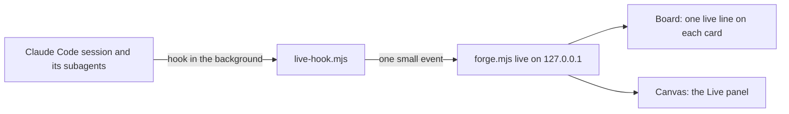

# 🧭 forge-engineering

`forge` is an agent plugin for the [VS Code Agents window](https://code.visualstudio.com/docs/agents/run/agents-window).
The same plugin folder also runs in GitHub Copilot CLI and Claude Code (see Hosts).
It gives every agent session a ticket workflow with review gates, a small set of plain ticket documents,
a ticket canvas in the browser, a repository wiki, daily recaps, coordinated agent sessions, and a ticket board that any session can show.

forge has a generic core and one profile (see Profile). This build has the GitHub profile:

| Area | Tool | CLI |
|---|---|---|
| Tracker | GitHub Issues of the main checkout. The key of issue `#123` is `GH-123`. | `gh` |
| Repository | GitHub pull requests, base branch `main` | `gh` |
| CI | GitHub Actions | `gh` |

**CLI first.** forge calls the tools through their official CLI (`gh`),
then through their REST API. It uses an MCP server only when no CLI or API can do the job.
CLI calls are visible, reproducible, and cost no context for tool lists.



## 🚀 Start

1. In VS Code, run **Chat: Install Plugin from Source**.
2. Enter `https://github.com/alexradunet/forge-engineering`.
3. Open your code checkout in the Agents window.
4. In a chat, say "set up forge".
5. Answer the setup form: your branch pattern (`users/<your name>/{KEY}-{slug}`) and the path of your clone.

Needs: Node.js 20 or later, Git, `gh`,
and VS Code with agent plugins enabled (`chat.plugins.enabled`). forge runs on Windows, macOS, and Linux.

Setup reads the repository first, so most answers are prefilled:

- the default branch and the branch pattern of your local branches, for example `users/alex/{KEY}-{slug}`,
- the path and the remote of your clone,
- each CLI that is missing or not logged in.

Then it creates `../<repo>.wiki`, seeds the profile config and rule pages, writes your values with a validated command,
asks you to store the credentials of the profile, asks you to approve the files by hash, and runs one live read for each tool.
At the end, it offers the optional extras: learning mode, daily recap, and automations.

| Say | Result |
|---|---|
| "set up forge" | First-time setup, or resume at the first open step |
| "check forge" | `doctor`, plugin version, and VS Code release notes |
| "refresh the forge config" | Copy the new profile templates after an update, and keep your personal values |
| "finish forge setup" | Resume after a stop |

`forge.mjs doctor` warns while `<user>` remains in `repo.branchPattern`, while the main checkout path is missing, or while a credential is missing.

forge targets the VS Code Agents window. VS Code changes each month. So the VS Code host file (`plugins/forge/hosts/vscode.md`) tells the agent
to read the current [VS Code documentation](https://code.visualstudio.com/docs/agents/run/agents-window) and the
[release notes](https://code.visualstudio.com/updates) before it advises on a VS Code feature.

### 🔌 Hosts

The rules and the skills name host verbs, for example `host.title` (set the session title) or `host.spawn`
(start a session). The `sessionStart` hook finds the host and adds its table from `plugins/forge/hosts/`,
which gives the tool or the manual step for each verb. Each host gets the same features. When a host has no tool
for a verb, the agent tells you the manual step.

| Host | Start | Host found by | Notes |
|---|---|---|---|
| VS Code Agents window | Install the plugin (above) | `AI_AGENT` contains `vscode` | Session tools, forms, artifacts, comments, and automations |
| GitHub Copilot CLI | `copilot plugin install` or `copilot --plugin-dir <clone>/plugins/forge` | no `AI_AGENT` and no `CLAUDECODE` | You run `/rename` and `/cwd`. The board is the session overview. |
| Claude Code | `claude plugin marketplace add <clone>`, then `claude plugin install forge@forge`. Or `claude --plugin-dir <clone>/plugins/forge` | `CLAUDECODE=1` | The hooks set the title. The context comes in numbered parts. No automations. |

`forge.mjs context --host <vscode|copilot-cli|claude>` prints the context of a host, for a check or for a host without the hook.

### 🔄 Update forge

VS Code has no update action for a plugin installed from a URL or local folder.
To update `forge`:

1. If you installed from a Git clone (`~/.vscode/agent-plugins/github.com/<owner>/<repo>` or `~/.copilot/installed-plugins/_direct/forge`), pull the latest `main` in that folder, or uninstall and reinstall the plugin.
2. Run **Developer: Reload Window** so that `%APPDATA%/Code/agentPlugins` gets a new copy of the plugin.
   For a `chat.pluginLocations` folder, VS Code makes a new copy only when the change time of the plugin root folder changes.
   A file edit does not change it. Before the reload, run `(Get-Item plugins\forge).LastWriteTime = Get-Date` in the clone.
3. When the update changed `plugins/forge/templates/config/`, say "refresh the forge config".

"check forge" reports when the installed plugin is behind its remote.

### 🏷️ Profile

The plugin has a generic core and one profile. This build has the GitHub profile. The profile holds the shared values in `plugins/forge/templates/config/`, the rule pages in `plugins/forge/templates/rules/`,
the setup values in `plugins/forge/templates/profile.md`, and the machine values in `plugins/forge/templates/profile.json`.
`profile.json` also lists the other profile files, the tools, and the company terms. `tests/profile.test.mjs` keeps the terms out of all other files.
Setup copies the config to the wiki. Change a shared value here, so that each user gets it.
The wiki holds only the copy, your personal values, and the helper scripts. To share the wiki, commit and push it. See [wiki.md](docs/wiki.md).

To make a company profile, change the files in `plugins/forge/templates/`. Add each other company file (a script or an `mcp.json`) to `files`,
each company test to `tests`, each CLI to `tools`, and each company name to `terms` in `profile.json`.

## 📦 Where things live

| Path | Content |
|---|---|
| `<repo>/../<repo>.wiki/` | The wiki: one Git repository for each code repository |
| `<wiki>/rules/` | Company rules for each session: tools, credentials, data rules (approve with `forge.mjs trust`) |
| `<wiki>/forge/config/` | Config: `tracker.md`, `repo.md`, `ci.md`, `policy.md` |
| `<wiki>/forge/scripts/` | Optional helper scripts |
| `<wiki>/raw/tickets/<key>/` | Ticket folders |
| OS credential store | Secrets (`cred.mjs set <name>`). Never in a file. |

Use a private wiki: a wiki can hold internal hosts, names, and company rules.
Setup offers the native wiki of the private repository, a separate private `<repo>-wiki` repository, or a local-only wiki.

## 🧩 Plugin layout

| Path | Content |
|---|---|
| `plugins/forge/plugin.json` | Plugin manifest ([Agent Plugins 1.0](https://agent-plugins.org)) for all hosts. Claude Code takes the name from the folder and the version from its marketplace. |
| `.github/plugin/marketplace.json`, `.claude-plugin/marketplace.json` | The marketplaces for VS Code and Copilot CLI, and for Claude Code. `tests/packaging.test.mjs` keeps the name, the version, and the source the same in each manifest, and runs each hook command. |
| `plugins/forge/context/` | The session rules, in a short form: `forge` (paths, ticket sessions, host verbs, the rules for external writes) and `style` (response style, "No AI tells", response shape, memory). The `sessionStart` hook gives them to each session. `tools.md` holds the steps that the agent reads before the first external call: capabilities, tool choice, external writes, the gate guard, and the manual step. `tests/context-budget.test.mjs` keeps the sizes. |
| `plugins/forge/hosts/` | One verb table for each host: `vscode.md`, `copilot-cli.md`, `claude.md`. The hook adds the verb table of the current host to the context. The other parts of the file (the ticket canvas, the feature documentation) stay in the file, and the agent reads them at the step. |
| `plugins/forge/com.github.copilot/hooks/` | `hooks.json`: the `sessionStart` hook. It gives each session the paths, the ticket context, the `forge` and `style` rules, and the approved company rules of `<wiki>/rules/`. The `preToolUse` hook is the gate guard (`forge.mjs hook pre-tool`, see Review gates). |
| `plugins/forge/hooks/` | `hooks.json`: the same context for Claude Code (spike). `SessionStart` gives it in parts of at most 9,000 characters (2 parts for a session without company rules), `UserPromptSubmit` sets the ticket title, and `PreToolUse` is the gate guard. See `Claude Code host` in [vscode-baseline.md](docs/vscode-baseline.md) Forge 7.6 adds the live reporter (`scripts/live-hook.mjs`) as a background hook on the activity events of a session: see [Live view](#-live-view). |
| `plugins/forge/automations/` | Automation templates: Forge maintenance and Prepare my daily |
| `plugins/forge/skills/` | `ticket`, `agents`, `board`, `wiki`, `daily-recap`, `forge-setup`, `learning-mode`, `writing` |
| `plugins/forge/templates/` | The profile: config (`config/`), rule pages (`rules/`), setup values (`profile.md`), and machine values with the list of the other profile files (`profile.json`) |
| `plugins/forge/scripts/` | `forge.mjs` (setup, config, trust, lint, board, worktree, snapshot, diff, canvas, live, gate-approve, hook, wiki scripts), `cred.mjs`, `live-hook.mjs` (the reporter of the live view) |
| `plugins/forge/vendor/mermaid/` | The only third-party program of the plugin: the small Mermaid build that draws the diagrams of the wiki page and the ticket canvas, with its license and a [notice](plugins/forge/vendor/mermaid/NOTICE.md) (version, hash, update steps) |
| `docs/` | [config.md](docs/config.md) (config format), [wiki.md](docs/wiki.md) (sharing and scripts), [evaluation.md](docs/evaluation.md) (behavioral runs: `npm run eval` gives the cases of `tests/evals/` to a real agent session), and [vscode-baseline.md](docs/vscode-baseline.md) (the VS Code features that forge uses) |
| `AGENTS.md` | [Rules for agents that develop forge](AGENTS.md): docs-first checks, tests, and file format |

## 🧩 Skills

| Skill | Use |
|---|---|
| `ticket` | One folder per work item in `<wiki>/raw/tickets/<key>`, full research and investigation, review gates, code map, ticket canvas, evidence, outbox. `SKILL.md` is short, and the steps of each phase are in `phases/`. |
| `agents` | Implementer sessions in worktrees, reviewer subagents, the cold read of gate documents, hand-off, session status |
| `board` | "Show the board" in any session: ticket status, refresh, session titles and state groups |
| `wiki` | Query, record, and lint the repository wiki |
| `daily-recap` | "Prepare my daily" (done, plan, blockers), with or without a daily meeting, and "record the daily outcome" |
| `forge-setup` | "set up forge", "check forge", "repair forge", "finish forge setup", "refresh the forge config" |
| `learning-mode` | Optional 15-minute lessons from artifact questions, saved in the repository wiki |
| `writing` | One source for the writing rules: modes, precedence, and the AI writing pattern catalog. Say "humanize this" or "check the writing". |

## ✍️ Writing rules

forge combines three rule sets:

- ASD-STE100 Simplified Technical English for all text.
- An ADHD response shape for chat ([i-have-adhd](https://github.com/ayghri/i-have-adhd), MIT).
- 26 AI writing patterns ([humanizer](https://github.com/blader/humanizer) 3.1.0, MIT), for example "not X but Y", one-line closers, and em dashes.

The [`writing` skill](plugins/forge/skills/writing/SKILL.md) decides which rules apply to each kind of text:

| Text | AI pattern check | Formatting |
|---|---|---|
| Chat replies | Short list in the `style` rule | Emoji headings |
| Ticket documents, recaps, config | Strong tells | Plain ticket style: emoji only for a state, no bold labels |
| Wiki pages and lessons | Full pass | Plain: no emoji, no bold labels |
| Outbox drafts, change request text, tracker comments | Full pass, required before Sendable? | Target format, plain |

No mode allows em dashes or en dashes in prose. License texts are in [NOTICE.md](plugins/forge/skills/writing/NOTICE.md).

## 🎫 Ticket work

1. Open a new session and paste the work item key or URL, for example "start APP-42" or "resume APP-42".
   The agent renames the session first (see Session titles below).
2. Forge names the worktree and the branch. `forge.mjs worktree APP-42 --summary "<goal>"` gives the branch
   from `repo.branchPattern` and the folder `<repo>.worktrees/<key>-<slug>`:
   - **New Worktree** session: the agent renames the `agents/...` branch with `git branch -m` before the first commit. VS Code keeps its folder name.
   - **Folder** session on the main checkout: after one "yes", the agent creates the worktree and moves the session there with `set_workspace`.
   - When a worktree of the ticket exists, the agent continues there.
3. Every new ticket uses `workflow: full-v3`, with no sizing question:
   research → canvas and scope interview → **Scoped?** →
   investigation (🛑 diagnosis stop) → plan → **Planned?** → implement → **Shippable?** → Evidence Testing.
   A small fix has the same phases and gates. Its documents are shorter.
4. Read the gate document, or read the ticket canvas, and add your comments. One explicit user approval covers the
   displayed file and revision set, recorded in a SHA-256 manifest. `forge.mjs gate-approve <key> <gate> --answer "<your exact answer>" --method form|chat --hash <reviewed digest>`
   accepts only `approve` in the form or `approve <gate>` in chat, and refuses a missing or changed digest. It checks the manifest and the documents, then records the approval in the README and in `approvals/history.md`. When a write fails, it restores both files.
   Unavailable sources and test gaps are recorded, not treated as safety evidence.
5. At Implement, the `agents` skill reuses a suitable current worktree. It starts another session only when needed.
6. Approve **Sendable?** for each external write. QA handover runs only when configured.
   Say "close APP-42"; **Learned?** approves distillation into wiki pages and archive.



| Gate | You approve | It holds |
|---|---|---|
| **Scoped?** | `story.md` | The problem, the scope, the acceptance checks, your interview answers, the history, and the open questions |
| **Planned?** | `plan.md` | The diagnosis, the steps with their files, the tests, the deployed checks, the risks, and the decisions |
| **Shippable?** | `review.md` | What changed, the tests that ran, and the findings of the adversarial review |
| **Sendable?** | each `outbox/` draft, before it is sent | The exact text, command, and target of one external write |
| **Learned?** | `close.md` | What you now know, and the wiki changes |

A manifest can also list `evidence/` files that you must see in an exact revision.
Before a gate opens, a subagent without the session history reads the gate document (the cold read).
It gives a paraphrase and the terms that it cannot resolve, and the session corrects the document before you see it.

The gate guard is a `preToolUse` hook. Before a `git push` or a new change request in a ticket worktree, it checks the approvals of Scoped?, Planned?, and Shippable?.
When one is missing or stale, it stops the command and names each finding. `policy.gateGuard` selects `deny` (default), `ask` (the host asks you), or `off`.
The guard reads the words of a shell command, so it is a net and not a wall: the written rules stay in force.

### 🕰️ Older tickets

Forge 8 supports only `workflow: full-v3`. It removed the rules, the templates, and the `migrate` command of the older layouts
(`full-v2`, `full-v1`, S/M/L, and tickets with no marker). `forge.mjs lint` reports a ticket with another layout as a read error.
Finish or archive such a ticket with Forge 7.6 before you update.
Resume reports missing or stale approval evidence and blocks only the affected action, not unrelated read-only work.
See the [ticket workflow contract](plugins/forge/skills/ticket/SKILL.md#-workflow).

Before edits, builds, or fixtures, Forge checks the actual worktree and resolves its baseline.
An explicit required commit takes priority over the ticket branch and the configured base branch.
Exact-commit proofs require HEAD equality. Resumed implementation can retain verified task changes above its baseline.
Forge never resets a branch or changes approved documents to repair a mismatch.
See the [worktree selection checks](plugins/forge/skills/agents/SKILL.md#select-the-execution-worktree).

The agent never merges. It asks before every write to the tracker, the repository host, or the CI.

### 📄 Ticket documents

A ticket has about 7 Markdown files, and each fact has one home. A file starts to exist when its phase starts.

| File | Content |
|---|---|
| `README.md` | The state: frontmatter and the Now card |
| `story.md` | Scoped?: problem, scope, acceptance checks, answers, history, open questions |
| `plan.md` | Planned?: diagnosis, steps, tests, checks, risks, decisions |
| `review.md` | Shippable?: changes, tests run, review findings |
| `proof.md` | Evidence Testing: one check for each changed behavior, with its result |
| `journal.md` | The dated log: work, decisions, problems, and finished steps |
| `map.md` | The code map: components with their layer, flow, data, tests, terms |
| `close.md` | Learned?: what you now know, and the wiki changes |

- A ticket document is plain: no emoji in a heading, no bold labels, and no section without content.
  An emoji shows only a state: 🟡 🔴 🟢 for the ticket and a risk, and 🟢 🔴 ⚪ for a check result.
- A gate document starts with a summary of at most 150 words: the key fact, the change, what the agent needs from you,
  and at most 3 decisions with a recommended answer. The whole document has at most 1,500 words. Longer material goes to `evidence/`.
- The approval form shows only the summary. At a later review, it shows only the changes since your last review
  (`forge.mjs diff <key> <gate>`). `forge.mjs snapshot <key> <gate>` saves the version that you saw.
- `forge.mjs lint` warns when a summary is missing or too long, a document is over its budget, or a section is empty.
- `proof.md` is not in `review.md`, because Evidence Testing writes its results after Shippable?, and a changed file makes an approval stale.

### 🗺️ Ticket canvas

`forge.mjs canvas <KEY>` writes `canvas.html` into the ticket folder: one page that shows the whole ticket on one board.
Open it in a browser tab, or in VS Code with **Open in Integrated Browser**.
`forge.mjs canvas <KEY> --serve` shows the same page on `http://127.0.0.1` until you send your comments from it.
The canvas and the [board page](#-ticket-overview) have links to each other, so you go from ticket to ticket in the browser.

| Part | Shows |
|---|---|
| Gate rail | The state, each gate with its status, the next step, and who the ticket waits on |
| Story | The summary and each section of `story.md`, the open questions, and the people |
| Code map | One lane for each layer of `map.md`, an arrow for each flow line, and a mark on each planned or changed component |
| Plan | The diagnosis, then the steps as a path with their state (planned, done, verified) |
| Review and proof | The review sections and each Evidence Testing check with its result |
| Journal | The newest entries |

- Each card has one of 3 tiers. The page opens with the cards that you must read for the gate that waits for you (the view **Now**). Each other card is a title strip: one line with the title, the tier, and the count of words. The other parts show their summary.

  | Tier | Cards |
  |---|---|
  | Must read (`must`): you decide a gate with it | Story: the summary, Problem, Scope, Done when, Facts, Preserve, and the open questions. Code map: the summary, and the components with the flow. Plan: the summary, the step titles, Risks, and Decisions. Review: the summary, Changes, Findings, and Not checked. Proof: Accepted gaps. Close: the summary, and What you now know |
  | Good to know (`good`) | Story: Answers, and the people. Plan: Diagnosis, the text of each step, Tests, Checks, and Assumptions. Review: Before and after, and Tests run. Proof: the summary, Checks, and Regression. Close: Ticket summary |
  | AI artifact (`ai`): a working note of the agent | Story: History, Related work, and Sources not available. Code map: Data, toggles, jobs, Tests, and Terms. Plan: Details. Proof: Automated test. Close: Wiki changes. Journal: each entry |

- An exception is always a card to read: a failed check, an open hypothesis, and a problem in the journal.
- The views **Must read**, **+ Good to know**, and **All** open more tiers, for each part (key `v`). A click on a title strip opens one card, and **Fold** on a card folds it again. A line such as `5 verified checks` or `3 more` shows the strips of its cards. The browser keeps the view and your choices until the next gate.
- Scroll to move, hold Ctrl and scroll to zoom, and drag the background. Zoomed out, each card shows its title in a large size and its state as a tint. A click on a part name or a double-click on a card title zooms in to read.
- Go to another ticket: **Board** opens the board page (key `b`), the ticket key opens a list of all tickets with a filter (key `t`), and the arrows go to the previous and the next ticket of the board (keys `[` and `]`). The browser keeps your view and your comments for each ticket.
- The `?` key shows all keys. The theme button changes between the system theme, light, and dark.
- A click on a component of the code map shows its arrows and their labels.
- **Comment** on a card saves a note in the browser. Select words on a card to comment on those words only, to mark them with **Remove**, or to give them a label (`unclear`, `wrong`, `too much`). The Comments panel has one box for a comment on the whole ticket.
- With `--serve`, **Send to agent** gives the comments to the ticket session: the command prints one message that starts with `Canvas comments for <KEY>:`, and stops. The server listens only on `127.0.0.1`, each run has a new link with a token, and `--port <n>` sets a fixed port for a forwarded port.
- Without `--serve`, **Copy all** gives the same message. Paste it into the ticket session.
- With `--serve`, the server also shows the board page and the other tickets. Only the page of its own ticket can send. For another ticket, use **Copy all** and the session of that ticket. After a Send the server stops: the page stays, and it tells you to get a new link from the session.
- The page is a view of the Markdown files. It loads nothing from a network, it sends the comments only to the forge server on your machine, it is in `raw/` and so never committed, and no approval comes from it. Gate approval stays in the session.
- A link can name one part, for example `canvas.html#zone-plan` or `canvas.html#plan-step-2`.
- A code link opens the file in VS Code. `--links file` writes plain `file://` links. `--json` prints the content of the page as data.
- An older ticket gets a simple canvas: one column for each of its files.

### 📍 Where a ticket is

- The Now card at the top of each ticket README shows the state, the phase, the open gate, the next step,
  who the ticket waits on, what is done, and the date. `forge.mjs lint` warns when the card
  does not agree with the frontmatter.
- The artifacts panel next to the chat input shows `<KEY> · Now` and the document of the open gate
  (`chat.artifacts.enabled`).
- VS Code 1.145 and later: in the Chat view, open **More Actions**, select **View Mode**, then **Conversation**
  (`chat.persistentProgressVerbosity`, experimental). The tool calls collapse, so a long session is easier to read.

### 🏷️ Session titles

Each ticket session has the title `<KEY> - <state> - <goal>`, for example `APP-4211 - 🟡 - Review invoice export fix`.
The title has less than 60 characters. Keys of one project have the same width, so the goals line up in the sessions list.

| State | Meaning |
|---|---|
| 🟡 | A gate or a question waits for you |
| 🔴 | A failure stops the work, for example CI or an expired credential |
| 🟢 | The last gate is approved, and no gate is open |
| ▶️ | The agent works |
| ⏳ | The work waits for an outside event, for example a review or a build |
| ✅ | The ticket is closed |

The plugin has a `sessionStart` [hook](plugins/forge/com.github.copilot/hooks/hooks.json).
When a session starts, `forge.mjs hook session-start` finds the ticket from the session folder, the branch,
or the key in the first prompt. It gives the agent the title, the Now card, and the worktree step.
The agent renames the session before any other step, and again at the end of the first turn,
because VS Code can replace the title after the first prompt
(see "Known gaps" in [vscode-baseline.md](docs/vscode-baseline.md)).
The context ends with the line `End of Forge context.`. When that line is missing, each skill runs
`forge.mjs context`, which prints the same context. In Claude Code, the hooks set the title with `sessionTitle`.
In Copilot CLI, the agent gives you the `/rename` command.

### 👥 People on a ticket

The ticket README keeps a `people:` list of everyone you work with on the ticket.
Each entry has a name or handle, a role, the ask, and one status:
`to-contact` → `drafted` → `waiting` → `reply-in` → `done`, plus `follow-up`.
The agent updates the list when you add a colleague question, draft a message, send it, or get a reply.
After more than 3 working days in `waiting`, it suggests a follow-up but changes the status only when you agree.
The board (`raw/board.md` and `board --json`) lists these long waits.
The list is outside approval manifests, so a status change never reopens a gate.
See [People](plugins/forge/skills/ticket/SKILL.md#-people).

## Learning mode

Learning mode helps you understand an artifact before you approve it. It is off by default.

1. Say "enable learning mode". Review the proposed `learningMode: true` policy edit and approve the changed config through trust.
2. Comment on an artifact: "What does idempotency mean here?" or "learn: why is this queue needed?"
3. Submit the feedback, or say "review my comments". Choose whether to create the offered bite.
4. Read the linked lesson in `<wiki>/learning/`. It explains the concept, its purpose, and the design reason.
5. Say "disable learning mode" to turn off offers. Existing lessons stay in the wiki.

Each bite includes a repository example, a small exercise, and a self-check within a 15-minute learning budget.
You can skip or defer it without blocking approval. Lessons never approve a gate or prove understanding.
The existing `Learned?` close gate stays unchanged.

The switch is `policy.learningMode` in the wiki config, not a VS Code switch.
Older configs default to `false` without reseeding.
There is no background watcher: the agent handles comments when you submit feedback or request review.
See [config.md](docs/config.md#learning-mode) for the setting and trust flow.

## 📋 Ticket overview

Say "show the board" or "my tickets". The agent reads the README frontmatter of each ticket
and groups the tickets by state: 🟡 Needs me, 🔴 Blocked, 🟢 Go, ▶️ Active, ⏳ Waiting, ✅ Done.
`forge.mjs board` writes the same view to `<wiki>/raw/board.md`, so you can keep it open in the editor.
Each row shows the session title, the open gate, the next step, who the ticket waits on, and the days since the update.
When `<wiki>/raw/sync/<KEY>.md` exists, the row also shows the change request, CI, and tracker status.

The same command writes the board page, `<wiki>/raw/board.html`, and the canvas of each ticket. Open the page in a browser tab, or in VS Code with **Open in Integrated Browser**.

- The tickets that wait for you are first, in a lane with the full width. The other open states are side by side, and **Done** is a closed list.
- A card shows the key, the title, the gates as steps, the next step, who the ticket waits on, and the change request, CI, and tracker status. A click on the card opens the ticket canvas. A ticket with a gate in review opens at the document of that gate.
- The filter (key `/`) hides tickets by their words. A state chip or a number key shows one state. The keys `j` and `k` go from ticket to ticket, and `t` opens the list of all tickets.
- An open ticket without an update for 7 days has a mark. Long waits for people and read errors have their own lists.
- The page loads nothing from a network, and it is in `raw/`, so it is never committed. [design-system.md](docs/design-system.md) gives the tokens, the components, and the UX cases of both pages.
`forge.mjs board --json` gives the same data to agents. Ticket README files remain the source of truth.

The reader supports the [ticket template](plugins/forge/skills/ticket/templates/README.md):
scalar fields, comments, quoted strings, folded text (`>`), literal text (`|`), and flat object lists
for `gates`, `changes`, and `people`. Text blocks support strip (`-`) and keep (`+`) chomping.
Lists can use inline arrays, inline objects, or indented fields.
YAML anchors, tags, and explicit block indentation indicators are not supported;
lint reports them as read errors. Existing tickets need no rewrite for supported YAML forms.
A ticket without `workflow: full-v3`, or with a `track` value, produces a read error.
CLI validation and the board use the shared parser in
[`scripts/lib/ticket.mjs`](plugins/forge/scripts/lib/ticket.mjs).

## 🧭 Board

Say "show the board" in any session: a session in the main checkout, a ticket session, or the Copilot CLI or Claude Code.
The `board` skill answers questions about your tickets and the other sessions, so you do not have to open each session.
A question that names a key does not start or resume that ticket.

| Say | Result |
|---|---|
| "Show the board" | The count for each state, then the tickets that need you |
| "What did we do on APP-42?" | The Now card, the latest journal entries, and the session link |
| "What must I approve on APP-42?" | The summary of the open gate document |
| "Refresh" | Reads the tracker, the change requests, and CI (read-only), writes `raw/sync/`, then fixes titles and state groups |
| "Fix the session titles" | Renames stale ticket session titles and, in VS Code, moves the sessions to their state groups |

The board does not edit code, ticket documents, or wiki pages. It writes only `raw/board.md`, `raw/sync/`, and the pages (`raw/board.html`, `raw/wiki.html`, and the `canvas.html` of each ticket).
It never approves a gate and never answers a question of a session for you,
because an approval covers the exact revision that the ticket session shows.
It never merges, pushes, or writes to the tracker.
To start a ticket, send its key or URL in a new session. To tell a ticket session something, type it in that session.
See the [board skill](plugins/forge/skills/board/SKILL.md).

Forge 6.5 had a **Forge Master** custom agent for this. Forge 6.6 removes it: VS Code ignored the agent body
(baseline click-check 14), and a persistent overview session added no function that a skill cannot give.

## 📖 Wiki page

`forge.mjs board` also writes `raw/wiki.html`: one page for the wiki of the repository. The board page and each ticket canvas have a link to it (key `w`).

- The page lists each wiki page by folder, and a filter finds a page by the words of its text.
- A page shows its status, its date, its sources, and **Used by**: the open tickets and the other pages that name it.
- On a ticket canvas, a link to a wiki page opens that page on the wiki page. The **Wiki** menu of the canvas lists each wiki page that the ticket names.
- The board lists the closed tickets. Each one opens its summary page (`tickets/<key>.md`), not its archive folder.
- A Mermaid block of a wiki page or of a card on a ticket canvas shows as a drawing. Forge has the small Mermaid build for this (`plugins/forge/vendor/mermaid/`, MIT), and the page loads it from your disk or from the Forge server, never from a network.
- The canvas server and the live server show the same page at `/wiki`.

The page is a view. It shows no file of `raw/` and `archive/`, and it changes no wiki page.

## 📡 Live view

`forge.mjs live` shows the board page and each ticket canvas on `http://127.0.0.1`, with what each agent session does now.
Forge stays a plugin: it does not start a session, and it has no terminal. Your sessions run where you start them, for example in Orca or in a terminal.



- A board card shows the state of its session (working, needs you, idle, or ended), the tool that runs now, and the count of subagents that run. A session without a ticket is in the list **Other sessions**.
- The canvas has the **Live** panel (key `l`): the prompt, the tool calls, the subagents as a tree, and the last text of the turn.
- A session shows on a ticket when it runs in the worktree of the ticket, or when its title starts with the ticket key.
- The server is read-only for a session. It has no route that sends text or a permission answer to a session, and its pages have no **Send to agent**.
- The reporter sends only short text: the prompt (at most 1,000 characters), the tool name with a short label (the first 80 characters of a command, a file path, or a search pattern), and the last message. It never sends a tool result or a file. It puts a mask on the value after a word such as `token` or `password`.
- The events stay in the memory of the server. The server writes one file: its state file in the forge data folder, which only you can read. It holds the port and the tokens for the reporter.
- When no live server runs, the reporter stops at once, and a session gets no delay and no message.
- The server stops with Ctrl+C, or after 8 hours without an event. `forge.mjs live --status` prints the link of the server that runs.

This version reports Claude Code sessions. Copilot CLI and VS Code sessions do not report yet: their hooks have no background option, so a reporter can slow each tool call (see the [baseline](docs/vscode-baseline.md)).

## ⏰ Automations

The plugin has two [automation](https://code.visualstudio.com/docs/agents/run/automations) templates.
VS Code shows them under **Templates from Plugins**. A template does nothing until you create and enable an automation from it.

| Template | Schedule | What it does |
|---|---|---|
| **Forge maintenance** | 09:00, 11:00, 13:00, 15:00, 17:00, Monday to Friday | Board, sync notes, lint report, people waits, titles, and state groups |
| **Prepare my daily** | 10:20, Monday to Friday | The draft daily recap of the `daily-recap` skill |

1. Select **Automations** in the Agents window sidebar, expand **Templates from Plugins**, and select a template.
2. Set the main checkout as the workspace, with **Run in the Cloud** off and not **New Worktree**.
   Keep the default **Agent**. In VS Code 1.145, a run with a plugin agent has no workspace
   and does not get the agent instructions. In **Advanced** > **Customizations**, keep **forge** selected.
   Review the prompt, the schedule, and the permissions. With **Interactive**, each run stops at its first command until you approve it. For runs without you, select **Allow all**.
3. Select **Run now** one time, and check the run in **History**. Then select **Enabled**, and save.

A run writes only in `<wiki>/raw/`, and changes only session titles and groups. It only reads the tracker,
the repository host, and CI. When **Automations** is not visible, turn on `chat.automations.enabled`.

## 🔎 Local validation

```sh
node "<plugin>/scripts/forge.mjs" lint [--wiki "<path>"] [--json] [--fix]
```

Default lint is read-only. It checks ticket metadata, workflow/gate agreement,
approval revisions, and canonical wiki metadata without inferring workflow, state,
or approval. Findings name the file, line when available, code, severity, and remedy.
Invalid input fails without hiding valid files.
Errors exit 1; warnings alone exit 0.
Index membership, semantic contradictions, HTTP retrieval, and claim truth remain
manual checks; lint does not prove them.

Explicit `--fix` only adds a missing final newline in an **unapproved** `*.draft.md`
whose metadata explicitly says `status: draft`,
preserving all other bytes and line-ending style. Direct and combined approval
references protect drafts from repair. Each repair is reported and appended to the
ticket's `repair-log.jsonl` with `started`/`applied` rows and before/after hashes;
a second pass changes nothing. It never repairs stale
approvals, changes a workflow, deletes pages, or publishes content.
See [validation and source limits](docs/wiki.md#local-validation-and-source-limits).

## 📚 Shared wiki

Edit config and helper scripts directly in `<wiki>/forge`. Git handles versioning and shared updates.
Each teammate reviews and approves the files by SHA-256 hash before forge uses them.
Trust approvals and credentials stay outside the wiki. See [wiki.md](docs/wiki.md).

## 🛠️ Develop

- Read [AGENTS.md](AGENTS.md) first. Before you change how forge uses a VS Code feature, read the release notes
  since the [VS Code baseline](docs/vscode-baseline.md) and the feature page. Use a native feature when one exists.
- `npm test` runs the tests.
- [Behavioral evaluation](docs/evaluation.md) describes manual runs through the
  supported harness, trace evidence, and execution approval. Deterministic fixtures
  and document checks do not establish model compliance; do not claim a behavioral
  pass without the required harness run evidence.
- To test a local checkout, run **Chat: Install Plugin from Source** with the `plugins/forge` folder.
  First uninstall or disable the forge plugin from the GitHub URL. With both installed, VS Code loads two plugins named `forge`, and the
  rules and skills appear two times. To go back, remove the local folder in **Chat: Open Customizations**, **Plugins**
  (or its `chat.pluginLocations` entry in the user settings), and enable the URL install again.
- Check the loaded rules and skills in **Chat: Open Customizations**.

## 📄 License

[MIT](LICENSE)
