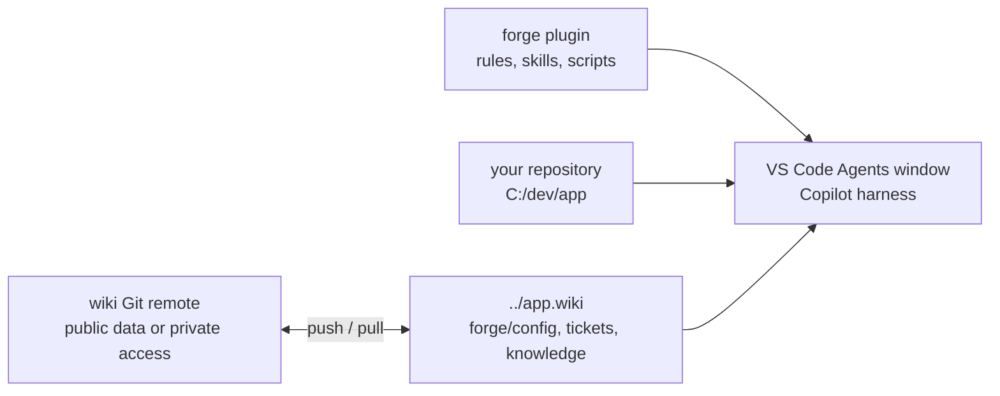

# 🧭 forge-engineering

`forge` is an agent plugin for the [VS Code Agents window](https://code.visualstudio.com/docs/agents/run/agents-window).
It gives every Copilot session a ticket workflow with review gates, a team wiki,
daily recaps, and coordinated agent sessions.

forge does not depend on one tracker, repository host, or CI. Each repository describes
its tools in four Markdown files in its wiki. Templates exist for GitHub, GitLab, Jira,
Jenkins, Azure Pipelines, and local Markdown work items.

**CLI first.** forge calls your tools through their official CLI (`gh`, `glab`, `acli`, `az`),
then through their REST API. It uses an MCP server only when no CLI or API can do the job.
CLI calls are visible, reproducible, and cost no context for tool lists.



## 🚀 Start

1. In VS Code, run **Chat: Install Plugin from Source**.
2. Enter `https://github.com/alexradunet/forge-engineering`.
3. Open your repository in the Agents window.
4. In a chat, say "set up forge".
5. Answer the setup form. The chat creates `../<repo>.wiki`, seeds the config, and checks each tool.

Needs: Node.js 20 or later, Git, and VS Code with agent plugins enabled (`chat.plugins.enabled`).
forge runs on Windows, macOS, and Linux.

forge targets the VS Code Agents window. VS Code changes each month. So the `forge` rule tells the agent
to read the current [VS Code documentation](https://code.visualstudio.com/docs/agents/run/agents-window) and the
[release notes](https://code.visualstudio.com/updates) before it advises on a VS Code feature.

### 🔄 Update forge

VS Code has no update action for a plugin from **Install Plugin from Source**. An uninstall and a new install can reuse the old clone
(seen in VS Code 1.144). Update the clone, then run **Developer: Reload Window**:

```sh
git -C ~/.vscode/agent-plugins/github.com/alexradunet/forge-engineering pull --ff-only
```

"check forge" reports when the installed plugin is behind its remote.

### 🏢 Company config

The plugin holds no company config. Each repository wiki holds its config and helper scripts.
Say "set up forge" to create them, or clone the team's existing wiki.
Commit and push the wiki to share changes. See [wiki.md](docs/wiki.md).

## 📦 Where things live

| Path | Content |
|---|---|
| `<repo>/../<repo>.wiki/` | The wiki: one Git repository for each code repository |
| `<wiki>/forge/config/` | Team config: `tracker.md`, `repo.md`, `ci.md`, `policy.md` |
| `<wiki>/forge/scripts/` | Optional helper scripts |
| `<wiki>/raw/tickets/<key>/` | Ticket folders |
| OS credential store | Secrets (`cred.mjs set <name>`). Never in a file. |

A public repository can use its native wiki when all tracked files and Git history contain public data.
Setup also offers a separate private `<repo>-wiki` repository, or a local-only wiki.

## 🧩 Plugin layout

| Path | Content |
|---|---|
| `plugins/forge/plugin.json` | Plugin manifest ([Agent Plugins 1.0](https://agent-plugins.org)) |
| `plugins/forge/com.github.copilot/rules/` | Always-on rules: `forge` (paths, capabilities, write rules), `style` (response style, memory, sessions) |
| `plugins/forge/skills/` | `ticket`, `agents`, `wiki`, `daily-recap`, `forge-setup` |
| `plugins/forge/extensions/` | Read-only ticket dashboard canvas |
| `plugins/forge/templates/config/` | Config templates |
| `plugins/forge/scripts/` | `forge.mjs` (setup, config, trust, wiki scripts), `cred.mjs`, `jenkins.mjs` |
| `docs/` | [config.md](docs/config.md) (config format) and [wiki.md](docs/wiki.md) (sharing and scripts) |

## 🧩 Skills

| Skill | Use |
|---|---|
| `ticket` | One folder per work item in `<wiki>/raw/tickets/<key>`, size tracks S/M/L, review gates, code map, evidence, outbox |
| `agents` | Implementer sessions in worktrees, reviewer subagents, hand-off, session status |
| `wiki` | Query, record, and lint the team wiki |
| `daily-recap` | "Prepare my daily" (done, plan, blockers), with or without a daily meeting, and "record the daily outcome" |
| `forge-setup` | "set up forge", "check forge", "repair forge" |

## 🎫 Ticket work

1. Say "start APP-42" or "resume APP-42".
2. Confirm the proposed track:
   - **S** small: plan, code, and close gates only.
   - **M** medium (default): one combined context and scope gate (`Briefed?`), then plan, code, and close.
   - **L** large: the full flow with the visual briefing.
3. Read gate documents, and comment with VS Code comment threads. Approve a gate in the approval form.
4. At Implement, the `agents` skill starts a session with **New Worktree**.
5. Say "close APP-42" to distill the folder into wiki pages.

The agent never merges. It asks before every write to the tracker, the repository host, or the CI.

## 📋 Ticket overview

Say "show the board" or "my tickets". The agent reads the README frontmatter of each ticket
and groups the open tickets by who must act: you, the agent, a colleague, or nobody (blocked).

### 🖼️ Ticket dashboard

Forge also bundles a read-only canvas. Say **"open the Forge ticket dashboard"**.
The agent supplies the repository wiki path from `forge.mjs where --json`.

- See tickets by state, with their phase, track, next action, waiting reason, and gates.
- Search tickets, filter by state, and include done tickets.
- Expand a card for its branch, worktree, source path, gates, and change links.
- The dashboard reads ticket files every 5 seconds. **Refresh** reads them immediately.
- Empty ticket folders show an empty board. Invalid files show errors without hiding valid tickets.

Ticket README files remain the source of truth. The dashboard never edits files, approves gates,
or calls a tracker. It stores no private data and needs no credentials.

Enable `chat.canvases.enabled`, then start a new local desktop session with the Copilot harness.
Other harnesses, remote sessions, and browser clients do not support canvases.
See [VS Code canvases](https://code.visualstudio.com/docs/agents/run/canvases).
If the canvas is missing, update Forge and reload VS Code. For local development,
install the source plugin as described below.

The canvas ID is `forge-ticket-dashboard`. Its open input is `{ "wikiPath": "<absolute wiki path>" }`.
Its `refresh` action returns current tickets and read errors. Reopening the same instance reuses
its server and rereads the same wiki. Separate instances can show separate repositories.
Each server binds only to `127.0.0.1` on a free port and stops when the canvas instance closes.
The panel needs no database; ticket files preserve its data across sessions.

The reader supports the [ticket template](plugins/forge/skills/ticket/templates/README.md):
one-line scalar fields, comments, quoted strings, and flat object lists for `gates` and `changes`.
Lists can use inline objects or indented fields. YAML anchors, tags, and multiline values
are not supported; the dashboard reports them as read errors. Use the template's one-line fields.

## 📚 Shared wiki

Edit config and helper scripts directly in `<wiki>/forge`. Git handles versioning and shared updates.
Each teammate reviews and approves the files by SHA-256 hash before forge uses them.
Trust approvals and credentials stay outside the wiki. See [wiki.md](docs/wiki.md).

## 🛠️ Develop

- `npm test` runs the tests.
- To test a local checkout, run **Chat: Install Plugin from Source** with the `plugins/forge` folder.
  First uninstall or disable the forge plugin from the GitHub URL. With both installed, VS Code loads two plugins named `forge`, and the
  rules and skills appear two times. To go back, remove the local folder in **Chat: Open Customizations**, **Plugins**
  (or its `chat.pluginLocations` entry in the user settings), and enable the URL install again.
- Check the loaded rules and skills in **Chat: Open Customizations**.

## 📄 License

[MIT](LICENSE)
