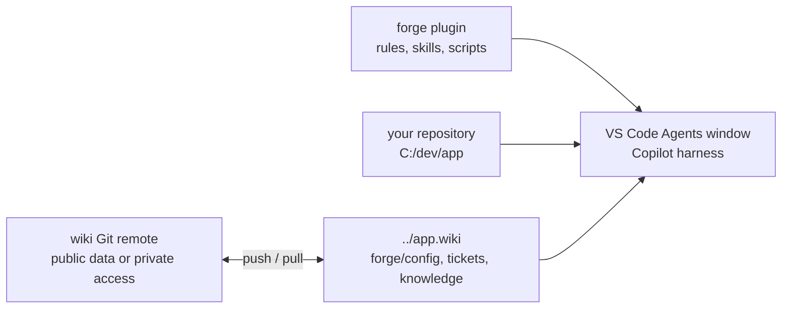
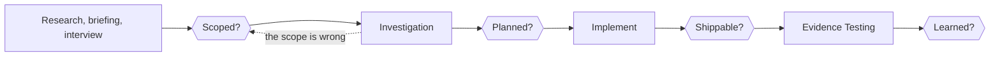

# 🧭 forge-engineering

`forge` is an agent plugin for the [VS Code Agents window](https://code.visualstudio.com/docs/agents/run/agents-window).
It gives every Copilot session a ticket workflow with review gates, a repository wiki,
daily recaps, and coordinated agent sessions, with one Forge Master overview session for each repository.

forge does not depend on one tracker, repository host, or CI. Each repository describes
its tools in four Markdown files in its wiki. Templates exist for GitHub, GitLab, Jira,
Jenkins, Azure Pipelines, and local Markdown work items.

**CLI first.** forge calls your tools through their official CLI (`gh`, `glab`, `acli`, `az`),
then through their REST API. It uses an MCP server only when no CLI or API can do the job.
CLI calls are visible, reproducible, and cost no context for tool lists.



## 🚀 Start

1. In VS Code, run **Chat: Install Plugin from Source**.
2. Enter `https://github.com/alexradunet/forge-engineering`.
3. Open your repository in the Agents window.
4. In a chat, say "set up forge".
5. Answer the two setup forms. The first form picks the tools; the second form sets the values.

Needs: Node.js 20 or later, Git, and VS Code with agent plugins enabled (`chat.plugins.enabled`).
forge runs on Windows, macOS, and Linux.

Setup reads the repository first, so most answers are prefilled:

- the host, the default branch, and the CI files (`.github/workflows`, `.gitlab-ci.yml`, `Jenkinsfile`, `azure-pipelines.yml`),
- the work item key prefix from branch names and commit subjects, for example `MFD-123`,
- the project, item URL, and main checkout for GitHub and GitLab.

Then it creates `../<repo>.wiki`, seeds the config, writes your values with a validated command,
asks you to approve the files by hash, and runs one live read for each tool.
At the end, it offers the optional extras: policy hooks, learning mode, daily recap, Forge Master, and automations.

| Say | Result |
|---|---|
| "set up forge" | First-time setup, or resume at the first open step |
| "check forge" | `doctor`, plugin version, and VS Code release notes |
| "switch the tracker to Jira" | Replace one config file and carry over the other values |
| "finish forge setup" | Resume after a stop |

`forge.mjs doctor` warns while a template placeholder, a missing checkout path, or a missing credential remains.

forge targets the VS Code Agents window. VS Code changes each month. So the `forge` rule tells the agent
to read the current [VS Code documentation](https://code.visualstudio.com/docs/agents/run/agents-window) and the
[release notes](https://code.visualstudio.com/updates) before it advises on a VS Code feature.

### 🔄 Update forge

VS Code has no update action for a plugin installed from a URL or local folder.
To update `forge`:

1. If you installed from a Git clone (`~/.vscode/agent-plugins/github.com/alexradunet/forge-engineering` or `~/.copilot/installed-plugins/_direct/forge`), pull the latest `main` in that folder, or uninstall and reinstall the plugin.
2. Reload extensions in the session (`extensions_reload`) or run **Developer: Reload Window** so `%APPDATA%/Code/agentPlugins` picks up the new snapshot.

"check forge" reports when the installed plugin is behind its remote.

### 🏢 Company config

The plugin holds no company config. Each repository wiki holds its config and helper scripts.
Say "set up forge" to create them, or clone an existing wiki.
The wiki can stay personal. To share it, commit and push it. See [wiki.md](docs/wiki.md).

## 📦 Where things live

| Path | Content |
|---|---|
| `<repo>/../<repo>.wiki/` | The wiki: one Git repository for each code repository |
| `<wiki>/rules/` | Company rules for each session: tools, credentials, data rules (approve with `forge.mjs trust`) |
| `<wiki>/forge/config/` | Config: `tracker.md`, `repo.md`, `ci.md`, `policy.md` |
| `<wiki>/forge/scripts/` | Optional helper scripts |
| `<wiki>/raw/tickets/<key>/` | Ticket folders |
| OS credential store | Secrets (`cred.mjs set <name>`). Never in a file. |

A public repository can use its native wiki when all tracked files and Git history contain public data.
Setup also offers a separate private `<repo>-wiki` repository, or a local-only wiki.

## 🧩 Plugin layout

| Path | Content |
|---|---|
| `plugins/forge/plugin.json` | Plugin manifest ([Agent Plugins 1.0](https://agent-plugins.org)) |
| `plugins/forge/context/` | The session rules: `forge` (paths, capabilities, write rules), `style` (response style, "No AI tells", memory, sessions). The `sessionStart` hook gives them to each session. |
| `plugins/forge/com.github.copilot/agents/` | `forge-master.agent.md`: the Forge Master custom agent |
| `plugins/forge/com.github.copilot/hooks/` | `hooks.json`: the `sessionStart` hook. It gives each session the paths, the ticket context, the `forge` and `style` rules, and the approved company rules of `<wiki>/rules/` |
| `plugins/forge/automations/` | Automation templates: Forge maintenance and Prepare my daily |
| `plugins/forge/skills/` | `ticket`, `agents`, `wiki`, `daily-recap`, `forge-setup`, `learning-mode`, `writing` |
| `plugins/forge/templates/` | Config templates (`config/`) and rule page templates (`rules/`) |
| `plugins/forge/scripts/` | `forge.mjs` (setup, config, trust, lint, board, worktree, snapshot, diff, migrate, hook, wiki scripts), `cred.mjs`, `jenkins.mjs` |
| `docs/` | [config.md](docs/config.md) (config format), [wiki.md](docs/wiki.md) (sharing and scripts), [evaluation.md](docs/evaluation.md) (behavioral runs), and [vscode-baseline.md](docs/vscode-baseline.md) (the VS Code features that forge uses) |
| `AGENTS.md` | [Rules for agents that develop forge](AGENTS.md): docs-first checks, tests, and file format |

## 🧩 Skills

| Skill | Use |
|---|---|
| `ticket` | One folder per work item in `<wiki>/raw/tickets/<key>`, full research and investigation, review gates, code map, evidence, outbox |
| `agents` | Implementer sessions in worktrees, reviewer subagents, hand-off, session status |
| `wiki` | Query, record, and lint the repository wiki |
| `daily-recap` | "Prepare my daily" (done, plan, blockers), with or without a daily meeting, and "record the daily outcome" |
| `forge-setup` | "set up forge", "check forge", "repair forge", "finish forge setup", "switch the tracker to GitLab" |
| `learning-mode` | Optional 15-minute lessons from artifact questions, saved in the repository wiki |
| `writing` | One source for the writing rules: modes, precedence, and the AI writing pattern catalog. Say "humanize this" or "check the writing". |

## ✍️ Writing rules

forge combines three rule sets:

- ASD-STE100 Simplified Technical English for all text.
- An ADHD response shape for chat ([i-have-adhd](https://github.com/ayghri/i-have-adhd), MIT).
- 26 AI writing patterns ([humanizer](https://github.com/blader/humanizer) 3.1.0, MIT), for example "not X but Y", one-line closers, and em dashes.

The [`writing` skill](plugins/forge/skills/writing/SKILL.md) decides which rules apply to each kind of text:

| Text | AI pattern check | Formatting |
|---|---|---|
| Chat replies | Short list in the `style` rule | Emoji headings |
| Gate documents, recaps, config | Strong tells | Ticket style with emoji and fixed labels |
| Wiki pages and lessons | Full pass | Plain: no emoji, no bold labels |
| Outbox drafts, change request text, tracker comments | Full pass, required before Sendable? | Target format, plain |

No mode allows em dashes or en dashes in prose. License texts are in [NOTICE.md](plugins/forge/skills/writing/NOTICE.md).

## 🎫 Ticket work

1. Open a new session and paste the work item key or URL, for example "start APP-42" or "resume APP-42".
   The agent renames the session first (see Session titles below).
2. Forge names the worktree and the branch. `forge.mjs worktree APP-42 --summary "<goal>"` gives the branch
   from `repo.branchPattern` and the folder `<repo>.worktrees/<key>-<slug>`:
   - **New Worktree** session: the agent renames the `agents/...` branch with `git branch -m` before the first commit. VS Code keeps its folder name.
   - **Folder** session on the main checkout: after one "yes", the agent creates the worktree and moves the session there with `set_workspace`.
   - When a worktree of the ticket exists, the agent continues there.
3. Every new ticket uses `workflow: full-v2`, with no sizing question or `track` field:
   research → visual briefing → scope interview → **Scoped?** →
   investigation (🛑 diagnosis stop) → plan → **Planned?** → implement → **Shippable?** → Evidence Testing.
4. Read and comment on the gate documents. One explicit user approval covers the
   displayed file/revision set, recorded in a SHA-256 manifest. Small fixes follow
   the same phases; unavailable sources and test gaps are recorded, not treated as safety evidence.
5. At Implement, the `agents` skill reuses a suitable current worktree. It starts another session only when needed.
6. Approve **Sendable?** for each external write. QA handover runs only when configured.
   Say "close APP-42"; **Learned?** approves distillation into wiki pages and archive.



| Gate | You approve | Evidence in the same approval |
|---|---|---|
| **Scoped?** | `scope.md` | `context.md`, `briefing.md`, `interview.md` |
| **Planned?** | `plan.draft.md` and its byte-identical copy `plan.md` | `investigation.md`, `decisions.md`, `test-plan.md` |
| **Shippable?** | `review.md` | the listed `evidence/` files |
| **Sendable?** | each `outbox/` draft, before it is sent | none |
| **Learned?** | `close.draft.md` | none |

Open `full-v1` tickets move to `full-v2` on resume with `forge.mjs migrate <key>`.
Approved and current Understood? and Agreed? approvals become Scoped?, and Diagnosed? and Designed? become Planned?.
When one of a pair is missing or stale, the merged gate opens again. Migration never creates an approval.
Existing S/M/L and trackless tickets retain their original phases, gates, and skips,
including recommended rather than mandatory Diagnosed?. Briefed? remains legacy-only.
Missing `track` never identifies the new workflow. Resume reports missing or stale
approval evidence and blocks only the affected action, not unrelated read-only work.
See the [ticket workflow contract](plugins/forge/skills/ticket/SKILL.md#-workflow).

Before edits, builds, or fixtures, Forge checks the actual worktree and resolves its baseline.
An explicit required commit takes priority over the ticket branch and the configured base branch.
Exact-commit proofs require HEAD equality. Resumed implementation can retain verified task changes above its baseline.
Forge never resets a branch or changes approved documents to repair a mismatch.
See the [worktree selection checks](plugins/forge/skills/agents/SKILL.md#select-the-execution-worktree).

The agent never merges. It asks before every write to the tracker, the repository host, or the CI.

### 📖 Read in layers

Each primary gate document (`scope.md`, `plan.draft.md`, `review.md`, `close.draft.md`) has cumulative
reading levels. Read from the top, and stop when you know enough:

| Level | Words from the top | What you get |
|---|---|---|
| ⚡ 1 min | 150 | The key fact, the TL;DR, what the agent needs from you, and at most 3 ❓ decisions with a recommended answer |
| ☕ 5 min | 1,150 | The problem, the proposal, and the main risks |
| 📖 10 min | 2,300 | Your interview answers, the options, and the reasons |
| 🔬 15 min | 3,450 | The history and the deep detail |
| 📂 Appendix | no limit | Links to the evidence. Nothing is dropped to make a document shorter. |

- The approval form shows only the ⚡ card. At a later review, it shows only "🔀 Changed since your last review"
  (`forge.mjs diff <key> <gate>`). `forge.mjs snapshot <key> <gate>` saves the version that you saw.
- `forge.mjs lint` warns when a level is over its budget, the ⚡ card is missing, or the levels are in the wrong order.
  Code, Mermaid, and link targets do not count as words.

### 📍 Where a ticket is

- The 📍 Now card at the top of each ticket README shows the state, the phase, the open gate, the next step,
  who the ticket waits on, what is done, the open questions, and the date. `forge.mjs lint` warns when the card
  does not agree with the frontmatter.
- The artifacts panel next to the chat input shows `<KEY> · 📍 Now` and the document of the open gate
  (`chat.artifacts.enabled`).
- VS Code 1.145 and later: in the Chat view, open **More Actions**, select **View Mode**, then **Conversation**
  (`chat.persistentProgressVerbosity`, experimental). The tool calls collapse, so a long session is easier to read.

### 🏷️ Session titles

Each ticket session has the title `<KEY> - <state> - <goal>`, for example `APP-4211 - 🟡 - Review invoice export fix`.
The title has less than 60 characters. Keys of one project have the same width, so the goals line up in the sessions list.

| State | Meaning |
|---|---|
| 🟡 | A gate or a question waits for you |
| 🔴 | A failure stops the work, for example CI or an expired credential |
| 🟢 | The last gate is approved, and no gate is open |
| ▶️ | The agent works |
| ⏳ | The work waits for an outside event, for example a review or a build |
| ✅ | The ticket is closed |

The plugin has a `sessionStart` [hook](plugins/forge/com.github.copilot/hooks/hooks.json).
When a session starts, `forge.mjs hook session-start` finds the ticket from the session folder, the branch,
or the key in the first prompt. It gives the agent the title, the 📍 Now card, and the worktree step.
The agent renames the session before any other step, and again at the end of the first turn,
because VS Code can replace the title after the first prompt
(see "Known gaps" in [vscode-baseline.md](docs/vscode-baseline.md)).

### 👥 People on a ticket

The ticket README keeps a `people:` list of everyone you work with on the ticket.
Each entry has a name or handle, a role, the ask, and one status:
`to-contact` → `drafted` → `waiting` → `reply-in` → `done`, plus `follow-up`.
The agent updates the list when you add a colleague question, draft a message, send it, or get a reply.
After more than 3 working days in `waiting`, it suggests a follow-up but changes the status only when you agree.
The list is outside approval manifests, so a status change never reopens a gate.
See [People](plugins/forge/skills/ticket/SKILL.md#-people).

## Learning mode

Learning mode helps you understand an artifact before you approve it. It is off by default.

1. Say "enable learning mode". Review the proposed `learningMode: true` policy edit and approve the changed config through trust.
2. Comment on an artifact: "What does idempotency mean here?" or "learn: why is this queue needed?"
3. Submit the feedback, or say "review my comments". Choose whether to create the offered bite.
4. Read the linked lesson in `<wiki>/learning/`. It explains the concept, its purpose, and the design reason.
5. Say "disable learning mode" to turn off offers. Existing lessons stay in the wiki.

Each bite includes a repository example, a small exercise, and a self-check within a 15-minute learning budget.
You can skip or defer it without blocking approval. Lessons never approve a gate or prove understanding.
The existing `Learned?` close gate stays unchanged.

The switch is `policy.learningMode` in the wiki config, not a VS Code switch.
Older configs default to `false` without reseeding.
There is no background watcher: the agent handles comments when you submit feedback or request review.
See [config.md](docs/config.md#learning-mode) for the setting and trust flow.

## 📋 Ticket overview

Say "show the board" or "my tickets". The agent reads the README frontmatter of each ticket
and groups the tickets by state: 🟡 Needs me, 🔴 Blocked, 🟢 Go, ▶️ Active, ⏳ Waiting, ✅ Done.
`forge.mjs board` writes the same view to `<wiki>/raw/board.md`, so you can keep it open in the editor.
Each row shows the session title, the open gate, the next step, who the ticket waits on, and the days since the update.
When `<wiki>/raw/sync/<KEY>.md` exists, the row also shows the change request, CI, and tracker status.
`forge.mjs board --json` gives the same data to agents. Ticket README files remain the source of truth.

The reader supports the [ticket template](plugins/forge/skills/ticket/templates/README.md):
scalar fields, comments, quoted strings, folded text (`>`), literal text (`|`), and flat object lists
for `gates`, `changes`, and `people`. Text blocks support strip (`-`) and keep (`+`) chomping.
Lists can use inline arrays, inline objects, or indented fields.
YAML anchors, tags, and explicit block indentation indicators are not supported;
lint reports them as read errors. Existing tickets need no rewrite for supported YAML forms.
Existing trackless tickets remain visible without an inferred workflow or size. Recorded S/M/L labels
are legacy context only. An unknown track value still produces a read error.
CLI validation and the board use the shared parser in
[`scripts/lib/ticket.mjs`](plugins/forge/scripts/lib/ticket.mjs).

## 🧭 Forge Master

The Forge Master is a custom agent for one overview session in each repository.
Ask it about your tickets and the other sessions, so you do not have to open each session.

1. Start a new session in the main checkout, with the Copilot harness and **Folder** (not **New Worktree**).
2. In the agent picker, select **Forge Master**, and send "Show the board".
3. It renames the session `Forge Master - <repo>`. Pin the session at the top of the sessions list.

| Say | Result |
|---|---|
| "Show the board" | The count for each state, then the tickets that need you |
| "What did we do on APP-42?" | The 📍 Now card, the latest log entries, and the session link |
| "What must I approve on APP-42?" | The ⚡ 1 min card of the open gate |
| "Refresh" | Reads the tracker, the change requests, and CI (read-only), writes `raw/sync/`, then fixes titles and state groups |
| "Tell APP-42: use the v2 endpoint" | Sends your exact words to that session. VS Code asks you to confirm. |
| "Start APP-43" | Shows the branch and the folder, creates the worktree after one "yes", and opens a ticket session |
| "Show my daily" | The first screen of the latest daily recap |

The Forge Master does not edit code, ticket files, or wiki pages. It writes only `raw/board.md` and `raw/sync/`.
It never relays a gate approval and never answers a question of a session for you,
because an approval covers the exact revision that the ticket session shows.
It never merges, pushes, or writes to the tracker.
See [forge-master.agent.md](plugins/forge/com.github.copilot/agents/forge-master.agent.md).

## ⏰ Automations

The plugin has two [automation](https://code.visualstudio.com/docs/agents/run/automations) templates.
VS Code shows them under **Templates from Plugins**. A template does nothing until you create and enable an automation from it.

| Template | Schedule | What it does |
|---|---|---|
| **Forge maintenance** | 09:00, 11:00, 13:00, 15:00, 17:00, Monday to Friday | Board, sync notes, lint report, people waits, titles, and state groups |
| **Prepare my daily** | 10:20, Monday to Friday | The draft daily recap of the `daily-recap` skill |

1. Select **Automations** in the Agents window sidebar, expand **Templates from Plugins**, and select a template.
2. Set the main checkout as the workspace, with **Run in the Cloud** off and not **New Worktree**.
   Review the prompt, the schedule, and the permissions.
3. Select **Run now** one time, and check the run in **History**. Then select **Enabled**, and save.

A run writes only in `<wiki>/raw/`, and changes only session titles and groups. It only reads the tracker,
the repository host, and CI. When **Automations** is not visible, turn on `chat.automations.enabled`.

## 🔎 Local validation

```sh
node "<plugin>/scripts/forge.mjs" lint [--wiki "<path>"] [--json] [--fix]
```

Default lint is read-only. It checks ticket metadata, workflow/gate agreement,
approval revisions, and canonical wiki metadata without inferring workflow, state,
or approval. Findings name the file, line when available, code, severity, and remedy.
Invalid input fails without hiding valid files.
Errors exit 1; warnings alone exit 0.
Index membership, semantic contradictions, HTTP retrieval, and claim truth remain
manual checks; lint does not prove them.

Explicit `--fix` only adds a missing final newline in an **unapproved** `*.draft.md`
whose metadata explicitly says `status: draft`,
preserving all other bytes and line-ending style. Direct and combined approval
references protect drafts from repair. Each repair is reported and appended to the
ticket's `repair-log.jsonl` with `started`/`applied` rows and before/after hashes;
a second pass changes nothing. It never repairs stale
approvals, migrates workflows, deletes pages, or publishes content.
See [validation and source limits](docs/wiki.md#local-validation-and-source-limits).

## 📚 Shared wiki

Edit config and helper scripts directly in `<wiki>/forge`. Git handles versioning and shared updates.
Each teammate reviews and approves the files by SHA-256 hash before forge uses them.
Trust approvals and credentials stay outside the wiki. See [wiki.md](docs/wiki.md).

## 🛠️ Develop

- Read [AGENTS.md](AGENTS.md) first. Before you change how forge uses a VS Code feature, read the release notes
  since the [VS Code baseline](docs/vscode-baseline.md) and the feature page. Use a native feature when one exists.
- `npm test` runs the tests.
- [Behavioral evaluation](docs/evaluation.md) describes manual runs through the
  supported harness, trace evidence, and execution approval. Deterministic fixtures
  and document checks do not establish model compliance; do not claim a behavioral
  pass without the required harness run evidence.
- To test a local checkout, run **Chat: Install Plugin from Source** with the `plugins/forge` folder.
  First uninstall or disable the forge plugin from the GitHub URL. With both installed, VS Code loads two plugins named `forge`, and the
  rules and skills appear two times. To go back, remove the local folder in **Chat: Open Customizations**, **Plugins**
  (or its `chat.pluginLocations` entry in the user settings), and enable the URL install again.
- Check the loaded rules and skills in **Chat: Open Customizations**.

## 📄 License

[MIT](LICENSE)
