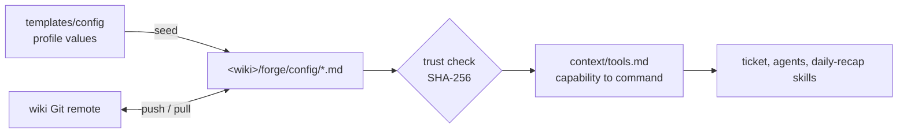

# ⚙️ Configuration

forge reads the config from four Markdown files in `<wiki>/forge/config/`.
`<wiki>` is the wiki of the repository, by default `../<repo>.forge/wiki`.

| File | Holds | Example |
|---|---|---|
| `tracker.md` | the work item tracker: key prefix, item URL, named queries, and one command for each `tracker.*` capability | Jira or GitHub Issues: the site, the project, and the tool (a CLI or an MCP server) |
| `repo.md` | the repository host: change name, branch pattern, checkouts, and the `repo.*` commands | GitHub `owner/repo`, base `main`, with `gh` |
| `ci.md` | the CI: the `ci.*` commands | GitHub Actions with `gh`, or Jenkins with a REST script |
| `policy.md` | policy values and the hook sections | Thursday no-merge, evidence on a deployed environment, QA handover |

The config travels with the wiki repository. Every clone of the wiki uses the same values.
`forge-setup` seeds missing files from [templates/config](../plugins/forge/templates/config),
and fills the personal values with `forge.mjs config set` and `config row` (see **Edit values**).
The templates hold the shared values of the profile. Change a shared value in the templates, so that each user gets it.
Edit them directly in the wiki. Clone or pull that wiki to share changes (see [wiki.md](wiki.md)).



## 🧾 File format

Each file has a flat YAML frontmatter for the values, and a Markdown body for the commands.

```markdown
---
provider: jira
host: jira.example.com
project: APP
prefix: APP
itemUrl: https://jira.example.com/browse/{KEY}
---

# 🟦 Jira Cloud

## 🔎 Queries
| Name | Query |
|---|---|
| `mine` | `assignee = currentUser() AND statusCategory != Done ORDER BY updated DESC` |

## 🔐 Auth check
## 🔑 Keys
## 🧰 Capabilities
| Capability | Command | Notes |
## 🩺 Failures
```

- The frontmatter is flat: `key: value`, with inline lists `[a, b]`. Quote a value that starts with `{`.
- An opening `---` without a closing delimiter is malformed and fails; it is not a missing file or an absent optional setting.
- In the skills, `<file>.<key>` means the frontmatter key `<key>` of `config/<file>.md`, for example `repo.changeName`.
- `tracker.queries` is the **Queries** table. `repo.checkouts` is the **Checkouts** table.
- A table cell cannot hold a `|` character.
- A team can add keys. A command can then use them as `<file>.<key>`.

## ✏️ Edit values

Edit a file directly, or use the validated commands. They parse and validate the result first, and write nothing on a problem.

```sh
node "<plugin>/scripts/forge.mjs" config set "repo.branchPattern=users/alex/{KEY}-{slug}"
node "<plugin>/scripts/forge.mjs" config row checkouts "app" "C:\dev\app" "acme/app"
node "<plugin>/scripts/forge.mjs" config row queries "team" "project = APP AND component = Payments"
node "<plugin>/scripts/forge.mjs" config row checkouts "old" --delete
```

- `config set` replaces a key, or adds it at the end of the frontmatter. It adds quotes to a value that starts with `{`.
- `config row` replaces the row with the same first cell, or appends a new row. Missing cells stay empty.
- Both keep the Markdown body, the line endings, and a byte order mark.
- Both print the changed files. Approve them with `forge.mjs trust` before forge uses them.
- `forge.mjs detect` prints the suggested personal values (`suggestion.values`): the base branch, the branch pattern of your local branches, and the main checkout.

## 🧱 Values

| File | Key | Meaning | Default |
|---|---|---|---|
| `tracker.md` | `provider` | Name of the tool | `jira` |
| | `prefix` | Upper-case key prefix (see Keys) | none |
| | `itemUrl` | URL template with `{KEY}` or `{number}` | none |
| | `host`, `project` | Site and project of the tracker | none |
| `repo.md` | `provider` | Name of the host | `github` |
| | `changeName` | The word for a change request | `PR` |
| | `branchPattern` | Branch template with `{KEY}` or `{key}`, plus `{number}`, `{slug}`. A template value such as `users/<user>/{KEY}-{slug}` needs your name | `{KEY}-{slug}` |
| | `baseBranch` | Default target branch | `master` |
| `ci.md` | `provider` | Name of the CI | `jenkins` |
| | `host` | CI server URL (Jenkins) | none |
| `policy.md` | `noMergeWeekdays` | Days on which the agent never proposes a merge | `[]` |
| | `evidenceOnDeployedEnv` | Evidence Testing must use a deployed environment when one is possible | `false` |
| | `qaHandover` | Run the QA handover step after the merge | `false` |
| | `learningMode` | Offer optional lessons for unfamiliar concepts in artifact comments | `false` |
| | `adversarialReviewModel` | Model of the adversarial reviewer; empty means a model different from the author's | empty |
| | `maxImplementers` | Maximum implementer sessions at the same time | `6` |
| | `gateGuard` | The gate guard for a push or a new change request of a ticket without a valid Shippable? approval: `deny`, `ask` (the host asks you), or `off` | `deny` |

## Learning mode

Set `learningMode: true` in `<wiki>/forge/config/policy.md` to enable learning offers.
Set it to `false` to disable offers. The value must be a boolean, not a quoted string.
Older configs without the key remain disabled; no reseed is needed.
Setup includes `learningMode: false`. Seeding preserves an existing policy file.

Say "enable learning mode" or "disable learning mode" to request the edit.
The agent shows the proposed change and asks before writing it.
After the edit, review the changed file and approve its exact hash through the existing trust flow.
The agent re-reads `forge.mjs config --json` before using the value.
Do not replace an existing policy file to change this one key.

With the mode enabled, comment with a plain question or an optional `learn:` marker:

- "What does this cache do?"
- "I do not understand idempotency."
- "learn: why is this queue needed?"

Submit the feedback or ask "review my comments".
The `learning-mode` skill answers briefly and offers a bite before creating it.
Choose one concept when several appear. Skip or Later creates nothing.
An explicit lesson request while disabled offers to enable the mode; it never silently changes policy.
Missing comment tools use a pasted question and artifact location instead.

Accepted bites live at `<wiki>/learning/<concept-slug>.md`, with index and log entries.
They link to the artifact and verified code or documentation.
Each explains how the concept works, what it does here, and why the change uses it.
A 3/4/5/3-minute budget covers explanation, example, exercise, and self-check: 15 minutes total.
The budget is a guide, not a reading-speed guarantee.
Disabling the mode does not delete saved lessons.

Learning adds no gate. Skipping or deferring a bite does not block review.
Lessons and self-checks never approve a gate or mark the user as understanding.
Learning threads stay unresolved until the user explicitly asks to resolve them.
The ticket's existing `Learned?` gate stays unchanged.
This is a repository policy and skill, not a custom UI or a background watcher.

## 📜 Capabilities

Skills never name a tool. They name a **capability**. The file `plugins/forge/context/tools.md` tells the agent how to find its row in the config file.
A **write** changes something outside the workspace. The agent drafts the text in `outbox/`, runs the Sendable? steps, and asks before every write.
The write capabilities are `tracker.comment`, `tracker.transition`, `tracker.link`, `repo.open-change`, `repo.update-change`, `repo.reply`, and `ci.trigger`. The gate guard reads the commands of these rows (the code spans of the Command and Notes cells, up to the first option or placeholder) and makes the host ask the user before each one. When a code span names an HTTP method option (`-X POST` or `--method POST`), only a command with a method other than GET is a write.
A code span needs 2 words or more before the first option or placeholder (for example `gh issue comment`). A one-word span such as `curl -X POST <url>` gives no write command, so the guard does not ask for it: the written rule applies.
`manual` in a row means that the agent tells the user the exact step, and waits.

| Capability | Kind | Input | Output |
|---|---|---|---|
| `tracker.fetch` | read | key | summary, type, status, priority, reporter, assignee, description, comments, links, URL |
| `tracker.search` | read | a named query or a native query | list of key, summary, status, updated |
| `tracker.comment` | **write** | key, Markdown text | comment URL or id |
| `tracker.transition` | **write** | key, target status | new status |
| `tracker.link` | **write** | key, other key or URL, relation | nothing |
| `repo.open-change` | **write** | repo, branch, base, title, body, draft flag | change URL and number |
| `repo.update-change` | **write** | change, new title or body | nothing |
| `repo.change-status` | read | change | state, approvals, mergeability, checks summary |
| `repo.review-comments` | read | change | open threads with file, line, author role, text |
| `repo.reply` | **write** | change, thread, text | nothing |
| `repo.history` | read | search text (keys, file paths) | old changes with reviewers and threads |
| `ci.status` | read | change or branch | pipelines or jobs with result and URL |
| `ci.logs` | read | job | log excerpt |
| `ci.trigger` | **write** | job, parameters | run URL |

Never available, with any tool: a merge (the user merges in the web UI), and closing a change without explicit approval.

## 🔑 Keys

Every work item has a key in the form `PREFIX-number`. Folders use the lower-case key.

| Tracker | Native id | Key | Folder |
|---|---|---|---|
| Jira | `APP-123` | `APP-123` (`prefix` = project key) | `app-123` |
| GitHub Issues | `#123` | `GH-123` (`prefix` = `GH`, `{number}` = the issue number) | `gh-123` |

The **Keys** section of `tracker.md` converts between the native id and the key.

## 🪝 Policy sections

`policy.md` has one section for each hook point of the `ticket` skill: `Start`,
`Investigate`, `Resume`, `Implement`, `Evidence Testing`, `QA handover`, and `Close`.
Write the step rules and traps there. Rules for each session (tools, credentials, data rules) go in the
`<wiki>/rules/` pages ([wiki.md](wiki.md#company-rules)). A section can add steps and make rules stricter.
It can never weaken a core rule: no merge, ask before every external write, explicit gate approval,
no secrets, and the adversarial review before every change request.

Every new ticket uses `workflow: full-v3` in its ticket README, not a policy sizing
setting. All research, scope interview, investigation, and review phases
apply even to small fixes. A small fix has shorter documents, not fewer phases. The investigation comes before the plan steps, and
Planned? approves both together in `plan.md`. `qaHandover: false` omits only QA handover, not
Evidence Testing or a required gate. Sendable? applies to each external write in every
phase. Forge 8 supports no other ticket layout: lint reports a ticket without `workflow: full-v3` as a read error. See the [ticket skill](../plugins/forge/skills/ticket/SKILL.md).

## ➕ Change a tool

forge is **CLI first**. The file `plugins/forge/context/tools.md`, "Tool choice: CLI first", gives the order: official CLI, then REST, then MCP.

1. Change the template in `plugins/forge/templates/config/<kind>.md` of this repository, so that each user gets it. Raise the plugin version.
2. Fill in the frontmatter, the **Auth check**, and each capability row. Keep `manual` for a gap.
3. Write the official CLI command (`gh`, `az`) in each row. Use JSON output flags when they exist. When the profile uses an MCP server for a tool, the template says why.
4. When no CLI exists, write a small Node script for the REST API in `<wiki>/forge/scripts/<name>.mjs`. Call it with `forge.mjs run <name>`. Read the token with `cred.mjs`.
5. Use an MCP server only when steps 3 and 4 cannot do a capability. Use a server from the repository `.mcp.json` or the forge plugin `mcp.json`. Forge never changes the repository: add a missing server to the forge `mcp.json`. Write the reason in the **Notes** column.
6. Validate the integration with a synthetic or explicitly selected work item through the full workflow; do not invent a tracker ticket or make external writes without approval.

## ✅ Checks

- `forge.mjs config --json` reads the config. It fails on a bad value: a lower-case prefix, a bad `itemUrl` or `branchPattern`, an unknown day, or a policy value of the wrong type.
- `forge.mjs config` fails closed when a file in `<wiki>/forge` is new or changed and you did not approve it (`forge.mjs trust`).
- `forge.mjs doctor` reports the wiki, each config file and its provider, a missing CLI, and trust.
- `doctor` also warns on setup gaps:
  - `config:placeholder`: `repo.branchPattern` still holds `<user>`. `forge.mjs worktree` also refuses that pattern.
  - `config:checkouts`: no Checkouts row, or the main checkout path does not exist on this machine.
  - `cred:<name>`: a credential that the config names (`cred.mjs set <name>`, `--cred <name>`, or Jenkins) is not stored. `doctor` checks presence only and never reads the value.
  - `mcp:<server>`: a server of the profile (`mcpServers` in `templates/profile.json`) is in no file, or it is in the forge `mcp.json` and also in the repository `.mcp.json` or the Copilot user `mcp-config.json`. Two entries load the same tools two times. `doctor` finds a server by its URL, not by its name. In a repository that is not the profile main checkout (`mainCheckout` in `templates/profile.json`), a server in no file is `ok`, because only the main checkout `.mcp.json` gives it.
  - `mcp:retired`: a server uses a retired URL (`mcpRetired` in `templates/profile.json`). Disable that server in **Chat: Open Customizations** > **MCP Servers**.
- A missing file gives the defaults. Every capability is then `manual`.

## 🔒 Rules

- Never put secrets in a config file. Credentials stay in a CLI login, or in the OS credential store (`cred.mjs set <name>`).
- Prefer a CLI login (`gh auth login`, `az login`) to an MCP server with a token. When a tracker has only an MCP server, use its OAuth sign-in.
- Agent Plugins forbid `${ENV}` in an MCP URL or header. When you must add an MCP server, use OAuth or a stdio server that reads the credential store.
