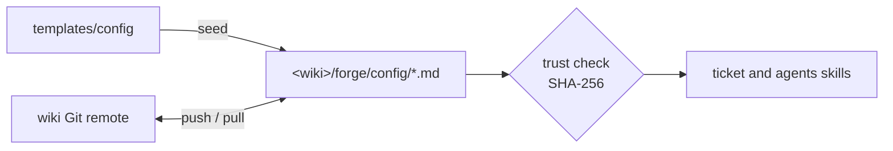

# ⚙️ Configuration

forge reads the config from two Markdown files in `<wiki>/forge/config/`.
`<wiki>` is the wiki of the repository, by default `../<repo>.forge/wiki`.

| File | Holds | Example |
|---|---|---|
| `repo.md` | the change name, the branch pattern, the base branch, and the **Checkouts** table | `PR`, `users/alex/{KEY}-{slug}`, base `main` |
| `policy.md` | policy values and the hook sections | Thursday no-merge, evidence on a deployed environment, QA handover |

Forge calls no tracker, no change request host, and no CI, so it has no config for them.
The config travels with the wiki repository. Every clone of the wiki uses the same values.
`forge-setup` seeds missing files from [templates/config](../plugins/forge/templates/config),
and fills the personal values with `forge.mjs config set` and `config row` (see **Edit values**).
Change a shared value in the templates, so that each user gets it.
Edit the files directly in the wiki. Clone or pull that wiki to share changes (see [wiki.md](wiki.md)).



## 🧾 File format

Each file has a flat YAML frontmatter for the values, and a Markdown body.

```markdown
---
changeName: PR
branchPattern: "users/alex/{KEY}-{slug}"
baseBranch: main
---

# Repository

## 📁 Checkouts
| Name | Path | Remote | baseBranch |
|---|---|---|---|
```

- The frontmatter is flat: `key: value`, with inline lists `[a, b]`. Quote a value that starts with `{`.
- An opening `---` without a closing delimiter is malformed and fails; it is not a missing file or an absent optional setting.
- In the skills, `<file>.<key>` means the frontmatter key `<key>` of `config/<file>.md`, for example `repo.changeName`.
- `repo.checkouts` is the **Checkouts** table.
- A table cell cannot hold a `|` character.

## ✏️ Edit values

Edit a file directly, or use the validated commands. They parse and validate the result first, and write nothing on a problem.

```sh
node "<plugin>/scripts/forge.mjs" config set "repo.branchPattern=users/alex/{KEY}-{slug}"
node "<plugin>/scripts/forge.mjs" config row checkouts "app" "C:\dev\app" "acme/app"
node "<plugin>/scripts/forge.mjs" config row checkouts "old" --delete
```

- `config set` replaces a key, or adds it at the end of the frontmatter. It adds quotes to a value that starts with `{`.
- `config row` replaces the row with the same first cell, or appends a new row. Missing cells stay empty.
- Both keep the Markdown body, the line endings, and a byte order mark.
- Both print the changed files. Approve them with `forge.mjs trust` before forge uses them.
- `forge.mjs detect` prints the suggested personal values (`suggestion.values`): the base branch, the branch pattern of your local branches, and the main checkout.

## 🧱 Values

| File | Key | Meaning | Default |
|---|---|---|---|
| `repo.md` | `changeName` | The word for a change request: `PR`, `MR`, or `none` (no change requests: the agent pushes to the base branch after Shippable?) | `PR` |
| | `branchPattern` | Branch template with `{KEY}` or `{key}`, plus `{number}`, `{slug}`. A template value such as `users/<user>/{KEY}-{slug}` needs your name | `{KEY}-{slug}` |
| | `baseBranch` | Default target branch | `master` |
| `policy.md` | `noMergeWeekdays` | Days on which the agent never proposes a merge | `[]` |
| | `evidenceOnDeployedEnv` | The proof of the changed behavior needs a deployed environment. `true`: Evidence Testing runs after the push. `false`: it runs before Shippable?, and `proof.md` is in the Shippable? manifest. | `false` |
| | `qaHandover` | Run the QA handover step after the merge | `false` |
| | `adversarialReviewModel` | Model of the adversarial reviewer; empty means a model different from the author's | empty |
| | `maxImplementers` | Maximum implementer sessions at the same time | `6` |
| | `planReview` | Review of the plan before Planned?: `off`, `attacker` (one reviewer subagent), or `panel` (3 reviewer subagents) | `off` |
| | `styleRules` | Add the response style rules of the plugin (Simplified Technical English, no AI tells, the ADHD response shape) to each session. A missing key means `true`. The template for a new wiki sets `false` | `true` |
| | `scopeComment` | After the scope check, draft a comment for the reporter with the scope and the open questions, as a paste text for you | `false` |
| | `gateGuard` | The guard for a push of a ticket without the valid approvals of Planned? and Shippable?: `deny`, `ask` (the host asks you), or `off` | `deny` |

`set up forge` asks for the team size and the response style, and writes one set of 4 values with `forge.mjs config set`, and `styleRules` as the user chooses. No code reads the team size. The template `policy.md` holds the small-team set.

| Key | Small team | Large team |
|---|---|---|
| `planReview` | `attacker` | `attacker` |
| `scopeComment` | `false` | `true` |
| `evidenceOnDeployedEnv` | `false` | `true` |
| `qaHandover` | `false` | `true` |

## 🚫 No external calls

Forge calls no tool outside the workspace: no tracker, no change request host, and no CI. A ticket has a key and an `item:` link in its README, and you paste the text of the work item into the chat.
The agent writes each text for another system (a comment, a change request description, a QA handover) as a paste text in `outbox/`, and you send it.
After the Shippable? GO the agent pushes the branch. You open the pull request and paste its URL into the chat, and the agent records it in `changes` of the README.
The agent never merges. The native permission prompt and the deny rules of your host cover a CLI call. A user setting `Bash(gh pr merge:*)` in Claude Code adds a hard stop for a merge.

## 🔑 Keys

The key of a ticket is what you type, for example `APP-123` or `GH-7`. When you give none, `forge.mjs local-key` gives `L-<n>`. Folders use the lower-case key (`app-123`).
The `item:` line of the README holds the link to the work item.

## 🪝 Policy sections

`policy.md` has one section for each hook point of the `ticket` skill: `Start`,
`Investigate`, `Resume`, `Implement`, `Evidence Testing`, `QA handover`, and `Close`.
Write the step rules and traps there. Rules for each session (data rules) go in the
`<wiki>/rules/` pages ([wiki.md](wiki.md#company-rules)). A section can add steps and make rules stricter.
It can never weaken a core rule: no merge, no call of an external tool, explicit gate approval,
no secrets, and the adversarial review before every change request.

Every new ticket uses `workflow: full-v4` in its ticket README, not a policy sizing
setting. All research, scope interview, investigation, and review phases
apply even to small fixes. A small fix has shorter documents, not fewer phases. The scope check is a question in chat. The investigation comes before the plan steps, and
Planned? approves `story.md` and `plan.md` together. `qaHandover: false` omits only QA handover, not
Evidence Testing or a required gate. Forge reads no other ticket layout: lint reports a ticket without `workflow: full-v4` as a read error. See the [ticket skill](../plugins/forge/skills/ticket/SKILL.md).

## ✅ Checks

- `forge.mjs config --json` reads the config. It fails on a bad value: a bad `branchPattern`, an unknown day, or a policy value of the wrong type.
- `forge.mjs config` fails closed when a file in `<wiki>/forge` is new or changed and you did not approve it (`forge.mjs trust`).
- `forge.mjs doctor` reports the wiki, each config file, trust, the session start hook, and the plugin version.
- `doctor` also warns on setup gaps:
  - `config:placeholder`: `repo.branchPattern` still holds `<user>`. `forge.mjs worktree` also refuses that pattern.
  - `config:checkouts`: no Checkouts row, or the main checkout path does not exist on this machine.
  - `unused:<file>`: a file that Forge does not use since 14.0.0 (`tracker.md`, `ci.md`, `rules/toolkit.md`, or a `profile` key in `forge/repo.json`). Remove it.
- A missing file gives the defaults. 

## 🔒 Rules

- Never put secrets in a config file.
