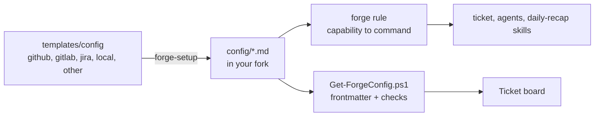

# ⚙️ Configuration

forge reads the team config from four Markdown files in `plugins/forge/config/` of your fork:

| File | Holds | Default template |
|---|---|---|
| `tracker.md` | the work item tracker: key prefix, item URL, named queries, and one command for each `tracker.*` capability | `tracker-local` |
| `repo.md` | the repository host: change name, branch pattern, checkouts, and the `repo.*` commands | `repo-other` |
| `ci.md` | the CI: the `ci.*` commands | `ci-other` |
| `policy.md` | policy values and the company hook sections | `policy` |

The config travels with the fork. Every machine of the team uses the same values.
`forge-setup` seeds the files from [templates/config](../plugins/forge/templates/config) (the "Configure the team" steps).



## 🧾 File format

Each file has a flat YAML frontmatter for the values, and a Markdown body for the commands.

```markdown
---
provider: gitlab
host: gitlab.com
project: group/app
prefix: APP
itemUrl: https://gitlab.com/group/app/-/issues/{number}
---

# 🦊 GitLab issues (`glab`)

## 🔎 Queries
| Name | Query |
|---|---|
| `mine` | `--assignee=@me` |

## 🔐 Auth check
## 🔑 Keys
## 🧰 Capabilities
| Capability | Command | Notes |
## 🩺 Failures
```

- The frontmatter is flat: `key: value`, with inline lists `[a, b]`. Quote a value that starts with `{`.
- In the skills, `<file>.<key>` means the frontmatter key `<key>` of `config/<file>.md`, for example `repo.changeName`.
- `tracker.queries` is the **Queries** table. `repo.checkouts` is the **Checkouts** table.
- A table cell cannot hold a `|` character.
- A fork can add keys. A command can then use them as `<file>.<key>`.

## 🧱 Values

| File | Key | Meaning | Default |
|---|---|---|---|
| `tracker.md` | `provider` | Name of the tool, for example `jira`, `gitlab`, `github`, `local` | `other` |
| | `prefix` | Upper-case key prefix (see Keys) | — |
| | `itemUrl` | URL template with `{KEY}` or `{number}` | — |
| | `host`, `project` | Site and project of the tracker | — |
| `repo.md` | `provider` | Name of the host, for example `github`, `gitlab` | `other` |
| | `changeName` | `PR` or `MR` | `MR` for gitlab, else `PR` |
| | `branchPattern` | Branch template with `{KEY}` or `{key}`, plus `{number}`, `{slug}` | `{KEY}-{slug}` |
| | `baseBranch` | Default target branch | `main` |
| `ci.md` | `provider` | Name of the CI | `other` |
| `policy.md` | `noMergeWeekdays` | Days on which the agent never proposes a merge | `[]` |
| | `evidenceOnDeployedEnv` | Evidence Testing must use a deployed environment when one is possible | `false` |
| | `qaHandover` | Run the QA handover step after the merge | `false` |
| | `adversarialReviewModel` | Model of the adversarial reviewer; empty means a model different from the author's | empty |
| | `maxImplementers` | Maximum implementer sessions at the same time | `6` |

## 📜 Capabilities

Skills never name a tool. They name a **capability**. The `forge` rule finds its row in the config file.
A **write** changes something outside the workspace. The agent drafts the text in `outbox\`, runs the Sendable? gate, and asks before every write.
`manual` in a row means that the agent tells the user the exact step, and waits.

| Capability | Kind | Input | Output |
|---|---|---|---|
| `tracker.fetch` | read | key | summary, type, status, priority, reporter, assignee, description, comments, links, URL |
| `tracker.search` | read | a named query or a native query | list of key, summary, status, updated |
| `tracker.comment` | **write** | key, Markdown text | comment URL or id |
| `tracker.transition` | **write** | key, target status | new status |
| `tracker.link` | **write** | key, other key or URL, relation | — |
| `repo.open-change` | **write** | repo, branch, base, title, body, draft flag | change URL and number |
| `repo.update-change` | **write** | change, new title or body | — |
| `repo.change-status` | read | change | state, approvals, mergeability, checks summary |
| `repo.review-comments` | read | change | open threads with file, line, author role, text |
| `repo.reply` | **write** | change, thread, text | — |
| `repo.history` | read | search text (keys, file paths) | old changes with reviewers and threads |
| `ci.status` | read | change or branch | pipelines or jobs with result and URL |
| `ci.logs` | read | job | log excerpt |
| `ci.trigger` | **write** | job, parameters | run URL |

Never available, with any tool: a merge (the user merges in the web UI), and closing a change without explicit approval.

## 🔑 Keys

Every work item has a key in the form `PREFIX-number`. Folders use the lower-case key.

| Tracker | Native id | Key | Folder |
|---|---|---|---|
| Jira | `ABC-123` | `ABC-123` (`prefix` = project key) | `abc-123` |
| GitLab | issue `#42` in `group/app` | `APP-42` (`prefix: APP`) | `app-42` |
| GitHub | issue `#42` in `org/app` | `APP-42` (`prefix: APP`) | `app-42` |
| Local | `<wiki>\items\ITEM-7.md` | `ITEM-7` | `item-7` |

The **Keys** section of each tracker file converts between the native id and the key.

## 🪝 Policy sections

`policy.md` has one section for each hook point of the `ticket` skill: `Toolkit`, `Data rules`, `Start`,
`Investigate`, `Resume`, `Implement`, `Evidence Testing`, `QA handover`, and `Close`.
Write the company rules, tools, and traps there. A section can add steps and make rules stricter.
It can never weaken a core rule: no merge, ask before every external write, explicit gate approval,
no secrets, and the adversarial review before every change request.

## ➕ Add a tool

forge is **CLI first**. The `forge` rule, "Tool choice: CLI first", gives the order: official CLI, then REST, then MCP.

1. Copy the closest template, or the `other` template of the same kind, to `config/<kind>.md`.
2. Fill in the frontmatter, the **Auth check**, and each capability row. Keep `manual` for a gap.
3. Write the official CLI command (`gh`, `glab`, `az`, `acli`) in each row. Use JSON output flags when they exist.
4. When the CLI has no command for a capability, use the REST API with `curl.exe` or `Invoke-RestMethod`.
5. Add an MCP server to `plugins/forge/mcp.json` only when steps 3 and 4 cannot do a capability. Write the reason in the **Notes** column.
6. Run one S-track work item end to end with it.

## ✅ Checks

- `Get-ForgeConfig.ps1` throws on a bad value: a lower-case prefix, a bad `itemUrl` or `branchPattern`, an unknown day, or a policy value of the wrong type.
- `Test-ForgeSetup.ps1` reports each config file, its provider, and a missing CLI.
- The config folder is `<FORGE_HOME>\plugins\forge\config` when it exists, so an edit counts at once. Else forge uses the config folder of the installed plugin copy.
- A missing file gives the defaults. Every capability is then `manual`.

## 🗂️ Ticket board

The board reads `tracker.md` and `repo.md` on each request. A change shows on the next refresh.

- `tracker.itemUrl` gives the work item link when the ticket README has no `item` field.
- `tracker.provider` gives the link name: "Jira", "Issue", or "Item". Else the name is "Work item".
- `repo.changeName` gives the change name in the UI: "PRs" or "MRs".
- A broken file gives the defaults and a warning in `--check`.

## 🔒 Rules

- Never put secrets in a config file. Credentials stay in user environment variables or in a CLI login.
- Prefer a CLI login (`gh auth login`, `glab auth login`, `acli jira auth login`) to an MCP server with a token.
- Agent Plugins forbid `${ENV}` in an MCP URL or header. When you must add an MCP server, use OAuth or a stdio server that reads the variable.
