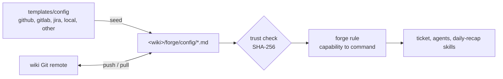

# ⚙️ Configuration

forge reads the team config from four Markdown files in `<wiki>/forge/config/`.
`<wiki>` is the wiki of the repository, by default `../<repo>.wiki`.

| File | Holds | Default template |
|---|---|---|
| `tracker.md` | the work item tracker: key prefix, item URL, named queries, and one command for each `tracker.*` capability | `tracker-local` |
| `repo.md` | the repository host: change name, branch pattern, checkouts, and the `repo.*` commands | `repo-other` |
| `ci.md` | the CI: the `ci.*` commands | `ci-other` |
| `policy.md` | policy values and the company hook sections | `policy` |

The config travels with the wiki repository. Every clone of the wiki uses the same values.
`forge-setup` seeds missing files from [templates/config](../plugins/forge/templates/config),
and fills the values with `forge.mjs config set` and `config row` (see **Edit values**).
Edit them directly in the wiki. Clone or pull that wiki to share changes (see [wiki.md](wiki.md)).



## 🧾 File format

Each file has a flat YAML frontmatter for the values, and a Markdown body for the commands.

```markdown
---
provider: gitlab
host: gitlab.com
project: group/app
prefix: APP
itemUrl: https://gitlab.com/group/app/-/issues/{number}
---

# 🦊 GitLab issues (`glab`)

## 🔎 Queries
| Name | Query |
|---|---|
| `mine` | `--assignee=@me` |

## 🔐 Auth check
## 🔑 Keys
## 🧰 Capabilities
| Capability | Command | Notes |
## 🩺 Failures
```

- The frontmatter is flat: `key: value`, with inline lists `[a, b]`. Quote a value that starts with `{`.
- An opening `---` without a closing delimiter is malformed and fails; it is not a missing file or an absent optional setting.
- In the skills, `<file>.<key>` means the frontmatter key `<key>` of `config/<file>.md`, for example `repo.changeName`.
- `tracker.queries` is the **Queries** table. `repo.checkouts` is the **Checkouts** table.
- A table cell cannot hold a `|` character.
- A team can add keys. A command can then use them as `<file>.<key>`.

## ✏️ Edit values

Edit a file directly, or use the validated commands. They parse and validate the result first, and write nothing on a problem.

```sh
node "<plugin>/scripts/forge.mjs" config set "tracker.prefix=MFD" "repo.branchPattern=feature/{KEY}-{slug}"
node "<plugin>/scripts/forge.mjs" config row checkouts "app" "C:\dev\app" "acme/app" "develop"
node "<plugin>/scripts/forge.mjs" config row queries "team" "project = MFD AND component = Payments"
node "<plugin>/scripts/forge.mjs" config row checkouts "old" --delete
```

- `config set` replaces a key, or adds it at the end of the frontmatter. It adds quotes to a value that starts with `{`.
- `config row` replaces the row with the same first cell, or appends a new row. Missing cells stay empty.
- Both keep the Markdown body, the line endings, and a byte order mark.
- Both print the changed files. Approve them with `forge.mjs trust` before forge uses them.
- `forge.mjs detect --tracker <t> --repo <r> --ci <c>` prints suggested values for a choice (`suggestion.values`).

## 🧱 Values

| File | Key | Meaning | Default |
|---|---|---|---|
| `tracker.md` | `provider` | Name of the tool, for example `jira`, `gitlab`, `github`, `local` | `other` |
| | `prefix` | Upper-case key prefix (see Keys) | — |
| | `itemUrl` | URL template with `{KEY}` or `{number}` | — |
| | `host`, `project` | Site and project of the tracker | — |
| `repo.md` | `provider` | Name of the host, for example `github`, `gitlab` | `other` |
| | `changeName` | `PR` or `MR` | `MR` for gitlab, else `PR` |
| | `branchPattern` | Branch template with `{KEY}` or `{key}`, plus `{number}`, `{slug}` | `{KEY}-{slug}` |
| | `baseBranch` | Default target branch | `main` |
| `ci.md` | `provider` | Name of the CI | `other` |
| | `host` | CI server URL (Jenkins) | — |
| `policy.md` | `noMergeWeekdays` | Days on which the agent never proposes a merge | `[]` |
| | `evidenceOnDeployedEnv` | Evidence Testing must use a deployed environment when one is possible | `false` |
| | `qaHandover` | Run the QA handover step after the merge | `false` |
| | `learningMode` | Offer optional lessons for unfamiliar concepts in artifact comments | `false` |
| | `adversarialReviewModel` | Model of the adversarial reviewer; empty means a model different from the author's | empty |
| | `maxImplementers` | Maximum implementer sessions at the same time | `6` |

## Learning mode

Set `learningMode: true` in `<wiki>/forge/config/policy.md` to enable learning offers.
Set it to `false` to disable offers. The value must be a boolean, not a quoted string.
Older configs without the key remain disabled; no reseed is needed.
Setup includes `learningMode: false`. Seeding preserves an existing policy file.

Say "enable learning mode" or "disable learning mode" to request the edit.
The agent shows the proposed change and asks before writing it.
After the edit, review the changed file and approve its exact hash through the existing trust flow.
The agent re-reads `forge.mjs config --json` before using the value.
Do not replace an existing policy file to change this one key.

With the mode enabled, comment with a plain question or an optional `learn:` marker:

- "What does this cache do?"
- "I do not understand idempotency."
- "learn: why is this queue needed?"

Submit the feedback or ask "review my comments".
The `learning-mode` skill answers briefly and offers a bite before creating it.
Choose one concept when several appear. Skip or Later creates nothing.
An explicit lesson request while disabled offers to enable the mode; it never silently changes policy.
Missing comment tools use a pasted question and artifact location instead.

Accepted bites live at `<wiki>/learning/<concept-slug>.md`, with index and log entries.
They link to the artifact and verified code or documentation.
Each explains how the concept works, what it does here, and why the change uses it.
A 3/4/5/3-minute budget covers explanation, example, exercise, and self-check: 15 minutes total.
The budget is a guide, not a reading-speed guarantee.
Disabling the mode does not delete saved lessons.

Learning adds no gate. Skipping or deferring a bite does not block review.
Lessons and self-checks never approve a gate or mark the user as understanding.
Learning threads stay unresolved until the user explicitly asks to resolve them.
The ticket's existing `Learned?` gate stays unchanged.
This is a repository policy and skill, not a custom UI or a background watcher.

## 📜 Capabilities

Skills never name a tool. They name a **capability**. The `forge` rule finds its row in the config file.
A **write** changes something outside the workspace. The agent drafts the text in `outbox/`, runs the Sendable? gate, and asks before every write.
`manual` in a row means that the agent tells the user the exact step, and waits.

| Capability | Kind | Input | Output |
|---|---|---|---|
| `tracker.fetch` | read | key | summary, type, status, priority, reporter, assignee, description, comments, links, URL |
| `tracker.search` | read | a named query or a native query | list of key, summary, status, updated |
| `tracker.comment` | **write** | key, Markdown text | comment URL or id |
| `tracker.transition` | **write** | key, target status | new status |
| `tracker.link` | **write** | key, other key or URL, relation | — |
| `repo.open-change` | **write** | repo, branch, base, title, body, draft flag | change URL and number |
| `repo.update-change` | **write** | change, new title or body | — |
| `repo.change-status` | read | change | state, approvals, mergeability, checks summary |
| `repo.review-comments` | read | change | open threads with file, line, author role, text |
| `repo.reply` | **write** | change, thread, text | — |
| `repo.history` | read | search text (keys, file paths) | old changes with reviewers and threads |
| `ci.status` | read | change or branch | pipelines or jobs with result and URL |
| `ci.logs` | read | job | log excerpt |
| `ci.trigger` | **write** | job, parameters | run URL |

Never available, with any tool: a merge (the user merges in the web UI), and closing a change without explicit approval.

## 🔑 Keys

Every work item has a key in the form `PREFIX-number`. Folders use the lower-case key.

| Tracker | Native id | Key | Folder |
|---|---|---|---|
| Jira | `ABC-123` | `ABC-123` (`prefix` = project key) | `abc-123` |
| GitLab | issue `#42` in `group/app` | `APP-42` (`prefix: APP`) | `app-42` |
| GitHub | issue `#42` in `org/app` | `APP-42` (`prefix: APP`) | `app-42` |
| Local | `<wiki>/items/ITEM-7.md` | `ITEM-7` | `item-7` |

The **Keys** section of each tracker file converts between the native id and the key.

## 🪝 Policy sections

`policy.md` has one section for each hook point of the `ticket` skill: `Toolkit`, `Data rules`, `Start`,
`Investigate`, `Resume`, `Implement`, `Evidence Testing`, `QA handover`, and `Close`.
Write the company rules, tools, and traps there. A section can add steps and make rules stricter.
It can never weaken a core rule: no merge, ask before every external write, explicit gate approval,
no secrets, and the adversarial review before every change request.

Every new ticket uses `workflow: full-v1` in its ticket README, not a policy sizing
setting. All research, briefing, scope interview, investigation, and review phases
apply even to small fixes. Diagnosed? must be approved before drafting the plan.
`qaHandover: false` omits only QA handover, not Evidence Testing or a required gate.
Sendable? applies to each external write in every phase. Existing S/M/L and trackless
tickets retain their original gates and recorded skips; absence of `track` never
selects the new workflow. See the [ticket skill](../plugins/forge/skills/ticket/SKILL.md).

## ➕ Add a tool

forge is **CLI first**. The `forge` rule, "Tool choice: CLI first", gives the order: official CLI, then REST, then MCP.

1. Copy the closest template, or the `other` template of the same kind, to `config/<kind>.md`.
2. Fill in the frontmatter, the **Auth check**, and each capability row. Keep `manual` for a gap.
3. Write the official CLI command (`gh`, `glab`, `az`, `acli`) in each row. Use JSON output flags when they exist.
4. When no CLI exists, write a small Node script for the REST API in `<wiki>/forge/scripts/<name>.mjs`. Call it with `forge.mjs run <name>`. Read the token with `cred.mjs`.
5. Use an MCP server only when steps 3 and 4 cannot do a capability. Add it in your VS Code user settings. Write the reason in the **Notes** column.
6. Validate the integration with a synthetic or explicitly selected work item through the full workflow; do not invent a tracker ticket or make external writes without approval.

## ✅ Checks

- `forge.mjs config --json` reads the config. It fails on a bad value: a lower-case prefix, a bad `itemUrl` or `branchPattern`, an unknown day, or a policy value of the wrong type.
- `forge.mjs config` fails closed when a file in `<wiki>/forge` is new or changed and you did not approve it (`forge.mjs trust`).
- `forge.mjs doctor` reports the wiki, each config file and its provider, a missing CLI, and trust.
- `doctor` also warns on setup gaps:
  - `config:placeholder`: a template value remains, for example `example.atlassian.net`, `owner/app`, `jenkins.example.com`, the `C:\dev\app` checkout, or a template `team` query.
  - `config:checkouts`: no Checkouts row, or the main checkout path does not exist on this machine.
  - `cred:<name>`: a credential that the config names (`cred.mjs set <name>`, `--cred <name>`, or Jenkins) is not stored. `doctor` checks presence only and never reads the value.
- A missing file gives the defaults. Every capability is then `manual`.

## 🔒 Rules

- Never put secrets in a config file. Credentials stay in a CLI login, or in the OS credential store (`cred.mjs set <name>`).
- Prefer a CLI login (`gh auth login`, `glab auth login`, `acli jira auth login`) to an MCP server with a token.
- Agent Plugins forbid `${ENV}` in an MCP URL or header. When you must add an MCP server, use OAuth or a stdio server that reads the credential store.
