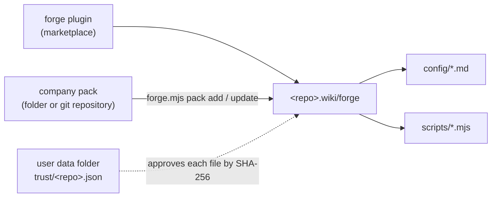

# 📦 Company packs

A pack holds the config, the rules, and the scripts of one company or team.
You install it into the repository wiki. You do not fork forge.



## 1️⃣ Layout

```text
acme-forge-pack/
  pack.json             {"name": "acme", "version": "1.2.0"}
  config/
    tracker.md          capability rows for your tracker (see docs/config.md)
    repo.md
    ci.md
    policy.md           policy values and the hook sections (Toolkit, Data rules, Start, ...)
  scripts/
    jenkins.mjs         small scripts for a credential or a guard
  tests/                not installed
```

- `pack.json` needs `name` (lowercase letters, digits, hyphens) and `version`.
- `include` (optional) lists the installed folders. The default is `["config", "scripts"]`.
- Keep the pack in a private repository when it names internal hosts or rules.

## 2️⃣ Install and update

Say "set up forge". Setup asks first whether you already have a pack, want to create one, or want no pack.
Or run the commands yourself:

```sh
node "<plugin>/scripts/forge.mjs" pack init <folder> --name <name> --tracker <t> --repo <r> --ci <c>   # a new pack
node "<plugin>/scripts/forge.mjs" pack add <folder or git URL>
node "<plugin>/scripts/forge.mjs" pack update            # the recorded source
node "<plugin>/scripts/forge.mjs" pack status
```

- `pack add` refuses to replace a file with other content. Compare it, then use `--force`.
- `pack update` merges each file with three-way merge (`git merge-file`). The base is the copy in `<wiki>/forge/.base`.
  - Not changed locally: forge takes the new file.
  - Changed locally and in the pack: forge merges. A conflict leaves `<<<<<<< local` markers. Fix them by hand.
  - Removed from the pack: forge deletes the file when it has no local change.
- Commit `<wiki>/forge` (with `.base` and `pack.lock.json`) in the wiki repository. Teammates get the same files.

### 🗂️ Develop a pack next to forge

Clone your pack into `packs/<name>` in your forge-engineering checkout. Git ignores `packs/`,
so the pack stays a separate, private repository. An agent that works in forge-engineering
then sees the core and your company installation together.

```sh
git clone <pack git URL> packs/<name>
# In the code repository: take the pack changes from your clone.
node "<forge-engineering>/plugins/forge/scripts/forge.mjs" pack update "<forge-engineering>/packs/<name>"
```

Change and test the pack in `packs/<name>`, then commit and push from that folder.

## 3️⃣ Trust

forge runs nothing from the wiki that you did not approve. A `git pull` or a pack update can change the files.

1. `node "<plugin>/scripts/forge.mjs" trust` lists each file under `<wiki>/forge` as `ok`, `new`, or `changed`, with its SHA-256.
2. Read the new and changed files.
3. `node "<plugin>/scripts/forge.mjs" trust approve config/tracker.md=<first 12 hash characters> ...`

The approvals are in the user data folder (`%LOCALAPPDATA%\forge`, `~/Library/Application Support/forge`,
or `$XDG_DATA_HOME/forge`), not in the wiki. `config` and `run` fail until each file is approved.
forge never approves a symlink (state `not-a-file`). `pack add` and `pack update` refuse a pack with symlinks.

## 4️⃣ Scripts

Use a CLI row in the config when the CLI has its own login (`gh`, `glab`, `acli`, `az`).
Write a script only for a credential or a guard, for example a REST call with a token, or a read-only SQL query.

```js
// scripts/jenkins.mjs: run with forge.mjs run jenkins <job>
import { pathToFileURL } from 'node:url';
const { getSecret } = await import(pathToFileURL(`${process.env.FORGE_CORE}/lib/cred.mjs`));
const token = getSecret('jenkins');
const res = await fetch(`https://ci.example.com/job/${process.argv[2]}/lastBuild/api/json`, {
  headers: { Authorization: `Basic ${Buffer.from(`me:${token}`).toString('base64')}` },
});
console.log(JSON.stringify(await res.json()));
```

- Run a script with `node "<plugin>/scripts/forge.mjs" run <name> [args...]`. Write that command in the capability row.
- forge sets `FORGE_CORE` (the core scripts folder), `FORGE_WIKI`, and `FORGE_REPO`.
- The user stores a secret with `node "<plugin>/scripts/cred.mjs" set <name>`. The prompt hides the input.
- A script with its own "set" command (for example, to parse a connection string) reads the secret with `readSecret(prompt)` from `${FORGE_CORE}/cred.mjs`, and stores it with `createStore().set(name, value)` from `${FORGE_CORE}/lib/cred.mjs`.
- The core already has `jenkins.mjs`. Call it with `--host` and `--cred` for a second Jenkins server. You do not need a pack script for it.
- Never print a secret. Pass it to a child process in its environment, not in its arguments.
- Use only Node.js built-ins. forge does not run `npm install` for a pack.

## 🔐 MCP servers

Use an MCP server only when no CLI and no REST call can do the capability (see the `forge` rule).
A pack cannot add an MCP server. Install it in your VS Code user settings, and name its tools in the capability row.

## ✅ Check a pack

1. `node "<plugin>/scripts/forge.mjs" doctor` reports no `fail` line.
2. Run one S-track work item end to end: start, plan, implement, open the change request, close.
3. Search the pack for secrets before every push.
