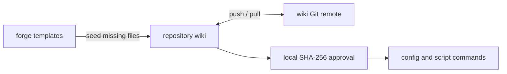

# Shared configuration in the wiki

The repository wiki is the source for configuration, helper scripts, and knowledge pages.
It is a separate Git repository at `../<repo>.wiki`.
There is no pack to install or update.



## Layout

```text
<repo>.wiki/
  .gitignore            raw/ and archive/ stay local
  index.md              knowledge index
  forge/
    repo.json           repository binding
    config/
      tracker.md
      repo.md
      ci.md
      policy.md
    scripts/            optional helper scripts
  raw/                  local working material
  archive/              local archives
```

Say "set up forge" to create the wiki and seed missing config files.
Setup keeps existing configuration. See [config.md](config.md) for the file format.

## Share through Git

1. Edit configuration and scripts directly in the wiki.
2. Review and commit only files that belong in the shared wiki.
3. Push the wiki after explicit approval of the command and target.
4. Teammates clone it to `../<repo>.wiki`, or pull changes in their existing clone.
5. Run setup to bind the clone and review its files before local trust approval.

Each code repository has its own wiki binding.
Do not bind one wiki to several unrelated repositories.
To reuse a script or setting elsewhere, copy the reviewed file into that repository's wiki.

### Public or private

A native public wiki is suitable when all tracked files and Git history contain public data.
Otherwise, use a private wiki repository or keep the wiki local.
Never change repository visibility as part of setup.

Before a public push, check configuration, scripts, knowledge pages, and Git history.
Exclude secrets, personal paths, internal hosts, company guidance, and private project details.
Check `forge/repo.json` and the **Checkouts** table for local paths.
Do not assume that a secret scan detects all private content.

Git ignores `raw/` and `archive/`. This does not untrack files that Git already tracks.
Check the tracked files before any push.
Never publish credentials or trust approvals.

## Trust

Forge does not use new or changed configuration or scripts until the user approves their hashes.
A Git pull cannot approve its own changes.

1. Run `node "<plugin>/scripts/forge.mjs" trust`.
2. Review each new or changed file.
3. Approve only after the user says yes: `node "<plugin>/scripts/forge.mjs" trust approve <path>=<first 12 hash characters> ...`.

Approvals live in the user data folder, not in the wiki.
Each teammate approves files on their own machine.
Forge refuses symlinks and special files.
`config` checks configuration; `run` checks both configuration and scripts.

Use `.gitattributes` with `* text=auto eol=lf` in the wiki for consistent line endings.
Hashes cover exact bytes, including line endings.

## Helper scripts

Prefer a CLI with its own login, such as `gh`, `glab`, `acli`, or `az`.
Use a script only for a credential or a guard that the CLI does not provide.
Store it in `<wiki>/forge/scripts/<name>.mjs`.

Run it from the code repository or its bound wiki:

```sh
node "<plugin>/scripts/forge.mjs" run <name> [args...]
```

Forge sets these environment variables:

| Variable | Value |
|---|---|
| `FORGE_CORE` | The core scripts folder |
| `FORGE_WIKI` | The repository wiki folder |
| `FORGE_REPO` | The main code checkout |

Use Node.js built-ins. Forge does not install dependencies for wiki scripts.
The core already provides `jenkins.mjs`; use `--host` and `--cred` for another server.

Read credentials through `${FORGE_CORE}/lib/cred.mjs`.
The user stores them with `node "<plugin>/scripts/cred.mjs" set <name>`.
A script that accepts a secret uses `readSecret(prompt)` from `${FORGE_CORE}/cred.mjs`.
Store that value with `createStore().set(name, value)` from `${FORGE_CORE}/lib/cred.mjs`.
Never print secrets or pass them in child process arguments.

## Existing installations

Installed configuration and scripts already live in the wiki. They keep working without the original pack.
Edit those installed files directly from now on.
The old `.base/` and `pack.lock.json` metadata stays ignored by trust and has no runtime role.
You can remove that metadata after review; no automatic deletion occurs.

If a former pack holds files not installed in a wiki, review them before a manual copy.
Do not copy its Git history or internal files into a public wiki.
Keep private clones separate until their required files have a safe home.
