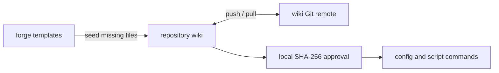

# Shared configuration in the wiki

The repository wiki is the source for configuration, helper scripts, and knowledge pages.
It is a separate Git repository at `../<repo>.wiki`.
There is no pack to install or update.



## Layout

```text
<repo>.wiki/
  .gitignore            raw/ and archive/ stay local
  index.md              knowledge index
  forge/
    repo.json           repository binding
    config/
      tracker.md
      repo.md
      ci.md
      policy.md
    scripts/            optional helper scripts
  raw/                  local working material
  archive/              local archives
```

Say "set up forge" to create the wiki and seed missing config files.
Setup keeps existing configuration. See [config.md](config.md) for the file format.

## Share through Git

1. Edit configuration and scripts directly in the wiki.
2. Review and commit only files that belong in the shared wiki.
3. Push the wiki after explicit approval of the command and target.
4. Teammates clone it to `../<repo>.wiki`, or pull changes in their existing clone.
5. Run setup to bind the clone and review its files before local trust approval.

Each code repository has its own wiki binding.
Do not bind one wiki to several unrelated repositories.
To reuse a script or setting elsewhere, copy the reviewed file into that repository's wiki.

### Public or private

A native public wiki is suitable when all tracked files and Git history contain public data.
Otherwise, use a private wiki repository or keep the wiki local.
Never change repository visibility as part of setup.

Before a public push, check configuration, scripts, knowledge pages, and Git history.
Exclude secrets, personal paths, internal hosts, company guidance, and private project details.
Check `forge/repo.json` and the **Checkouts** table for local paths.
Do not assume that a secret scan detects all private content.

Git ignores `raw/` and `archive/`. This does not untrack files that Git already tracks.
Check the tracked files before any push.
Never publish credentials or trust approvals.

Ticket links under `raw/` and `archive/` are local-only references. Label them as such
in a shared index or summary; they may be unavailable on another machine without
being broken. Shared summaries must explain the problem, fix, and durable knowledge
with shared sources and canonical links, without depending on ignored working files.
Do not unignore or publish working material to make a reference resolve.

## Local validation and source limits

Run from the repository or pass an explicit wiki path:

```sh
node "<plugin>/scripts/forge.mjs" lint [--wiki "<path>"] [--json] [--fix]
```

Default lint is read-only. It checks ticket shape, workflow/gate agreement, approval
revisions, and canonical wiki metadata. Only explicit `workflow: full-v1` selects
the new mandatory gate set. Existing S/M/L and trackless tickets retain their
original process, including skips and recommended Diagnosed?. Missing or conflicting
metadata is a finding, never permission to infer a state or migrate the ticket.

Canonical checks cover `title`, `status`, `updated`, and `sources`; existing
`index.md` and `log.md` instead require `title` and `type`. An absent `log.md`
is allowed until it is created. Age and `needs-check` findings are review warnings.
Index membership drift, semantic contradictions, HTTP retrieval, and the truth
of page text remain manual checks, not automated CLI results.

JSON output has this stable shape:

```json
{
  "version": 1,
  "wikiPath": "<absolute wiki path>",
  "findings": [
    {
      "file": "<file>",
      "line": null,
      "code": "<finding code>",
      "severity": "error",
      "message": "<what failed>",
      "remedy": "<specific user action>"
    }
  ],
  "repairs": [],
  "summary": { "errors": 1, "warnings": 0, "repaired": 0 }
}
```

`line` is a line number when known, otherwise `null`. Repair entries have
`file`, `code`, and `log` (the repair-log path). Errors exit with status 1; warnings
alone exit 0. Invalid input retains findings for valid files. A clean lint does not prove
workflow compliance or claim accuracy.

`--fix` is explicit and has one safe repair: append a missing final newline to an
unapproved `*.draft.md` with explicit `status: draft` metadata; the filename alone
is insufficient. Check both direct gate references and combined manifests,
including legacy Briefed? references, before editing. Preserve existing content and
line endings; never modify approved content. Report each repair and append the
file and change to that ticket's `repair-log.jsonl`, using `started` and `applied`
rows with before/after hashes. A repeat fix pass makes no changes.
No repair may infer workflow/state, create approval, fix stale approvals, delete
pages, or publish anything. Headerless existing index/log files need a reported,
user-reviewed metadata correction, not an automatic migration.
The shared validator's `checkAction` is a validation API, not an action executor.
The CLI exposes `lint` only; it never implements, sends, merges, or closes a ticket.

Approval manifests live outside their hashed document sets. README gates retain
`doc`, user approval `date`, and `hash`, adding a ticket-relative `manifest` JSON path.
`hash` is the full SHA-256 of raw manifest bytes. The manifest contains
`version: 1`, `gate`, and `documents` entries with ticket-relative `path` and full
lowercase raw-byte `sha256`. Designed? additionally requires both byte-identical plan
files and `approvedCopies: [{ "from": "plan.draft.md", "to": "plan.md" }]`; this field
is allowed only for Designed?. One user GO approves the whole displayed revision set.
Approval README/records and the manifest never hash themselves.

Each Sendable? write also retains `outbox/<name>.approval.json` outside the hashed
set: `version: 1`, exact draft `doc`, `status: approved` or `sent`,
`approval_manifest`, full raw-manifest `approval_hash`, user `approval_date`, exact
`target`, exact `command`, and `result` (returned id/URL when sent). The manifest
must cover that exact draft and include exact `command` and `target` strings,
binding the operation in its raw-byte hash. Both sidecar values must match the
manifest exactly; operation drift requires a new manifest and explicit approval.
The README gate's `doc` names the draft, never the sidecar. Create the
sidecar only after GO; update delivery status there, never in the frozen draft.
Keep old sidecars when README Sendable? moves to a later write.
Validate sidecars when present; absence is not evidence of an external send and
must not produce an inferred send history.
Sidecar metadata parsing applies only to `*.approval.json` files inside `outbox/`,
not arbitrary JSON files elsewhere in the ticket.

Legacy single-document `doc` + `hash` records verify raw document bytes.
Legacy combined Briefed? without a manifest is freshness-unverifiable and needs
explicit review before the affected action. Report missing evidence on Resume
without blocking unrelated read-only work. See the [complete approval contract](../plugins/forge/skills/ticket/SKILL.md#approval-revisions).

Classify wiki sources before checking them:

| Source class | Check and limitation |
|---|---|
| URL | Retain as a remote reference; local existence checks do not verify its content or availability. |
| Repository source | Resolve a repository-relative path only when its base repository is known from binding or configured checkout identity. Never guess from the wiki location. |
| Local-only raw/archive | Report unavailable on this machine separately from a broken shared link; do not publish it to repair the reference. |
| Moved path | Report the old path and verified replacement when known; do not delete the page or silently retarget its claims. |
| Unknown format, command, or historical investigation | Report that it cannot be resolved automatically; retain it for manual evidence review. |

Existence never verifies the text of a page. An old `updated` date is a review signal,
not proof that knowledge is false. Verify claims against current code or tools;
record unavailable sources and uncertainty instead of inventing evidence.

## Trust

Forge does not use new or changed configuration or scripts until the user approves their hashes.
A Git pull cannot approve its own changes.

1. Run `node "<plugin>/scripts/forge.mjs" trust`.
2. Review each new or changed file.
3. Approve only after the user says yes: `node "<plugin>/scripts/forge.mjs" trust approve <path>=<first 12 hash characters> ...`.

Approvals live in the user data folder, not in the wiki.
Each teammate approves files on their own machine.
Forge refuses symlinks and special files.
`config` checks configuration; `run` checks both configuration and scripts.

Use `.gitattributes` with `* text=auto eol=lf` in the wiki for consistent line endings.
Hashes cover exact bytes, including line endings.

## Helper scripts

Prefer a CLI with its own login, such as `gh`, `glab`, `acli`, or `az`.
Use a script only for a credential or a guard that the CLI does not provide.
Store it in `<wiki>/forge/scripts/<name>.mjs`.

Run it from the code repository or its bound wiki:

```sh
node "<plugin>/scripts/forge.mjs" run <name> [args...]
```

Forge sets these environment variables:

| Variable | Value |
|---|---|
| `FORGE_CORE` | The core scripts folder |
| `FORGE_WIKI` | The repository wiki folder |
| `FORGE_REPO` | The main code checkout |

Use Node.js built-ins. Forge does not install dependencies for wiki scripts.
The core already provides `jenkins.mjs`; use `--host` and `--cred` for another server.

Read credentials through `${FORGE_CORE}/lib/cred.mjs`.
The user stores them with `node "<plugin>/scripts/cred.mjs" set <name>`.
A script that accepts a secret uses `readSecret(prompt)` from `${FORGE_CORE}/cred.mjs`.
Store that value with `createStore().set(name, value)` from `${FORGE_CORE}/lib/cred.mjs`.
Never print secrets or pass them in child process arguments.

## Existing installations

Installed configuration and scripts already live in the wiki. They keep working without the original pack.
Edit those installed files directly from now on.
The old `.base/` and `pack.lock.json` metadata stays ignored by trust and has no runtime role.
You can remove that metadata after review; no automatic deletion occurs.

If a former pack holds files not installed in a wiki, review them before a manual copy.
Do not copy its Git history or internal files into a public wiki.
Keep private clones separate until their required files have a safe home.
