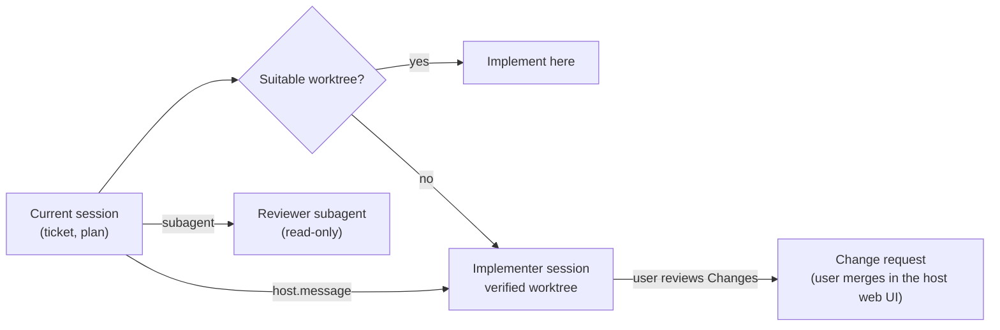

# 🤖 Agent sessions

> When your context has no `End of Forge context.` line, or a `Forge context part <i> of <n>` part is
> missing or has a different id, run `node "<plugin>/scripts/forge.mjs" context` first and follow its output. `<plugin>`
> is two folders above the folder of this file. When the command fails, read
> [forge.md](../../context/forge.md) (the `forge` rule), and [style.md](../../context/style.md) (the `style` rule) unless `policy.styleRules` is `false`.

The host is the orchestrator. A task can continue in its current isolated session.
In the VS Code Agents window, you see all sessions in the sessions list and in the session grid.
This skill decides when to use which host verb (the `# Forge host` table). It does not repeat the host documentation.



## 🧭 Choose the tool

| Need | Use | Visible as |
|---|---|---|
| Implement an approved plan in a suitable current worktree | continue here after the checks below | the current session |
| Implement without a suitable current worktree, or delegate an independent task | a new session (`host.spawn`) after the checks below | a new session |
| Quick review, research, or a check | a subagent (`task` tool) | nothing; the result comes back here |
| Test a gate document on a reader without the session history | a cold read subagent (see "Cold read") | nothing; the result comes back here |
| Test if the plan of `plan.md` is right | a plan review subagent (see "Plan review") | nothing; the result comes back here |
| Give more work or a correction to a running session | `host.message` | a message in that session |
| Status of my sessions | `host.sessions` | nothing; the result comes back here |

## 🛠️ Implementer session

1. Check the gate first. For a ticket, validate fresh plan-gate revision evidence before starting implementation. For `workflow: full-v4`, that is Planned?: verify the manifest, its raw-byte SHA-256, and every covered document (`story.md`, `plan.md`, and the listed evidence). Unverifiable approval blocks implementation, not read-only resume.
2. Select the execution worktree with the checks below. Continue here when it is suitable. Do not start another implementer merely because the ticket reached Implement. `<F>` means `node "<plugin>/scripts/forge.mjs"`, where `<plugin>` is the folder two levels above this skill. `<F> worktree <KEY> --summary "<short>"` gives the ticket branch, the folder, and the suggested action (see "Worktrees" in the `ticket` skill).
3. Only when another session is needed, start it with `host.spawn`:
   - title: `<KEY> - ▶️ - <short>` (for example `APP-123 - ▶️ - Implement outbox retry on timeout`). The session keeps it current. See "Session title" in the `ticket` skill.
   - folder: the verified worktree path when one already exists; otherwise the checkout from `repo.checkouts` or the task repository.
   - `worktree`: `false` for an existing verified worktree; `true` only when a new worktree is needed (VS Code). The spawn tool has no base-branch parameter. Never assume that a new worktree selects the ticket branch or a required commit. For a pinned baseline, use the manual step below.
   - relationship: a nested session for work on the current ticket. An independent session only for an unrelated task.
4. Write a self-contained `prompt`:
   - the goal, and the paths to the approved `story.md` and `plan.md`, and to `map.md` (the code map of the area)
   - the ticket's workflow marker (`full-v4`), README, and approval manifest/record paths; revalidate the exact approved revisions before editing, and stop if stale or unverifiable
   - the branch name from `repo.branchPattern`, as `<F> worktree` prints it (see "Worktrees" in the `ticket` skill). In a **New Worktree** session on an `agents/...` branch, rename the branch with `git branch -m <branch>` before the first commit.
   - the selected worktree, repository identity, branch, resolved baseline SHA, and whether the task requires an exact HEAD or resumes existing implementation. Verify these before edits, builds, or fixtures. Continue in that worktree; do not delegate again merely to obtain isolation.
   - the scope, and what is out of scope
   - the stop condition: "Stop after the tests pass and report. Do not push or create a change request."
   - the report: changed files and the tests run, in a form that the lead session can copy into `map.md` and `review.md`
   - the rules: ask before CI triggers and tracker writes; never merge; plus the rules of the `## Implement` section of `<config>/policy.md`
   - the main session rules, in short form. A session that `host.spawn` starts loads the plugin skills and runs the Forge `sessionStart` hook, which gives the `forge`, `style`, and company rules. It gets no `AGENTS.md` text of the repository, and it can start without MCP servers. When a capability row names an MCP server and its tools are not in the session, it asks the ticket session to do that step. When the hook fails, the prompt is its only source of the rules. Include the response style with the "No AI tells" list of the `style` rule, the paths `<wiki>` and the ticket folder as resolved absolute paths, and the safety rules above.
5. Give the user the session link only when a new session was created.
6. Record the session title, worktree path, branch, baseline SHA, and selection reason in the ticket `README.md` and as a `log` entry in `journal.md` (`log.md` in an older ticket). Keep approval records outside hashed documents.

### Select the execution worktree

Read the ticket `README.md`, approved plan, and current request. Inspect Git in the actual session folder, not only the main checkout:

- Run `git rev-parse --show-toplevel`, `git rev-parse --git-common-dir`, `git worktree list --porcelain`, `git branch --show-current`, `git rev-parse HEAD`, and `git status --short`.
- Verify the repository against the configured checkout. Identify a linked worktree from Git, not its folder name or branch prefix.
- Select the baseline in this order: an explicit required commit; the recorded ticket branch for existing work; the checkout `baseBranch` (else `repo.baseBranch`) only for a new task without a ticket branch. Resolve the selected ref to a full commit SHA. If it is missing, ambiguous, or conflicts with ticket evidence, stop and ask. Do not silently use the default branch.

| Situation | Action |
|---|---|
| Current linked worktree belongs to this task and meets its baseline rule | Reuse the current session. A different generated branch name alone does not require another worktree. |
| Another recorded worktree belongs to this task and meets its baseline rule | Resume its existing session, or start a session there with `workspace` set to that path and `worktree: false`. |
| No suitable worktree exists | Create one from the selected baseline: `<F> worktree <KEY> --summary "<short>" --base <full SHA> --create`, after one `host.ask` confirmation. Then move this session to the new folder (`host.move`), or start a session there (`host.spawn` with `worktree: false`). Verify its actual HEAD before any edits, builds, or fixtures. |
| Repository, task ownership, or local changes are uncertain | Report the evidence and ask before switching, moving, or replacing work. |

Baseline rules:

- For an exact-commit proof, require `HEAD == required commit`. Being ahead by 15 commits is still a mismatch. Do not weaken this check to ancestry.
- For resumed implementation, preserve known task commits and local edits. Verify the recorded baseline is an ancestor with `git merge-base --is-ancestor <baseline> HEAD`, and inspect the intervening commits and diff. Ancestry alone does not prove that the changes belong to this task.
- Never reset, force-switch, stash, delete, or change the approved baseline to make these checks pass. A mismatch blocks execution, not read-only diagnosis. Do not edit approved documents or their manifests to repair it.

Manual step for a pinned baseline:

1. In the Agents window, select **New Worktree** and choose the ticket branch as the base only after its tip matches the required SHA.
2. If no branch names that SHA, ask for approval to create a dedicated branch there. Never move an existing branch.
3. Give the user a self-contained prompt with the absolute ticket path and required SHA. Require the Git checks above before execution.
4. After verification, continue in that session. Do not request another worktree at Implement.

See the current [Agents window documentation](https://code.visualstudio.com/docs/agents/run/agents-window#_choose-where-an-agent-makes-changes) for base selection.

Limits:

- A VS Code worktree shares local resources (for example a database) with the main checkout. The `## Implement` section of `<config>/policy.md` names the limits.
- Worktree sessions run with **Allow all**. The instructions are the only guard for CI and tracker writes.
- Tool-started sessions have no plugin skills. When the implementer needs a skill, tell the user to start the session from **New** in the Agents window instead, and give them the prompt to paste.
- Run at most `policy.maxImplementers` implementer sessions at the same time (default 6).
- Worktree end of life: **Mark as Done** (archive) removes a clean worktree that VS Code created and keeps the branch. A restore creates the worktree again. It keeps a worktree with uncommitted or outgoing changes. **Delete** never removes the worktree ([vscode#332442](https://github.com/microsoft/vscode/issues/332442)). VS Code does not remove repository resources, for example a database per worktree. **Chat: Open Worktree Cleanup** lists inactive worktrees. See the `ticket` skill Close step.

## 🔎 Reviewer subagent

Use a subagent for a quick review. It stays inside the current session.

1. Give it the diff source: a worktree path, a branch, or a change request number.
2. Give it the plan or acceptance criteria to check against.
3. Ask for findings only: bugs, risks, missing tests. No style comments. No edits.
4. Verify each finding before you report it to the user.

For a full code review before Shippable?, the user can also use the **Run Code Review** button in the Changes panel.

## 🐟 Cold read

Required before each review gate of a `full-v4` ticket (Planned?, Shippable?, Learned?). The session that wrote a gate document knows more than the document says. The user reads the document later, without that knowledge. A subagent without the session history reads it the same way and shows what is missing.

1. Start a subagent with `task` (a `general-purpose` or read-only research agent). When the host lets you select a model, a model family different from your own finds more.
2. Give it only this, and nothing from the session:
   - the absolute path of the gate document (for Planned?, the paths of `story.md` and `plan.md`), and for Planned? also the path of `map.md`
   - "Read this document and the files that it links. Do not read other ticket files. Read-only: no edits, no commits."
   - "Answer in 4 parts. (1) Say in at most 5 lines what the document asks the user to approve. (2) List each term, name, or reference that you cannot resolve from the document and its links. (3) List each claim that has no link to evidence or code. (4) List each place where two statements do not agree."
   - for Planned?: "(5) Can you implement this plan from `story.md`, `plan.md`, and `map.md` alone? List each fact that you must guess."
3. Do not give it the goal, the history, or your own summary. A reader that has your context cannot find what the document lacks.
4. Compare part 1 with what you mean. When they differ, the summary is not clear: correct the document. Add each missing term to the document or to **Terms** of `map.md`. Add each missing link. Add each fact that an implementer must guess to the plan.
5. Record one `check` entry in `journal.md`: the findings in short form, and what you changed.
6. Run one cold read for each review revision. Run it again only after you rewrote the summary or a full section. This check has no loop and no second reviewer: a small fix gets one short read.

The cold read tests the document. It does not approve a gate, and it does not replace the adversarial review of the code.

## 🧐 Plan review

Run it before Planned?, after the cold read, only when `policy.planReview` is `attacker` or `panel`. The cold read tests if the document is clear. The plan review tests if the plan is right. It does not approve a gate.

1. The reviewer is a subagent with no session history. It is read-only, and it has access to the code.
2. Use the model in `policy.adversarialReviewModel`. When it is empty and the host lets you select a model, use a model family different from your own.
3. Give it only this: the paths of `story.md`, `plan.md`, and `map.md`, the path of the ticket worktree (or the checkout), and the baseline commit SHA. Do not give your conclusions or the session history.
4. `attacker`: start one subagent with this prompt text:

   > Read `story.md`, `plan.md`, and `map.md` at the given paths. The code is in the given worktree, at the given commit. Try to break the plan. Look for:
   > - a place that the plan does not list: a caller, a consumer, a job, a toggle, or a config
   > - a fact about the code that is wrong
   > - a step that fails on a retry, on a partial failure, or under load
   > - a missing rollback or data migration
   > - a behavior of **Preserve** that the plan breaks
   > - a simpler option that **Decisions** does not reject
   > - an assumption that only a run can prove, with the cheapest run for it
   >
   > Give each finding a severity (`blocker`, `concern`, or `nit`), the file and the line as evidence, and the correction. Read-only: no edits, no commits, no style comments.

5. `panel`: start 3 subagents at the same time. They get the same inputs and the same report shape as `attacker`. Each has one role:
   - **Design Critic**: does the plan solve the Problem of `story.md`? Which options did it not examine? What fails under load, on a retry, or on a partial failure?
   - **Codebase Auditor**: does each path, symbol, and signature of the plan exist at the baseline SHA? Which callers does the plan not list?
   - **Operability Reviewer**: idempotency, rollback, data migration, observability, and the **Preserve** list.
6. Verify each finding before you act on it. Reject it with evidence, or correct the plan.
   - A `blocker` must be resolved, or it becomes a `Decision` line for the user.
   - A `concern` is listed.
   - A `nit` is dropped.
7. Run 2 rounds at most. In round 2, only a reviewer that gave a blocker reads the corrected plan. There is no round 3. A blocker that is still open goes to **Open blockers** of the review file and to a `Decision` line.
8. Write the review file `evidence/plan-review-NNN.md`. NNN has 3 digits and is the next free number. Use this shape:

   ```markdown
   ---
   type: evidence
   ticket: <KEY>
   date: <yyyy-mm-dd>
   plan-sha256: <SHA-256 of the raw bytes of plan.md after your last edit>
   mode: attacker | panel
   rounds: 1 | 2
   ---
   # Plan review <KEY> NNN

   ## Open blockers
   - <reviewer>: <finding>. Evidence: <file:line>. Done: <what you did>.

   ## Concerns

   ## Resolved

   ## Rejected
   ```

   - Write each finding in one bullet, with its reviewer, its evidence, and what you did.
   - To get the hash, run `<F> gate-open <key> planned --dry-run`. It prints the hash when no review covers the plan. You can also use the hash tool of the shell.
   - `gate-open` shows **Open blockers** and **Concerns** in the form text. Write them for the user: plain words, one line each.
9. Add one `check` entry to `journal.md`: the mode, the rounds, the counts by severity, and what changed in the plan.

## 🥊 Adversarial review

Required before every change request, including a draft. It is a second, hostile read of the change. It tries to break it.

1. Run it after the tests pass and before you write the final `review.md`. Do not run it on a half-done change.
2. Start a `rubber-duck` subagent with `task` (when that agent type is missing, use `code-review` or `general-purpose` with a review-only prompt). Use the model in `policy.adversarialReviewModel` unless the user names another model. When it is not set, pick a model family different from your own. A model different from the author finds different bugs.
3. Give it a complete prompt (the subagent has no memory of this session):
   - the repository path, and how to see the change (`git status`, `git diff`, untracked files)
   - the goal and the acceptance criteria
   - what was changed and why, and the decisions the user already made
   - where the evidence is (ticket folder: `story.md`, `plan.md`, `map.md`, `evidence/`)
   - specific attack questions: missed places, wrong assumptions, SDK or API behavior, tests that pass without the fix, flaky or order-dependent tests, side effects beyond the goal (EOL, BOM, accidental edits), CI and build risks
4. Tell it: read-only, no edits, no commits, no style comments, rank findings by severity with file, line, and evidence.
5. Run it in the background. Do not poll. Continue with independent work, or wait for the notification.
6. Verify each finding yourself. Reject a finding with evidence, or fix it and add a test where it applies.
7. Record the result in **Findings** of `review.md` (model, findings, what you fixed or rejected) and as a `check` entry in `journal.md`.
8. If the review changes the code, run the affected tests again. If it changes the approved story or the approved plan, open Planned? again.

Never create a change request until step 7 is done.

## 🔁 Hand-off

- Plan → implement: obtain one approval over the exact displayed revision set (Planned?). Then reuse a suitable current worktree or start the implementer as described above. Native plan-mode approval alone does not approve the ticket gate.
- More work for a running session: `host.message`. Queue it. Interrupt the active turn only to correct it.
- Each message states the goal, the scope, and the stop condition.
- `host.message` does not wait for a reply. Do not poll. Tell the user that the message is sent, then stop.

## 📊 Status

Only when the user asks:

1. `host.sessions`: find the blocked sessions first, then read a summary of the sessions that matter.
2. Report one line per session: title, status, last result, and what it needs from the user.

## 🚫 Rules

- Never answer a session's question, trust prompt, or permission prompt for the user. Report it.
- Never merge a change request. The user merges in the web UI of the repository host.
- A policy section can allow a host-side agent to fix blockers. It never allows a merge.
- Delete or archive only sessions that the user asks you to remove. A delete cannot be undone.
- Verify a session's claims (tests, builds) before you build on them.
