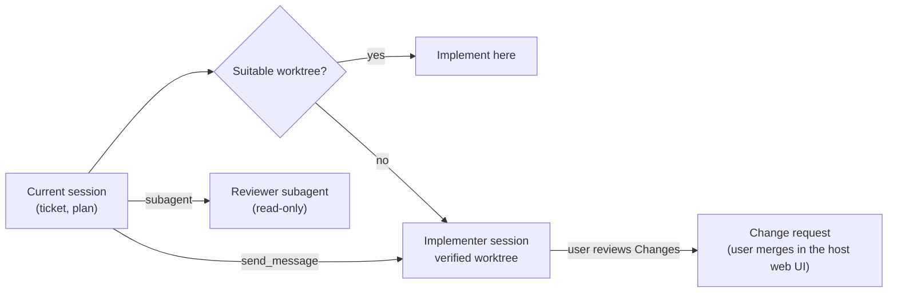

# 🤖 Agent sessions in the VS Code Agents window

The Agents window is the orchestrator. A task can continue in its current isolated session.
You see all sessions in the sessions list and in the session grid.
This skill decides when to use which tool. It does not repeat the VS Code documentation.

## 🧭 Choose the tool

| Need | Use | Visible as |
|---|---|---|
| Implement an approved plan in a suitable current worktree | continue here after the checks below | the current session |
| Implement without a suitable current worktree, or delegate an independent task | `create_session` after the checks below | a new session |
| Quick review, research, or a check | a subagent (`task` tool) | nothing; the result comes back here |
| Give more work or a correction to a running session | `send_message` | a message in that session |
| Status of my sessions | `list_sessions`, then `get_session_context` | nothing; the result comes back here |

## 🛠️ Implementer session

1. Check the gate first. For a ticket, validate fresh Designed? revision evidence before starting implementation. For a new `workflow: full-v1` ticket, verify mandatory Diagnosed? and the Designed? manifest: its raw-byte SHA-256, every covered document, byte-identical `plan.draft.md` and `plan.md`, and `approvedCopies: [{ "from": "plan.draft.md", "to": "plan.md" }]`. Existing tickets retain their original gates and skips; do not infer `full-v1` from missing `track`. Verify legacy single-document hashes against raw document bytes. Unverifiable approval blocks implementation, not read-only resume.
2. Select the execution worktree with the checks below. Continue here when it is suitable. Do not start another implementer merely because the ticket reached Implement.
3. Only when another session is needed, call `create_session`:
   - `title`: `<KEY> - ▶️ - <session goal>` (for example `APP-123 - ▶️ - Implement outbox retry on timeout`). The session keeps it current. See "Session title" in the `ticket` skill.
   - `workspace`: the verified worktree path when one already exists; otherwise the checkout from `repo.checkouts` or the task repository.
   - `worktree`: `false` for an existing verified worktree; `true` only when a new worktree is needed. The tool has no base-branch parameter. Never assume that `true` selects the ticket branch or a required commit. For a pinned baseline, use the manual step below.
   - `relationship`: omit it for work on the current ticket. Use `independent` only for an unrelated task.
4. Write a self-contained `prompt`:
   - the goal, and the paths to the approved `plan.md` and to `map.md` (the code map of the area)
   - the ticket's explicit workflow marker or original legacy process, README, and approval manifest/record paths; revalidate the exact approved revisions before editing, and stop if stale or unverifiable
   - the branch name from `repo.branchPattern` (see "Worktrees" in the `ticket` skill)
   - the selected worktree, repository identity, branch, resolved baseline SHA, and whether the task requires an exact HEAD or resumes existing implementation. Verify these before edits, builds, or fixtures. Continue in that worktree; do not delegate again merely to obtain isolation.
   - the scope, and what is out of scope
   - the stop condition: "Stop after the tests pass and report. Do not push or create a change request."
   - the report: changed files and the tests run, in a form that the lead session can copy into `map.md` and `review.md`
   - the rules: ask before CI triggers and tracker writes; never merge; plus the rules of the `## Implement` section of `<config>/policy.md`
   - the main always-on rules, in short form. A session that `create_session` starts loads **no** plugin rules, skills, or MCP servers. The prompt is its only guide. Include the response style with the "No AI tells" list of the `style` rule, the paths `<wiki>` and the ticket folder as resolved absolute paths, and the safety rules above.
5. Give the user the session link only when a new session was created.
6. Record the session title, worktree path, branch, baseline SHA, and selection reason in the ticket `README.md` and `log.md`. Keep approval records outside hashed documents.

### Select the execution worktree

Read the ticket `README.md`, approved plan, and current request. Inspect Git in the actual session folder, not only the main checkout:

- Run `git rev-parse --show-toplevel`, `git rev-parse --git-common-dir`, `git worktree list --porcelain`, `git branch --show-current`, `git rev-parse HEAD`, and `git status --short`.
- Verify the repository against the configured checkout. Identify a linked worktree from Git, not its folder name or branch prefix.
- Select the baseline in this order: an explicit required commit; the recorded ticket branch for existing work; the checkout `baseBranch` (else `repo.baseBranch`) only for a new task without a ticket branch. Resolve the selected ref to a full commit SHA. If it is missing, ambiguous, or conflicts with ticket evidence, stop and ask. Do not silently use the default branch.

| Situation | Action |
|---|---|
| Current linked worktree belongs to this task and meets its baseline rule | Reuse the current session. A different generated branch name alone does not require another worktree. |
| Another recorded worktree belongs to this task and meets its baseline rule | Resume its existing session, or start a session there with `workspace` set to that path and `worktree: false`. |
| No suitable worktree exists | Create one from the selected baseline, then verify its actual HEAD before any edits, builds, or fixtures. |
| Repository, task ownership, or local changes are uncertain | Report the evidence and ask before switching, moving, or replacing work. |

Baseline rules:

- For an exact-commit proof, require `HEAD == required commit`. Being ahead by 15 commits is still a mismatch. Do not weaken this check to ancestry.
- For resumed implementation, preserve known task commits and local edits. Verify the recorded baseline is an ancestor with `git merge-base --is-ancestor <baseline> HEAD`, and inspect the intervening commits and diff. Ancestry alone does not prove that the changes belong to this task.
- Never reset, force-switch, stash, delete, or change the approved baseline to make these checks pass. A mismatch blocks execution, not read-only diagnosis. Do not edit approved documents or their manifests to repair it.

Manual step for a pinned baseline:

1. In the Agents window, select **New Worktree** and choose the ticket branch as the base only after its tip matches the required SHA.
2. If no branch names that SHA, ask for approval to create a dedicated branch there. Never move an existing branch.
3. Give the user a self-contained prompt with the absolute ticket path and required SHA. Require the Git checks above before execution.
4. After verification, continue in that session. Do not request another worktree at Implement.

See the current [Agents window documentation](https://code.visualstudio.com/docs/agents/run/agents-window#_choose-where-an-agent-makes-changes) for base selection.

Limits:

- A VS Code worktree shares local resources (for example a database) with the main checkout. The `## Implement` section of `<config>/policy.md` names the limits.
- Worktree sessions run with **Allow all**. The instructions are the only guard for CI and tracker writes.
- Tool-started sessions have no plugin skills. When the implementer needs a skill, tell the user to start the session from **New** in the Agents window instead, and give them the prompt to paste.
- Run at most `policy.maxImplementers` implementer sessions at the same time (default 6).

## 🔎 Reviewer subagent

Use a subagent for a quick review. It stays inside the current session.

1. Give it the diff source: a worktree path, a branch, or a change request number.
2. Give it the plan or acceptance criteria to check against.
3. Ask for findings only: bugs, risks, missing tests. No style comments. No edits.
4. Verify each finding before you report it to the user.

For a full code review before Shippable?, the user can also use the **Run Code Review** button in the Changes panel.

## 🥊 Adversarial review

Required before every change request, including a draft. It is a second, hostile read of the change. It tries to break it.

1. Run it after the tests pass and before you write the final `review.md`. Do not run it on a half-done change.
2. Start a `rubber-duck` subagent with `task` (when that agent type is missing, use `code-review` or `general-purpose` with a review-only prompt). Use the model in `policy.adversarialReviewModel` unless the user names another model. When it is not set, pick a model family different from your own. A model different from the author finds different bugs.
3. Give it a complete prompt (the subagent has no memory of this session):
   - the repository path, and how to see the change (`git status`, `git diff`, untracked files)
   - the goal and the acceptance criteria
   - what was changed and why, and the decisions the user already made
   - where the evidence is (ticket folder: `context.md`, `map.md`, `evidence/`, `plan.md`)
   - specific attack questions: missed places, wrong assumptions, SDK or API behavior, tests that pass without the fix, flaky or order-dependent tests, side effects beyond the goal (EOL, BOM, accidental edits), CI and build risks
4. Tell it: read-only, no edits, no commits, no style comments, rank findings by severity with file, line, and evidence.
5. Run it in the background. Do not poll. Continue with independent work, or wait for the notification.
6. Verify each finding yourself. Reject a finding with evidence, or fix it and add a test where it applies.
7. Record the result in `review.md` (a row in the checklist: model, findings, what you fixed or rejected) and in `log.md`.
8. If the review changes the code, run the affected tests again. If it changes the approved scope or plan, reopen Designed?.

Never create a change request until step 7 is done.

## 🔁 Hand-off

- Plan → implement: obtain one approval over the exact displayed revision set, including the identical draft/approved plan pair for new manifests. Then reuse a suitable current worktree or start the implementer as described above. Native plan-mode approval alone does not approve the ticket gate.
- More work for a running session: `send_message` with `delivery: queue`. Use `steer` only to correct the active turn.
- Each message states the goal, the scope, and the stop condition.
- `send_message` does not wait for a reply. Do not poll. Tell the user that the message is sent, then stop.

## 📊 Status

Only when the user asks:

1. `list_sessions` (filter with `status: ["inputNeeded"]` to find blocked sessions).
2. `get_session_context` with `detail: summary` for the sessions that matter.
3. Report one line per session: title, status, last result, and what it needs from the user.

## 🚫 Rules

- Never answer a session's question, trust prompt, or permission prompt for the user. Report it.
- Never merge a change request. The user merges in the web UI of the repository host.
- A policy section can allow a host-side agent to fix blockers. It never allows a merge.
- Delete or archive only sessions that the user asks you to remove. `delete_session` cannot be undone.
- Verify a session's claims (tests, builds) before you build on them.
