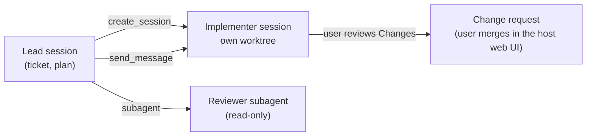

# 🤖 Agent sessions in the VS Code Agents window

The Agents window is the orchestrator. Each task runs in its own session.
You see all sessions in the sessions list and in the session grid.
This skill decides when to use which tool. It does not repeat the VS Code documentation.

## 🧭 Choose the tool

| Need | Use | Visible as |
|---|---|---|
| Implement an approved plan, a long or parallel task | `create_session` with a worktree | a new session |
| Quick review, research, or a check | a subagent (`task` tool) | nothing; the result comes back here |
| Give more work or a correction to a running session | `send_message` | a message in that session |
| Status of my sessions | `list_sessions`, then `get_session_context` | — |

## 🛠️ Implementer session

1. Check the gate first. For a ticket, Designed? must be approved against the current `plan.md` hash.
2. Call `create_session`:
   - `title`: `<KEY> - ▶️ - <session goal>` (for example `APP-123 - ▶️ - Implement outbox retry on timeout`). The session keeps it current. See "Session title" in the `ticket` skill.
   - `workspace`: the path of the checkout from `repo.checkouts` (read the config with `forge.mjs config --json`, see the `forge` rule), or the repository of the task.
   - `worktree`: `true`. Each implementer gets its own worktree.
   - `relationship`: omit it for work on the current ticket. Use `independent` only for an unrelated task.
3. Write a self-contained `prompt`:
   - the goal, and the paths to the approved `plan.md` and to `map.md` (the code map of the area)
   - the branch name from `repo.branchPattern` (see "Worktrees" in the `ticket` skill)
   - the scope, and what is out of scope
   - the stop condition: "Stop after the tests pass and report. Do not push or create a change request."
   - the report: changed files and the tests run, in a form that the lead session can copy into `map.md` and `review.md`
   - the rules: ask before CI triggers and tracker writes; never merge; plus the rules of the `## Implement` section of `<config>/policy.md`
   - the key always-on rules, in short form. A session that `create_session` starts loads **no** plugin rules, skills, or MCP servers. The prompt is its only guide. Include the response style, the paths `<wiki>` and the ticket folder as resolved absolute paths, and the safety rules above.
4. Give the user the session link from the result.
5. Record the session title and worktree path in the ticket `README.md` and `log.md`.

Limits:

- A VS Code worktree shares local resources (for example a database) with the main checkout. The `## Implement` section of `<config>/policy.md` names the limits.
- Worktree sessions run with **Allow all**. The instructions are the only guard for CI and tracker writes.
- Tool-started sessions have no plugin skills. When the implementer needs a skill, tell the user to start the session from **New** in the Agents window instead, and give them the prompt to paste.
- Run at most `policy.maxImplementers` implementer sessions at the same time (default 6).

## 🔎 Reviewer subagent

Use a subagent for a quick review. It stays inside the current session.

1. Give it the diff source: a worktree path, a branch, or a change request number.
2. Give it the plan or acceptance criteria to check against.
3. Ask for findings only: bugs, risks, missing tests. No style comments. No edits.
4. Verify each finding before you report it to the user.

For a full code review before Shippable?, the user can also use the **Run Code Review** button in the Changes panel.

## 🥊 Adversarial review

Required before every change request, including a draft. It is a second, hostile read of the change. It tries to break it.

1. Run it after the tests pass and before you write the final `review.md`. Do not run it on a half-done change.
2. Start a `rubber-duck` subagent with `task` (when that agent type is missing, use `code-review` or `general-purpose` with a review-only prompt). Use the model in `policy.adversarialReviewModel` unless the user names another model. When it is not set, pick a model family different from your own. A model different from the author finds different bugs.
3. Give it a complete prompt (the subagent has no memory of this session):
   - the repository path, and how to see the change (`git status`, `git diff`, untracked files)
   - the goal and the acceptance criteria
   - what was changed and why, and the decisions the user already made
   - where the evidence is (ticket folder: `context.md`, `map.md`, `evidence/`, `plan.md`)
   - specific attack questions: missed places, wrong assumptions, SDK or API behavior, tests that pass without the fix, flaky or order-dependent tests, side effects beyond the goal (EOL, BOM, accidental edits), CI and build risks
4. Tell it: read-only, no edits, no commits, no style comments, rank findings by severity with file, line, and evidence.
5. Run it in the background. Do not poll. Continue with independent work, or wait for the notification.
6. Verify each finding yourself. Reject a finding with evidence, or fix it and add a test where it applies.
7. Record the result in `review.md` (a row in the checklist: model, findings, what you fixed or rejected) and in `log.md`.
8. If the review changes the code, run the affected tests again. If it changes the approved scope or plan, reopen Designed?.

Never create a change request until step 7 is done.

## 🔁 Hand-off

- Plan → implement: the lead session writes and gets approval for `plan.md`, then starts the implementer (above).
- More work for a running session: `send_message` with `delivery: queue`. Use `steer` only to correct the active turn.
- Each message states the goal, the scope, and the stop condition.
- `send_message` does not wait for a reply. Do not poll. Tell the user that the message is sent, then stop.

## 📊 Status

Only when the user asks:

1. `list_sessions` (filter with `status: ["inputNeeded"]` to find blocked sessions).
2. `get_session_context` with `detail: summary` for the sessions that matter.
3. Report one line per session: title, status, last result, and what it needs from the user.

## 🚫 Rules

- Never answer a session's question, trust prompt, or permission prompt for the user. Report it.
- Never merge a change request. The user merges in the web UI of the repository host.
- A policy section can allow a host-side agent to fix blockers. It never allows a merge.
- Delete or archive only sessions that the user asks you to remove. `delete_session` cannot be undone.
- Verify a session's claims (tests, builds) before you build on them.
