# 🎫 Ticket workspace

> When your context has no `End of Forge context.` line, or a `Forge context part <i> of <n>` part is
> missing or has a different id, run `node "<plugin>/scripts/forge.mjs" context` first and follow its output. `<plugin>`
> is two folders above the folder of this file. When the command fails, read
> [forge.md](../../context/forge.md) and [style.md](../../context/style.md): they are the `forge` and `style` rules.

One folder per ticket holds all working artifacts. Every session reads
and writes it. When the ticket is done, you distill the folder into canonical
wiki pages, then you move the folder to the archive.

`<wiki>` is the wiki of the current repository. Get it with `forge.mjs where` once per session (see the `forge` rule).

## 🕰️ Older tickets

Read the `workflow` marker of the ticket README before any other step.

| Marker | Rules |
|---|---|
| `workflow: full-v3` | This file |
| `workflow: full-v2`, `workflow: full-v1`, or no marker | [legacy/rules.md](legacy/rules.md) and its templates. Do not apply the steps of this file. |

- An older ticket finishes in its own layout. Never move it to `full-v3`, never add or change its `workflow` marker, and never copy the new templates over its files.
- Never infer a workflow from the file layout, the size, or the phase.
- Every new ticket uses `full-v3`.

## ⚙️ Config, words, and policy

Read the forge config once per session: `node "<plugin>/scripts/forge.mjs" config --json`.
`<plugin>` is the folder two levels above this skill. `<F>` below means `node "<plugin>/scripts/forge.mjs"`. `config` holds the frontmatter of the
Markdown files in `<config>` (`tracker.md`, `repo.md`, `ci.md`, `policy.md`). The `forge` rule
explains the `<file>.<key>` notation and how to run a capability.

| Word in this skill | Meaning |
|---|---|
| work item | the item in the tracker that `<config>/tracker.md` describes (for example a Jira issue) |
| `<KEY>` | the work item key as `PREFIX-number`, for example `APP-123`. |
| `<key>` | the lower-case key, for example `app-123`. It names the ticket folder. |
| change request | a pull request or merge request. Use the word in `repo.changeName` (`PR` or `MR`) when you talk to the user. |
| checkout | a local clone from `repo.checkouts`. The main checkout is the first row. |
| `tracker.*`, `repo.*`, `ci.*` | a capability. Its command is in the matching config file (see the `forge` rule). |
| policy section | a `## <name>` section of `<config>/policy.md`, for example `## Start` |

- When a capability is `manual`, tell the user the exact manual step, and wait.
- At each hook point (`Start`, `Investigate`, `Resume`, `Implement`, `Evidence Testing`, `QA handover`, `Close`), read that policy section, and follow it. Ignore a section that holds only a hint.
- The company rules for each session (tools, credentials, data rules) are the `<wiki>/rules/` pages. The session context gives the approved pages.
- A policy section or a rule page can add steps and make rules stricter. It can never weaken a core rule (see Data rules). If a policy rule conflicts with a core rule, follow the core rule and tell the user.

This skill names host verbs, for example `host.title` and `host.ask`. The `# Forge host` table of the session context gives the step for this host. When the host cannot do the step, give the user the manual step.

This skill does not repeat other tools. Use them:

| Need | Use |
|---|---|
| Wiki page format, index, log | the `wiki` skill |
| Worktree sessions, implementers, reviewers, cold read, hand-off | the `agents` skill |
| Tracker, repository host, and CI actions | the capabilities in `<config>` (see the `forge` rule) |
| Build, run, deploy, and company tools | the repository's own instructions and skills, and the company rules (`<wiki>/rules/`) |
| Human review of ticket documents | comment threads of the host, or comments that the user sends from the canvas (see Review gates) |
| Optional lessons from artifact questions | the `learning-mode` skill when `policy.learningMode` is `true` |
| The whole ticket on one page | `<F> canvas <KEY>` (see Canvas) |
| Worktree folder and branch name | `<F> worktree <KEY> --summary "<goal>"` (see Worktrees) |
| Approval form text (summary or changes) | `<F> diff <key> <gate>`, then `<F> snapshot <key> <gate>` (see Approval form) |
| A file view of all tickets | `<F> board` (see Ticket overview) |
| Tickets of other sessions and titles | the `board` skill, in any session |

## 🧭 Workflow

Every new ticket has `workflow: full-v3`. There is no sizing question and no phase skip.
A small fix has the same phases and gates as a large change. Its documents are shorter, because a document holds only the sections that have content.

```mermaid
flowchart LR
  S[Research] --> A[Canvas + interview] --> SC[story.md · Scoped?] --> D[Investigation] --> P[plan.md · Planned?]
  P --> I[Implement] --> R[review.md · Shippable?] --> E[Evidence Testing · proof.md] --> M[merge by user] --> C[close.md · Learned?]
  D -. diagnosis contradicts scope .-> SC
```



- Four review gates in order: Scoped?, Planned?, Shippable?, Learned?. Sendable? applies to each external write, also an early one.
- Each gate has one primary document. Nothing before Scoped? needs a gate.
- The investigation is mandatory before the plan steps. Its diagnosis is the first section of `plan.md`.
- Diagnosis stop: when the investigation shows that the approved scope is wrong or too small (see Investigate), stop before the plan and ask.
- Evidence Testing is a required step, not a gate. It blocks the merge proposal.
- QA handover runs only when `policy.qaHandover` is `true`. It uses Sendable?, not a new gate.

Two goals for every ticket:

1. Deliver the change with the full evidence-linked process, also for a small fix.
2. At Close, the user knows the affected areas, how the feature lives in the code, and what it is used for. `map.md` and the canvas carry this.

## 🗂️ Folder layout

The folder name is `<key>`, for example `app-123`. A file starts to exist when its phase starts.

```text
<wiki>/raw/tickets/<key>/
  README.md     frontmatter (state, phase, gates, people, change requests) and the Now card
  story.md      Scoped?: problem, scope, done-when, answers, history, open questions
  plan.md       Planned?: diagnosis, steps, tests, checks, risks, decisions
  review.md     Shippable?: changes, tests run, review findings
  proof.md      Evidence Testing: one check for each changed behavior, with its result
  journal.md    append-only dated entries: log, decision, problem, check, step
  map.md        code map: components with their layer, flow, data, tests, terms
  close.md      Learned?: what you now know, and the wiki changes
  canvas.html   generated view of all files above (never edit, never hash)
  evidence/     sanitized tool outputs, the work item snapshot, spike results
  outbox/       drafts of external writes, and one approval sidecar for each sent write
  approvals/    revision manifests, history.md, and snapshots/ of each review
```

Each fact has one home. Another document gives a link, not a copy. Read [templates/_style.md](templates/_style.md) before you write a ticket document.

## 🔒 Data rules

- `raw/` and `archive/` can hold names of customer environments (for example tenant or instance names).
- `raw/` and `archive/` can hold aggregated metrics: counts, durations, row totals, plan shapes.
- Never store customer row data, document content, personal data, secrets, tokens, or connection strings.
- Canonical pages (outside `raw/` and `archive/`) stay free of customer environment names.
- Ask before every tracker write: create, edit, transition, comment, or log work.
- Ask before every CI trigger, rebuild, or stop (`ci.trigger`). Show the job and its parameters first.
- Never merge a change request. No provider has `repo.merge`. The user merges in the web UI of the repository host. Reviewer approvals and green checks do not change this.
- Close a change request only after explicit user approval in the current conversation.
- Never offer a merge on a weekday in `policy.noMergeWeekdays` (local time). Propose the next allowed day.
- When the user must edit a file by hand (for example a connection string or a secret), open every such file yourself with `host.open`, and list the exact edits in chat. Never write the secret yourself.
- The company rules (`<wiki>/rules/`, in the session context) add rules to this list.

These core rules always win over a policy section or a rule page: no merge, ask before every external write, explicit gate approval, no secrets, and the adversarial review before every change request.

## 🚦 Review gates

| Gate | Primary doc | Opens before |
|---|---|---|
| Scoped? | `story.md` | investigation work on the agreed scope |
| Planned? | `plan.md` | implementation |
| Sendable? | the exact `outbox/` draft | each tracker, document, or change request text write |
| Shippable? | `review.md` | push or change request creation |
| Learned? | `close.md` | canonical wiki writes and the archive move |

Each gate name is the question that the user answers by approval. The user approves with `approve <name>`, with or without the `?` and in any case (`approve planned`).
Open colleague questions do not block a gate.

### 🐟 Cold read

The user reads a gate document without your session history. So test it with a reader that has none.

Before you open Scoped?, Planned?, Shippable?, or Learned?, run one cold read of the primary document (the `agents` skill, "Cold read"):

1. The reader gets only the path of the document. It gives a paraphrase, each term or reference that it cannot resolve, and each claim without an evidence link.
2. For `plan.md`, it also says if it can implement the plan from `plan.md` and `map.md` alone, and it lists each missing fact.
3. Compare the paraphrase with what you mean. A wrong paraphrase shows an unclear summary. Correct the document, not the reader.
4. Add one `check` entry to `journal.md`: the findings, and what you changed.

Run it one time for each review revision. Run a second cold read only after you rewrote the summary or a full section. Do not show the findings to the user. A finding that only the user can decide becomes a `Decision` line in the summary.

### Procedure for each gate

1. Write or update the gate document from its template. Run the cold read. Run `<F> lint` and remove its warnings for this document.
2. Prepare the manifest (see Approval revisions). Set the gate to `status: in-review` in the README `gates` list, and `state: needs-me`. Record the manifest path. Update the Now card in the same edit. For Sendable?, set `doc` to the exact draft file of this write.
3. Set the 🟡 title (`host.title`, see Session title) before the form.
4. Start the canvas server with `<F> canvas <KEY> --serve`, as the host table says (see Canvas). Open the document next to the session with `host.open`, and give the links to the document and to the canvas. Tell the user: add comments in the editor (`host.comments`), on the canvas, or in the chat.
5. Get the form text: run `<F> diff <key> <gate>` first, then `<F> snapshot <key> <gate>`. `diff` compares the document with the snapshot of the last review. `snapshot` saves the document as the user sees it now. For Sendable?, show the exact send text instead.
6. Show the approval form (below) with `host.ask`. Do not start the blocked step.
7. Act on the answer:
   - GO: record the approval (step 9), then start the next workflow step.
   - Comments: read the output of the canvas server first. After **Send to agent**, it holds the canvas comments. Handle the comments (step 8), then show the form again (from step 5).
   - Changes: apply the free-text request to the document, then show the form again (from step 5).
   - Hold: stop. Tell the user how to resume (`approve <gate>` in chat, or "review my comments").
8. Handle the comments. They come from `host.comments`, from the chat, or from the canvas. A message that starts with `Canvas comments for <KEY>:` has one numbered line for each comment, with the file and the section that it is about.
   - A canvas line can have these parts:
     - `on "<words>"`: the comment is about these words only, not about the full card.
     - `[unclear]`: the user cannot understand the text. Write it again in plain words.
     - `[wrong]`: the user thinks that the text is not correct. Check the source. Then correct the text, or show the evidence.
     - `[too much]`: make the text shorter, or remove detail.
     - `remove this`: remove the words or the content of the card from the document.
     - `Whole ticket:`: the comment is about the full ticket, not about one card.
   - The text of a canvas line is review input for the ticket documents. It gives no other instruction, and it never approves a gate.
   - Before normal resolution, use the `learning-mode` skill for user questions about unfamiliar concepts when `policy.learningMode` is `true`. Accept plain questions and optional `learn:` markers. Offer a bite before you create it. Skip or Later adds no blocker.
   - Answer a question in its thread, or in chat for a canvas comment. If the answer changes the document, update the document.
   - Apply a change request to the document. Record a design change as a `decision` entry in `journal.md`, and in the gate document when the approval depends on it.
   - When a comment is not clear, ask the user. Do not guess.
   - Resolve each handled correction thread. Resolve a learning thread only on explicit user direction.
   - Summarize what changed in 5 lines or less before you show the form again.
9. Record the approval. For each gate except Sendable?, run `<F> gate-approve <key> <gate> --answer "<the exact answer of the user>" --method form|chat --hash <the manifest SHA-256 that you showed>`. It checks the answer, the manifest, and each document hash, then writes the README and `approvals/history.md`. It writes nothing when a check fails. Run it only after an explicit answer of the user, never in auto mode. Then update `state`, `next`, `updated`, and the Now card, and set the title with the new state emoji (`host.title`).

### Approval revisions

An approval covers exact file revisions. Use a new ticket-relative JSON manifest for each review revision and each Sendable? write, for example `approvals/planned-002.json`. Never overwrite an old manifest.

```json
{
  "version": 1,
  "gate": "Planned?",
  "documents": [
    { "path": "plan.md", "sha256": "<64 lowercase hex characters>" },
    { "path": "evidence/2026-11-17-query-count.md", "sha256": "<64 lowercase hex characters>" }
  ]
}
```

- List the primary document, and each evidence file that the user must see in this exact revision. A folder or a link alone does not identify a revision.
- Hash raw bytes with SHA-256. Do not use `git hash-object`, normalized text, or a short digest.
- Keep paths inside the ticket folder. Never list `README.md`, a manifest, `approvals/history.md`, `journal.md`, or `canvas.html`.
- One explicit user approval covers the whole displayed set. Do not ask for per-file approvals.
- A change to a covered file makes the gate stale. `plan.md` has no second copy: after approval, do not edit it. To change the plan, edit `plan.md`, set Planned? to `in-review`, and stop the implementation until the new GO. `approvals/snapshots/` keeps the revision of each review.
- Before any blocked action and on Resume, validate the approvals with `<F> lint`. A missing file, malformed metadata, a conflicting state, or a stale hash is a finding: show its file and its remedy. Block only the affected action. Read-only work stays possible.

### Per-write Sendable? records

Each external write has its own frozen draft, manifest, and approval record.

- The Sendable? manifest lists the exact draft, plus the exact `command` and `target` strings, so its hash binds the operation and the text:

  ```json
  "command": "<exact command>",
  "target": "<exact target>"
  ```

- After explicit GO, create `outbox/<name>.approval.json` from [templates/outbox.approval.json](templates/outbox.approval.json): `version: 1`, `doc`, `status: approved`, `approval_manifest`, `approval_hash`, `approval_date`, and the same `target` and `command`.
- Before the write, check the sidecar against the manifest. A changed command, target, or draft needs a new manifest and a new approval.
- After the write, change only the sidecar: `status: sent`, and `result` with the returned id or URL. Never write a status, a date, or a link into an approved draft.
- A second write needs a new approval and a new record, also for the same text. A missing sidecar is not evidence that a write occurred.
- The README Sendable? `doc` names the exact draft of the current write, never the sidecar.

### ✅ Approval form

Show it with `host.ask` at each gate. Use one field, `decision`, with these options. Put the gate question first in the message, for example "Planned? Is the plan for APP-123 correct?".

| Value | Title |
|---|---|
| `approve` | 🟢 GO: approve and start the next step |
| `comments` | 💬 Comments: I added comments in the editor or on the canvas |
| `changes` | ✏️ Changes: I typed them in the free-text answer |
| `later` | ⏸️ Hold: not now |

The message body is short. Put in it, in this order:

1. The gate question, and the links to the primary document and to the canvas.
2. The output of `<F> diff <key> <gate>` (Procedure step 5):
   - First review: the summary of the document. Nothing more from the document.
   - Later review: only the changed sections and lines. Do not repeat the summary. When nothing changed, say so in one line.
3. One line with the manifest link and its SHA-256 (a 12-character display prefix is fine; the stored hash is full length). When the set has more than one file, add one line for each file. State that GO approves this exact set.

- Set no default. The user must pick an option.
- If unhandled comments exist on the document, say so in the message.
- If the user declines or cancels the form, treat it as `later` (Hold).

Rules:

- Approval comes only from the user: an `approve` answer in the approval form, or `approve <gate>` in chat in the current conversation.
- Comments, resolved threads, canvas comments, and "looks good" notes do not approve a gate.
- Lessons and self-checks do not approve a gate or prove understanding.
- Never answer the approval form for the user, and never approve in auto mode. No session approves a gate for another session.
- A required gate blocks its step. A change to an approved document reopens its gate.
- Native plan approval of the host does not replace a ticket gate.

## 🚀 Start

1. Set the title (`host.title`) first, before any other tool call or question: `<KEY> - ▶️ - <summary>`. When the prompt has only the key, use `<KEY> - ▶️ - Start ticket`, and rename again after step 2 (see Session title).
2. Fetch the work item with `tracker.fetch`, with its comments. Normalize the key to `<KEY>`. Choose `short`: 3 to 6 words from the work item summary.
3. Read the `## Start` policy section.
4. Create the folder. If it exists, run Resume instead.
5. Save the work item snapshot as `evidence/<yyyy-mm-dd>-work-item.md`: summary, type, status, priority, reporter, assignee, description, comments, the item URL, and the snapshot date.
6. Write `README.md` from [templates/README.md](templates/README.md): `workflow: full-v3`, `phase: start`, `state: active`, `short`, `next`, `item`, and all gates. Fill the Now card from the frontmatter.
7. Place the session (see Worktrees). Preserve an existing session worktree. Run `<F> worktree <KEY> --summary "<short>"` and follow its `action`. Record `branch` and `worktree` (the absolute path) in the README.
8. Seed `map.md` from [templates/map.md](templates/map.md): the purpose, the terms, and a first guess of the components. Mark each guess `(unverified)`.
9. Start `journal.md` from [templates/journal.md](templates/journal.md) with one `log` entry.
10. Add the ticket to the "Tickets → Active" list in `<wiki>/index.md`. Mark its raw folder as local-only. Append a `create` entry to `<wiki>/log.md`.
11. Do the research (next section). Then run `<F> canvas <KEY>`, give the link, do the interview, and write the scope. Open Scoped?.
12. After Scoped?, investigate, then write the plan steps, and open Planned? before implementation. Do not skip a phase for a small fix, and do not run a blocked phase in auto mode.

### 🧭 Research

The user possibly does not know the problem, its history, or the people around it. Give the user that context first.
Do this automatically. It is read-only, so it needs no approval. Research depth follows the evidence, not a word count or a duration.

1. Read the wiki: `<wiki>/index.md`, matching canonical pages, and related archived tickets.
2. Read the sources that the work item links: documents, postmortems, linked items, sibling and follow-up items (`tracker.search` on the same reporter, labels, and dates).
3. Trace the history in the code (read-only): `git log --all --grep <keys>` in each checkout, and related change requests (`repo.history`). Review threads show who reviewed and what they said. The `## Investigate` policy section can name older sources.
4. Survey the code in the checkouts of `repo.checkouts`: affected areas, existing patterns, related docs, skills, and instructions. Identify existing tests, missing coverage, behavior to preserve, and regression risks.
5. If the work item names a customer environment or a production symptom, take a small read-only sample with the tools that the `## Investigate` policy section allows. Ask first before any tool that needs approval.
6. If a source is not available (VPN off, tool not authenticated, capability `manual`), write it in **Sources not available** of the story, and continue. Absence of evidence is not proof of safety.
7. Write `story.md` from [templates/story.md](templates/story.md), without the summary and the Scope section for now: Problem, History, Related work, Facts, Preserve, and Open questions. Put tool outputs in `evidence/`. Add what you learned about the code to `map.md`.
8. List the colleagues who know the area: reporter, authors and reviewers of related change requests, owners of sibling items and related documents. Add each one to the README `people` list with `status: to-contact`, with why and what to ask (see People).
9. Write draft messages to them in `outbox/colleague-questions.md`. The user sends them. Never contact people yourself. Set each drafted person to `status: drafted` with `draft: outbox/colleague-questions.md`.
10. Present the context in plain words, in at most 10 lines, with the link to the canvas. Answer questions.

#### 💬 Colleague questions do not block

- Keep each colleague question as a line in **Open questions** of `story.md`: question, person, status (`draft`, `asked`, `answered`, `no reply`), and the impact if the answer differs.
- The user can approve Scoped? with open colleague questions.
- When an open question blocks the plan, the plan states an assumption and a fallback for it (**Assumptions**).
- When an answer arrives, record it as a `log` entry in `journal.md`, and update the line status. Name the documents that the answer changes. Update only those documents, and reopen only their gates.
- Keep the README `people` entry of the same person in step with the line status (see People).

### 👥 People

The README `people` list holds every person you work with on the ticket, in every phase.
It is the source for the people on the canvas, the board, and the daily recap.

- Add people when they appear: reporter and experts at Start, the PO or domain owner at the interview, reviewers at the change request, QA at the QA handover.
- Write a name or tracker handle only. Never store email addresses, phone numbers, or other personal data.
- Keep one entry per person. Put all open asks for that person in one `ask` line.
- Set `since` to today on each status change. The board and the recap show waits from this date.
- The README is outside approval manifests. A people change never reopens a gate.

| Status | Meaning | Who acts |
|---|---|---|
| `to-contact` | The user must send a message; no draft yet | user |
| `drafted` | An `outbox/` draft is ready; the user must review and send it | user |
| `waiting` | The message is sent; waiting for the answer | them |
| `follow-up` | No answer in time; the user must send a reminder | user |
| `reply-in` | The answer arrived; the user or agent must record and act on it | user |
| `done` | Nothing open with this person | nobody |

Map the status of an **Open questions** line to the person status:

| Question status | Person status |
|---|---|
| `draft` | `to-contact`, or `drafted` when an outbox draft exists |
| `asked` | `waiting` |
| `no reply` | `follow-up` |
| `answered` | `reply-in` until the answer is recorded, then `done` when no other ask is open |

- When the user confirms a sent message (or a Sendable? write to a person is `sent`), set `waiting`.
- Suggest `follow-up` when a person is `waiting` for more than 3 working days. Change the status only after the user agrees.
- When a person blocks the next step, set `waiting_on: "colleague: <name> (<what>)"`.
- Ask the user before you add a person that no ticket source names.

### 🧪 Spikes

A spike is a short read-only check that answers one fact before a scope question or a plan decision.

- Run a spike when a question depends on a fact that a tool can check. Do not ask the user a question that a tool can answer.
- Time box: 15 minutes. If the spike needs more, stop, write what you found, and add the rest to the investigation.
- Allowed: code search, `git log`, change request threads, tracker reads, CI reads, and the read-only tools that the `## Investigate` policy section allows (check their credentials first).
- Not allowed: code edits, builds that change the main checkout, CI triggers, external writes.
- Save the result as `evidence/<yyyy-mm-dd>-spike-<topic>.md`. Link it from the question. Add new code facts to `map.md`. Add one `log` entry to `journal.md`.

### 🖼️ Canvas

The canvas is one HTML page that shows the whole ticket on one board: the gate rail, the story and the people, the code map with the changed components, the plan as a path, and the review with its proof. The user reads and moves on it. The Markdown files stay the source.

- Make it with `<F> canvas <KEY>`. It writes `<wiki>/raw/tickets/<key>/canvas.html` from the ticket files and prints the path. `<F> canvas <KEY> --json` prints the same content as data.
- Run it again after each change of a ticket document that the user will read: after the research, when a gate opens, after you handle comments, and at Resume. Run it when the user asks to "show the canvas" or "show the code map".
- Give the user the `file://` link of `canvas.html`. The host table says how the user opens a local HTML page.
- For a review, run `<F> canvas <KEY> --serve`. It shows the same page on `http://127.0.0.1` (this machine only) and prints the link. This page has the button **Send to agent**. When the user selects it, the command prints the comment message and stops.
  - Use it when a gate opens, and when the user wants to comment on the canvas. Start it as the host table says, give the user the link, and do not wait for the command in the turn.
  - Each run has a new link. After you handle the comments, run it again and give the new link.
  - When the gate has its approval, stop a canvas server that still runs. It also stops after 8 hours.
  - The page from the `file://` link has no **Send to agent**. There, the user selects **Copy all** and pastes the message into the session.
- The page is a view. Never edit it, never list it in a manifest, and never take a fact or an approval from it.
- The canvas reads the section names and the line shapes of the templates. Keep them, or a card stays empty.
- On the canvas, the user can comment on a card or on selected words, mark text with **Remove**, give a label (`unclear`, `wrong`, `too much`), and write one comment on the whole ticket. The comments come as one message. That message starts with `Canvas comments for <KEY>:`. Handle it as review comments (gate Procedure, step 8).
- The code map on the canvas comes from `map.md`: one lane for each **Layer** of the **Components** table, one arrow for each **Flow** line, and a mark for each **Change** value. Keep `map.md` to the slice of the code that this ticket needs: 6 to 20 components.

### 🎤 Interview

Start after the research, when the user has the canvas link. Ground each question in the story or its evidence.

1. Before you ask, run a spike for each question that depends on a checkable fact.
2. Ask up to 5 questions in one `host.ask` form, grouped by topic. For each question, give why it matters, the options, and the recommended answer as the field default with its reason in the field description. Never answer for the user or accept recommendations in auto mode.
3. Run a second round only for answers that raise new questions.
4. Record each answer in **Answers** of `story.md`, with the question, the answer, and why it matters. Add one `decision` entry to `journal.md` for an answer that changes the scope.

### 🎯 Scope

`story.md` is the primary document of Scoped?.

1. Complete `story.md`: the summary, **Scope** (In and Out), and **Done when**, each acceptance check with its proof. Put the scope choice that changes the plan most first in the summary.
2. Open Scoped? (see the gate Procedure). The manifest lists `story.md`, and each evidence file that the user must see.
3. After GO, set `phase: investigate` and start Investigate.

### 🌳 Worktrees

Each ticket has one worktree folder and one branch. Forge names both:

- Branch: `repo.branchPattern`, with `{KEY}`, `{key}`, `{number}`, and `{slug}` (2 to 5 lower-case words of the goal, joined by `-`).
- Folder: `<repo>.worktrees/<key>-<slug>`, next to the main checkout.

Run `<F> worktree <KEY> --summary "<short>"` at Start and before the first commit. It is read-only and prints JSON: `branch`, `folder`, `base` (ref and full SHA), `current` (this session folder), `existing` (a worktree that already has the branch or the folder), `related` (other worktrees of the key), `action`, and `commands`. Follow the `action`:

| `action` | When | Do |
|---|---|---|
| `reuse` | This session folder is a linked worktree on the ticket branch | Continue here. |
| `rename-current` | A **New Worktree** session: a linked worktree on an `agents/...` branch, and the ticket branch does not exist | Run the printed `git branch -m <branch>` before the first commit. The folder name stays; the host owns it. |
| `resume` | Another worktree already has the ticket branch or folder | Tell the user the path. In a Folder session, confirm the folder, then move the session to it (`host.move`). |
| `create` | No ticket worktree exists | In a Folder session on the main checkout: run the command again with `--create`. Ask one `host.ask` question that confirms `folder`. Then move the session to `folder` (`host.move`). |

- Preserve an existing session worktree. When `current` is a linked worktree in `related` (a ticket worktree with an older name), continue there; do not create another one. Do not rename an existing suitable branch merely to match the pattern.
- `host.move` uses the Forge worktree as it is. Never let the host make a second worktree for the ticket.
- At Implement, use the `agents` skill to verify the current repository, worktree, branch, HEAD, and local changes. Reuse a suitable current worktree. Do not create another session only because the phase changed.
- Select an explicit required commit first, then the recorded ticket branch for existing work. Use the checkout `baseBranch` (else `repo.baseBranch`) only for a new task without a ticket branch. Resolve the baseline to a full SHA before execution. Never silently replace a pinned baseline with the default branch.
- An exact-commit proof requires HEAD equality, not just ancestry. For resumed implementation, inspect and preserve known task changes above the recorded baseline. Follow the selection checks and manual step in the `agents` skill when the current worktree is unsuitable.
- Record `branch` and `worktree` (the absolute folder path only) in `README.md`. Record the session name, the resolved baseline SHA, and the selection reason as a `log` entry in `journal.md`. Do not alter hashed approval documents.
- Read the `## Implement` policy section. It names limits of worktrees, for example a shared local database.
- Close removes a worktree that Forge created only after the user says yes (see Close).

### 🏷️ Session title (info bar)

The user asked for these titles. The ticket skill owns the title of a ticket session. This rule overrides the general tool advice not to rename a fresh chat.

```text
<KEY> - <state emoji> - <short>
```

| State emoji | When |
|---|---|
| 🟡 | a gate or a question waits for the user |
| 🟢 | the last gate is approved, and no gate is open |
| ▶️ | no gate is open and nothing blocks; the work continues |
| ⏳ | the work waits for an outside event, for example a change request review or a build |
| 🔴 | a failure stops the work, for example CI or an expired credential |
| ✅ | the ticket is closed |

- `<short>` is the README `short`: a phrase in sentence case that says what the ticket tries to achieve, for example `Fix outbox retry on timeout`. Do not repeat the key, the phase, or the gate name. Keep it stable.
- Use only these emoji in the title. Do not end the title with `?`: some hosts remove a final `?`. Keep the title under 60 characters.
- Set the title (`host.title`) first, before any other tool call or question, when the session starts or resumes a ticket. Follow the extra steps of the host row.
- Set it again at each change of the state emoji or the goal. Before a `host.ask` question that waits for the user, set 🟡 first.
- The `board` skill and the maintenance automation can fix a stale title of a ticket session.

### 📌 Artifacts panel

The artifacts panel of the host (`host.artifact`) shows what this session works on.

- At Start and Resume, record the ticket `README.md` as an artifact with the label `<KEY> · Now`.
- When a gate opens, record its primary document with the label `<KEY> · <gate> · <file>`, for example `APP-123 · Planned? · plan.md`. Remove the document of a gate that is approved.
- Record a change request that the session creates or changes as an artifact. Record the work item URL as a reference.
- Do not record evidence files, snapshots, or the journal.
- The panel can be off, or the host has no panel. Then the host row gives a Markdown link instead.

### 📋 Ticket overview

When the user asks for "the board", "my tickets", or a ticket status, use the `board` skill. `<F> board --json` reads the README frontmatter of each ticket folder and groups the tickets by `state`. `<F> board` writes the same view to `<wiki>/raw/board.md`. The README frontmatter stays the source.

- Start `waiting_on` with `you:`, `colleague:`, or `outside:`.
- When a gate is `in-review` or `waiting_on` starts with `you:`, set `state: needs-me`.

### 🏷️ Frontmatter

The ticket README starts with YAML frontmatter (`type: ticket`), see [templates/README.md](templates/README.md). Check it against this table after each README change.

| Key | Values |
|---|---|
| `key`, `title` | `APP-123`, the work item summary (required) |
| `short` | 3 to 6 words for the session title and the board, for example `Doc import error telemetry` |
| `workflow` | `full-v3` |
| `phase` | `start`, `investigate`, `plan`, `implement`, `review`, `closed` (required) |
| `state` | `needs-me` 🟡, `go` 🟢, `active` ▶️, `waiting` ⏳, `blocked` 🔴, `done` ✅ (required; same as the session title emoji) |
| `next`, `waiting_on` | one line each |
| `item`, `branch`, `worktree`, `updated` | work item URL, branch name, the absolute worktree folder path only, `yyyy-mm-dd`. The sessionStart hook compares `worktree` with the session folder. |
| `changes` | change requests: list of `{url, label, state}`; `state`: `draft`, `open`, `merged`, `closed`, `abandoned`. |
| `people` | list of `{name, status, role, since, ask, via, draft, note}`; `name` and `status` required; `since` is `yyyy-mm-dd`; `draft` is `outbox/<name>.md`. See People. |
| `gates` | list of `{name, doc, need, status, date, hash, manifest, note}`; `status`: `todo`, `in-review`, `approved`, `skipped`, `blocked`. An approved gate needs the approval `date`, the `manifest` path, and the `hash` of the raw manifest bytes. |

- The README body starts with the **Now** card: State, Phase, Open gate, Next, Waiting on, Done so far, and Updated. Update it with each frontmatter change. `<F> lint` warns when State, Phase, or Next does not match the frontmatter. The hook shows the card when a session opens.
- Every other document has `type`, `ticket`, and `updated`. A gate document also has `gate`. The gate status lives only in the README `gates` list.
- `outbox/` drafts have authoring `status` and optional `target` (`tracker-comment`, `tracker-item`, `change`, `email`, `chat`, `other`). `evidence/` files have `date`.
- Quote a value that contains `: `, or the YAML does not parse.

## 🔁 Resume

1. Set the title (`host.title`) first, before any other tool call or question (see Session title). Use the README `state` and `short`.
2. Read `README.md`. When its `workflow` is not `full-v3`, stop here and follow [legacy/rules.md](legacy/rules.md). Missing frontmatter or contradictory metadata needs an explicit finding and user-directed repair, not template replacement or inferred state.
3. Read the last entries of `journal.md`.
4. Read the `## Resume` policy section, for example credential checks.
5. Validate the approvals with `<F> lint --wiki "<wiki>" --json`. Default lint is read-only. Never run `--fix` implicitly.
6. Run `<F> canvas <KEY>`. Show the Now card first, with the link to the canvas. Then tell the user the last result, the policy checks, the approval findings, the people who need a message or a reply (`to-contact`, `drafted`, `follow-up`, `reply-in`), and the people you wait for. A finding blocks only the affected action.
7. Show the approval form for each gate that is `in-review`.
8. Before implementation or a proof run, apply the Worktrees checks. A resumed session does not need another worktree when the current one is suitable. Preserve valid approval evidence when you report a baseline mismatch.

## 🔎 Investigate

- Start only after Scoped? is fresh. Investigate every ticket, also a small fix.
- Start `plan.md` from [templates/plan.md](templates/plan.md) with only the **Diagnosis** section: one line for each suspected cause, with the status `open`, `supported`, or `rejected`.
- Save each tool result that supports a finding as `evidence/<yyyy-mm-dd>-<topic>.md`, with the tool and its parameters, the time window, and a sanitized excerpt. Link each hypothesis to its evidence file.
- Add each verified code fact to `map.md`: the components with their layer, the flow, the data, the toggles, the jobs, and the tests. Remove `(unverified)` when you verify a guess.
- Read-only tools that the `## Investigate` policy section allows do not need approval. CI reads (`ci.status`, `ci.logs`) do not need approval.
- Write each environment, build, and test problem with its fix as a `problem` entry in `journal.md`. Append one `log` entry per work session.
- Update `phase`, `state`, `next`, `updated`, and the Now card in `README.md`.

### 🛑 Diagnosis stop

When the cause or the facts do not fit the approved scope, stop before the plan steps. Set 🟡 in the title, then ask with one `host.ask` question. The message has at most 150 words: what you found (max 3 lines), why it changes the scope, and the evidence link. Options:

| Value | Title |
|---|---|
| `rescope` | 🎯 Change the scope: reopen Scoped? |
| `keep` | ➡️ Keep the scope: plan within it and note the gap |
| `later` | ⏸️ Hold: not now |

- `rescope`: add a `decision` entry to `journal.md`, update `story.md`, and run Scoped? again. The Scoped? approval is no longer fresh.
- `keep`: write the gap and its risk in **Risks** of the plan, and continue.
- Never choose for the user.

## 📝 Plan

1. Verify that Scoped? is fresh.
2. Make the plan with the user. Complete `plan.md`: the summary, then **Steps** (each with `Files:`, `Why:`, and `Test:`), **Tests**, **Checks** (one deployed check for each changed behavior, with its baseline and control, or the reason why none is possible), **Risks**, **Decisions** (choice, reason, rejected options), and **Assumptions** for open colleague questions. Leave out a section that has no content.
3. In **Components** of `map.md`, set **Change** to `planned` for each component that a step changes.
4. Set `phase: plan` in the README. Set `next` to the Planned? review.
5. Open Planned? (see the gate Procedure). The manifest lists `plan.md`, and each evidence file that the user must see.
6. After GO, do not edit `plan.md`. A change to the plan reopens Planned? and stops the implementation until the new GO.

Implementer sessions and later sessions read the approved `plan.md` and `map.md` from the ticket folder.

### Review other files

Any Markdown file in the ticket folder can get a review the same way: open it with `host.open`, link it, the user adds comments, and you handle them with `host.comments`. Only gate documents need an approval record.

Open every document that the user must read with `host.open`. Examples: gate documents, `outbox/` drafts, and files that the user must edit by hand.

## 🛠️ Implement

- Read the `## Implement` policy section first.
- Use the `agents` skill to select the execution worktree (see Worktrees). Continue in a suitable current worktree; start another session only when needed. Do not edit code in the main checkout.
- Validate Planned? and its manifest before implementation. Unverifiable evidence blocks implementation, not read-only research.
- Follow the repository's own instructions and skills for the code change.
- After each plan step, add a `step <n> done` entry to `journal.md` with the commit or the files and the test result. Set **Change** to `done` in `map.md` for the components of that step.
- For a quick code review before Shippable?, use a reviewer subagent (the `agents` skill).
- Before Shippable?, and so before any push or change request (draft too), run the adversarial review subagent (the `agents` skill, "Adversarial review"). Handle its findings. Record them in **Findings** of `review.md`.
- Find the end-to-end and regression tests that cover the changed code (search the test projects for the changed classes, jobs, and features). Add them to **Tests** of `map.md`.
- Write `review.md` from [templates/review.md](templates/review.md): the summary, **Changes** (area, files, why, user impact), **Before and after** when the behavior changes, **Tests run**, **Findings**, and **Not checked**. If no regression test covers the change, write that in **Not checked**. Then open Shippable?.
- Draft every external text (tracker comment, change request title and description, shared document) in `outbox/<target>.draft.md` from [templates/outbox.draft.md](templates/outbox.draft.md). Run a full pass of the `writing` skill (outbound mode) on the text between the `send` markers. Send only that text. Run Sendable? before the write.
- Open the change request with `repo.open-change` after Shippable? and Sendable?. Add it to the README `changes` list.
- When end-to-end or regression tests exist, run the relevant ones (and the whole suite when the risk is wide) on a deployed branch before you mark the change request ready. The `## Implement` policy section can make this stricter. Ask the user before each deploy or CI trigger (`ci.trigger`). Show the job and its parameters first.
- Record test results, change request links, and CI results (`ci.status`) as `log` entries in `journal.md`. Record build and test problems as `problem` entries.
- Set the phase to `implement` and then to `review` in `README.md`.
- After Shippable? and the change request, run the Evidence Testing step (next section). Do not report a change request as ready to merge before that step is done.

## 🔬 Evidence Testing

Evidence Testing is a separate step between review and merge. It proves that the changed behavior works, with concrete evidence. Regression runs alone are not enough, because they only show that old behavior still works.

Read the `## Evidence Testing` policy section before you start. It names the deploy procedure, the observation tools, and the known traps of the company environments.

Rules:

1. Run it on every ticket that changes behavior, before any merge proposal. Never propose or accept a merge without it.
2. Start it after Shippable? and the change request. When a deployed branch is needed, the code must be pushed first.
3. Set the README `next` key to "Evidence Testing" while it is open. Keep the phase `review`.
4. Write `proof.md` from [templates/proof.md](templates/proof.md). Copy each check from **Checks** of the approved `plan.md`, with the status `open`. Update the file as you go. `proof.md` is outside the approval manifests, so its updates reopen no gate.
5. Test the changed functionality itself. When `policy.evidenceOnDeployedEnv` is `true`, do it in a deployed environment whenever a deployment is possible. Use a local run only when no deployment is possible, and write the reason in `Environment:`. Unit tests, mutation checks, and regression runs alone are not evidence. Each check has the action, the expected result, the observed result, and the evidence: query output, log or telemetry line, screenshot, API response, or job link.
   - Check the baseline first. Ask: does this check also pass without the fix? If yes, the environment cannot show the change. Example: a test environment that never samples telemetry passes "events are not sampled" with or without the fix. Change the environment, or pick another observation.
   - Check that the observed items are not exempt by other means. Example: some event types can set their own sampling rate, so they look correct with or without the fix. Search the code for the emitter before you trust an observation.
   - A deployed run can finish with no proof (no traffic, wrong event type, telemetry not flowing). Then mark the check `⚪ not proven` with the reason. Never write a pass from rows that the baseline also produces.
   - Add a control in the same environment: an observation that must differ when the environment is set up right. A check without a working control is `⚪ not proven`, never `🟢 verified`.
   - Test environments can expire. Plan the traffic for right after the deploy, or extend the lifetime.
   - A deploy can use a throwaway branch with test-only config. Never open a change request from it. Delete it after the run.
6. Put each check output in `evidence/<yyyy-mm-dd>-<topic>.md`. Link it from the check. Store only aggregated or masked data (see Data rules).
7. Cover the unhappy path where the ticket has one (error, threshold, empty input, feature toggle off).
8. Ask the user if an automated test would bring evidence. Do this when you start the checks, with `host.ask`:
   - Search the test projects for a fitting project and for helpers that you can reuse.
   - Propose the test: what it does, what it asserts, which CI job runs it, and the cost.
   - Say what it cannot prove (for example telemetry that the test cannot read). Then name the other check that closes the gap.
   - A manual check that needs database or admin access that the agent lacks is a strong reason to propose a test. CI environments often have that access.
   - Options: "Add an automated test", "Manual evidence only", "Not now". Record the answer in **Automated test** of `proof.md`.
   - A new test is a code change. It needs a new commit, a new review, and Shippable? again before the push.
9. Add the regression evidence to **Regression**: unit tests, regression and suite runs (job, run number, result, link), and old failures with their first failing run.
10. Mark a check `🟢 verified`, `🔴 failed`, or `⚪ not proven: <why>`. Do not leave `open` as a final state. A check that is not possible needs the explicit acceptance of the user in **Accepted gaps**.
11. Ask the user before each deploy, CI trigger, or database write. Show the job or the exact steps first. Never write to a database without approval. Do not escalate access (for example secret store or firewall changes) on your own.
12. A failed check goes to `journal.md` as a `problem` entry, and back to Implement.
13. The step is done when every check is `🟢 verified` (or an accepted `⚪`). Add a `step <n> verified` entry to `journal.md` for each step that a check proves. Then add a short "Evidence" section to the change request description draft in `outbox/`, run Sendable?, update the description with `repo.update-change`, and tell the user that the change request can be merged. Never suggest a merge on a day in `policy.noMergeWeekdays`.
14. When the change request has all approvals (`repo.change-status`) and Evidence Testing is done, report it and stop. The user merges in the web UI of the repository host. Record the merge as a `log` entry when the user reports it.
15. After the merge, run the QA handover (next section) when `policy.qaHandover` is `true`. Else go to Close when the user says that the ticket is done.

## 🧑‍🔬 QA handover

Run it only when `policy.qaHandover` is `true`. Run it after the user reports the merge, or when the user says that the ticket goes to QA. Do it before Close. It tells QA what we tested, and how QA can test the change.

Read the `## QA handover` policy section first. It can set the comment format, the QA status, and the QA tools.

1. Write `outbox/qa-handover.draft.md` from [templates/qa-handover.md](templates/qa-handover.md). The tracker comment is the text between the `send` markers. Draft it from `proof.md`, `plan.md`, `review.md`, and `map.md`. Do not invent results. Link the evidence files only in "Why this wording", because QA cannot open the wiki.
2. The comment has these parts, in this order, in plain words for a tester: what changed (with the toggle), how we self-tested, the self-QA on a deployed environment (one row for each check of `proof.md`, and the accepted gaps), how to test it (preconditions, numbered steps with exact inputs, the expected result, one control case, clean-up, shortcuts), and the regression areas and known limits.
3. Write for QA: no code paths unless QA needs them, no customer environment or customer names, no secrets, no credentials, and no links that only developers can open. Use the same words as the work item.
4. Run Sendable? for the draft. After GO, send the comment with `tracker.comment`.
5. Do not transition the work item yourself. Ask the user whether to move it to QA, and show the target status first. After a yes, use `tracker.transition`. Send the comment before the transition, so that QA finds it.
6. Record the comment id or link and the time as a `log` entry in `journal.md`, and in the per-write Sendable? record. Set that record to `sent`, without changing the approved draft bytes.
7. If QA finds a problem later, add a `problem` entry to `journal.md` and, when it changes the test guidance, send a short follow-up comment (same Sendable? rule).

## ✅ Close

Run only when the user says that the ticket is done.

1. Read all files in the ticket folder.
2. List the durable knowledge: how the code works (from `map.md`), root causes, gotchas, tool tips, and decisions.
3. Write `close.md` from [templates/close.md](templates/close.md): the summary, **What you now know** (max 5 items), **Wiki changes** (each canonical page to create or update, with its key lines), and **Ticket summary** for `tickets/<key>.md`. Open Learned?. Continue only after Learned? is approved.
4. Write or update canonical pages with the `wiki` skill Record procedure:
   - the area folder of the code (see the folder layout in the `wiki` skill) for code and architecture knowledge. Use `map.md` as the main source: purpose, components, flow, data, tests.
   - `tooling/` for tool and environment knowledge
   - `decisions/` for decisions that apply after the ticket
   Remove customer environment names from these pages.
   Read the `## Close` policy section. It can name more folders and knowledge owners.
5. Create `<wiki>/tickets/<key>.md` from the ticket summary (below). Link canonical pages and shared work item and change request sources. Label the archive link local-only; the summary must remain useful without ignored raw material.
6. Move the ticket from "Active" to "Done" in `<wiki>/index.md`. Add lines for the new canonical pages.
7. Set `phase: closed` and `state: done` in `README.md`, and update the Now card. Rename the session title to ✅.
8. Move the folder:
   ```sh
   node -e "const fs=require('fs'),[,a,b]=process.argv;fs.mkdirSync(require('path').dirname(b),{recursive:true});fs.renameSync(a,b)" "<wiki>/raw/tickets/<key>" "<wiki>/archive/tickets/<key>"
   ```
9. Append a `close` entry to `<wiki>/log.md` that lists each changed page. Commit the canonical pages in the wiki repository.
10. Clean up the ticket worktree. Ask the user first, with one `host.ask` confirmation. Without a "yes", leave it.
    - Run `git status --short` and check for outgoing commits in the worktree. Uncommitted or unpushed work blocks the cleanup. Report it.
    - Run the repository cleanup that the `## Close` policy section names (for example a database per worktree).
    - A worktree that `<F> worktree --create` made (its folder is in `<repo>.worktrees/`): after the "yes", run `git worktree remove "<folder>"` from the main checkout. Keep the branch. Never use `--force`.
    - A worktree that VS Code made (a **New Worktree** session): tell the user to use **Mark as Done** on the session in the Agents window, not **Delete**. Delete leaves the worktree on disk ([vscode#332442](https://github.com/microsoft/vscode/issues/332442)). Mark as Done keeps the branch, but it does not always remove the worktree (for example after `git branch -m`). After Mark as Done, run `git worktree list`. When the folder is still there, run `git worktree remove "<folder>"` from the main checkout, or tell the user to run **Chat: Open Worktree Cleanup**. A worktree that another tool created needs that tool's remove command.
    - A session that runs in the worktree locks the folder. Report the path that is left.
11. Tell the user what you recorded, in one line per page.

## 🧩 Templates

Copy each document from the `templates/` folder next to this skill. Read [templates/_style.md](templates/_style.md) first.

| File in the ticket folder | Template |
|---|---|
| `README.md` | [templates/README.md](templates/README.md) |
| `story.md` | [templates/story.md](templates/story.md) |
| `plan.md` | [templates/plan.md](templates/plan.md) |
| `review.md` | [templates/review.md](templates/review.md) |
| `proof.md` | [templates/proof.md](templates/proof.md) |
| `journal.md` | [templates/journal.md](templates/journal.md) |
| `map.md` | [templates/map.md](templates/map.md) |
| `close.md` | [templates/close.md](templates/close.md) |
| `outbox/<target>.draft.md` | [templates/outbox.draft.md](templates/outbox.draft.md) |
| `outbox/<target>.approval.json` (after GO only) | [templates/outbox.approval.json](templates/outbox.approval.json) |
| `outbox/qa-handover.draft.md` | [templates/qa-handover.md](templates/qa-handover.md) |

- A template shows every possible section. Write only the sections that have content, in the order of the template.
- Keep the section names and the line shapes of the template.

`<wiki>/tickets/<key>.md`:

```markdown
---
title: <KEY>: <summary>
updated: <YYYY-MM-DD>
status: verified
sources:
  - <work item URL>
  - <change request URL>
---
# <KEY>: <summary>

<Problem in one paragraph.>

- Root cause: <text>
- Fix: <text>
- Knowledge: <links to canonical pages>
- Local-only working archive: <archive/tickets/<key>/; may be unavailable on another machine>
```
