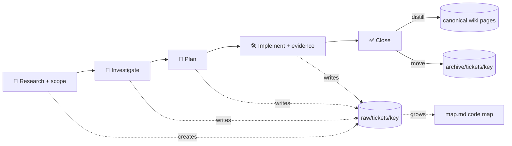
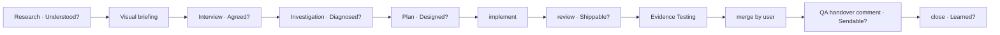
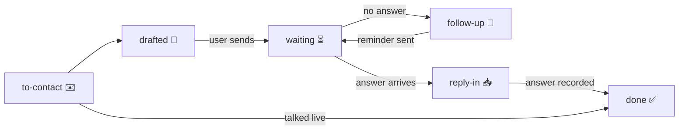

# 🎫 Ticket workspace

One folder per ticket holds all working artifacts. Every session reads
and writes it. When the ticket is done, you distill the folder into canonical
wiki pages, then you move the folder to the archive.

`<wiki>` is the wiki of the current repository. Get it with `forge.mjs where` once per session (see the `forge` rule).

## ⚙️ Config, words, and policy

Read the team config once per session: `node "<plugin>/scripts/forge.mjs" config --json`.
`<plugin>` is the folder two levels above this skill. `config` holds the frontmatter of the
Markdown files in `<config>` (`tracker.md`, `repo.md`, `ci.md`, `policy.md`). The `forge` rule
explains the `<file>.<key>` notation and how to run a capability.

| Word in this skill | Meaning |
|---|---|
| work item | the item in the tracker that `<config>/tracker.md` describes (for example a Jira, GitLab, or GitHub issue, or a local Markdown item) |
| `<KEY>` | the work item key as `PREFIX-number`, for example `APP-123`. GitLab and GitHub numbers get `tracker.prefix`. |
| `<key>` | the lower-case key, for example `app-123`. It names the ticket folder. |
| change request | a pull request or merge request. Use the word in `repo.changeName` (`PR` or `MR`) when you talk to the user. |
| checkout | a local clone from `repo.checkouts`. The main checkout is the first row. |
| `tracker.*`, `repo.*`, `ci.*` | a capability. Its command is in the matching config file (see the `forge` rule). |
| policy section | a `## <name>` section of `<config>/policy.md`, for example `## Start` |

- When a capability is `manual`, tell the user the exact manual step, and wait.
- At each hook point (`Toolkit`, `Data rules`, `Start`, `Investigate`, `Resume`, `Implement`, `Evidence Testing`, `QA handover`, `Close`), read that policy section, and follow it. Ignore a section that holds only a hint.
- A policy section can add steps and make rules stricter. It can never weaken a core rule (see Data rules). If a policy rule conflicts with a core rule, follow the core rule and tell the user.


Two goals for every ticket:

1. Deliver the change with the full evidence-linked process, even for a small fix (see Workflow).
2. At Close, the user knows the affected areas, how the feature lives in the code, and what it is used for. `map.md` and the Close debrief carry this.

This skill does not repeat other tools. Use them:

| Need | Use |
|---|---|
| Wiki page format, index, log | the `wiki` skill |
| Worktree sessions, implementers, reviewers, hand-off | the `agents` skill |
| Tracker, repository host, and CI actions | the capabilities in `<config>` (see the `forge` rule) |
| Build, run, deploy, and company tools | the repository's own instructions and skills, and the `## Toolkit` policy section |
| Company guidance | the sources that the policy sections name |
| Session plan inside Copilot | plan mode (`plan.md` in session state) |
| Human review of ticket documents | VS Code comment threads (see Review gates) |
| Optional lessons from artifact questions | the `learning-mode` skill when `policy.learningMode` is `true` |
| Visual briefing | `briefing.md` with Mermaid diagrams, in the Markdown preview (see Visual briefing) |
| Frontmatter check | compare each file with the tables in Frontmatter |

## 🗂️ Folder layout

The folder name is `<key>`, for example `app-123`.

```text
<wiki>/raw/tickets/<key>/
  README.md          frontmatter: workflow, phase, state, next, waiting_on, branch, change requests, people, gates; body: toolkit, files
  ticket.md          work item snapshot
  context.md         pre-investigation brief: problem, history, related work, open questions, people to ask
  map.md             living code map: purpose, flow, files, data, tests, changes (grows in every phase)
  briefing.md        visual briefing: timeline, concept graph, people (Mermaid)
  interview.md       scope questions and user answers
  investigation.md   hypotheses table and findings
  evidence/          sanitized tool outputs, one file per item
  plan.md            approved implementation plan
  plan.draft.md      proposed plan awaiting explicit approval
  outbox/            drafts of external writes (tracker comments, change request text), awaiting approval
  outbox/<name>.approval.json  per-write approval and delivery sidecar; never hashed by its manifest
  review.md          code review summary before push or change request (diff, tests, risks)
  test-plan.md       manual, deploy, and regression test plan and results
  evidence-testing.md  Evidence Testing step: one check per changed behavior, with concrete evidence (required before merge)
  outbox/qa-handover.draft.md  tracker comment for QA after the merge: self-testing, self-QA, and how to test (see QA handover)
  close.draft.md     proposed wiki changes before close
  troubleshooting.md problems and fixes (environment, build, tests)
  decisions.md       decisions and reasons
  log.md             append-only dated work log
  approvals/         revision manifests, outside the documents they hash
  repair-log.jsonl   append-only log of explicit lint repairs, when any
```

## 🔒 Data rules

- `raw/` and `archive/` can hold names of customer environments (for example tenant or instance names).
- `raw/` and `archive/` can hold aggregated metrics: counts, durations, row totals, plan shapes.
- Never store customer row data, document content, personal data, secrets, tokens, or connection strings.
- Canonical pages (outside `raw/` and `archive/`) stay free of customer environment names.
- Ask before every tracker write: create, edit, transition, comment, or log work.
- Ask before every CI trigger, rebuild, or stop (`ci.trigger`). Show the job and its parameters first.
- Never merge a change request. No provider has `repo.merge`. The user merges in the web UI of the repository host. Reviewer approvals and green checks do not change this.
- Close a change request only after explicit user approval in the current conversation.
- Never offer a merge on a weekday in `policy.noMergeWeekdays` (local time). Propose the next allowed day.
- When the user must edit a file by hand (for example a connection string or a secret), open every such file in VS Code yourself with `code <path> [<path>...]`, and list the exact edits in chat. Never write the secret yourself.
- Read the `## Data rules` policy section. It adds rules to this list.

These core rules always win over a policy section: no merge, ask before every external write, explicit gate approval, no secrets, and the adversarial review before every change request.

`ask_user` below means the question form of the harness. When it is not available, ask in chat and wait for the answer.

## 🧭 Workflow

Every **new** ticket has `workflow: full-v1`, no `track` field, no sizing question,
and no size-based phase skips. Research depth follows the evidence, not a word count or duration.



- Diagnosed? is mandatory before planning. Briefed? does not exist in `full-v1`.
- Sendable? applies to **each external write**, including early colleague or tracker writes.
- Evidence Testing is a required step, not a gate, and blocks the merge proposal.
- QA handover runs only when `policy.qaHandover` is `true`; it uses Sendable?, not a new gate.

### Legacy boundary

Only the explicit `workflow: full-v1` marker selects the new process. Existing tickets
without that marker, including trackless tickets, retain their original phases, gates,
and skips. Never infer a workflow from missing `track`, file layout, size, or current phase.
Do not add `full-v1` on Resume or require new gates merely because this skill changed.

| Legacy metadata | Original process retained |
|---|---|
| `track: S` | brief → plan → implement → Evidence Testing → conditional QA → close; Understood?, Agreed?, Diagnosed? skipped; no Briefed?, interview, or required visual briefing |
| `track: M` | brief + interview → Briefed? → plan → implement → Evidence Testing → conditional QA → close; Briefed? approves `context.md` and `interview.md` together, replacing separate Understood?/Agreed?; Diagnosed? skipped |
| `track: L` | context → Understood? → briefing → interview → Agreed? → investigation → recommended Diagnosed? → plan → implement → Evidence Testing → conditional QA → close; no Briefed? |
| no track or workflow | preserve the original recorded process and skips; the historical full-flow default had recommended Diagnosed?, not mandatory |

Designed?, Shippable?, per-write Sendable?, and Learned? remain required in the original
process. Recommended legacy Diagnosed? can be declined with a logged reason.
Do not recalibrate, escalate, or downgrade existing tickets automatically.
Missing or contradictory legacy metadata is a finding requiring user direction before
the affected action, not permission to assign a workflow, rewrite history, or reopen
gates solely to meet `full-v1`.

## 🚦 Review gates

The user reviews ticket artifacts with VS Code comment threads at these gates:

| Gate | Step | Document | Need | Opens before |
|---|---|---|---|---|
| Understood? | Research | `context.md` + explicitly listed `evidence/` | required | visual briefing and scope interview |
| Agreed? | Scope | `interview.md` + `briefing.md` | required | investigation work on the agreed scope |
| Diagnosed? | Investigation | `investigation.md` + explicitly listed `evidence/` | required | the plan draft |
| Designed? | Plan | `plan.draft.md`, byte-identical `plan.md`, `decisions.md`, `test-plan.md` | required | implementation |
| Sendable? | External write | `outbox/` drafts | required | each tracker, document, or change request text write |
| Shippable? | Code | `review.md` | required | push or change request creation |
| Learned? | Close | `close.draft.md` | required | canonical wiki writes and the archive move |

Open colleague questions do not block a gate. See Pre-investigation.
The table is the `full-v1` contract. Apply the Legacy boundary to existing tickets.

Each gate name is the question that the user answers by approval. The user approves with `approve <name>`, with or without the `?` and in any case (`approve designed`).

### 🧾 Gate document shape

Every gate document uses the plain ticket style. Read [templates/_style.md](templates/_style.md) and copy the template for the document (see Templates).

- The short version comes first: key fact, TL;DR quote, glance table, diagram.
- Long details go under a bold `**📂 <label>**` line. Do not drop information to make a document shorter.
- Do not use HTML (`<details>`) or GitHub alerts (`[!NOTE]`). The Agents window preview does not render them.
- Link each fact to its evidence file or to code (`[File.cs](<checkout>/path/File.cs:42)` with the absolute checkout path, which opens in VS Code).
- End with **❓ Decisions needed** (max 5 items). Write "None — GO only" when it is empty.
- Explain each term that the user may not know, in plain words, or link to its row in `map.md`.

Procedure for each gate:

1. Write or update the gate documents. Prepare the exact review set and manifest (see Approval revisions). For Designed?, stage `plan.md` as a byte-identical copy before review; it is not approved until GO.
2. Set the gate to `status: in-review` in the README `gates` list, and `state: needs-me`. Record its manifest path and pending review digest without granting approval. For Sendable?, set `doc` to this write's exact draft file, not just `outbox/`; retain prior writes' approvals in separate manifests and history. Set the state emoji of the session title to 🟡.
3. Open the documents next to the session: run `code -r "<absolute path>"` with the shell tool in `async` mode (the command can block for 30 seconds or more). Open at most 3 at once; link every file in the exact review set. Tell the user: add comments in the editor, or send them with VS Code's comment submit button.
4. Show the approval form (below) with `ask_user`. Do not start the blocked step.
5. Act on the answer:
   - **GO**: record the approval (step 7), then start the next workflow step.
   - **Comments**: handle the comments (step 6), then show the form again.
   - **Changes**: apply the free-text request to the document, then show the form again.
   - **Hold**: stop. Tell the user how to resume (`approve <gate>` in chat, or "review my comments").
6. Handle the comments (`listComments`). Comments sent with VS Code's submit button (`/act-on-feedback`) arrive the same way:
   - Before normal resolution, use the `learning-mode` skill for user questions about unfamiliar concepts when `policy.learningMode` is `true`.
   - Accept plain questions and optional `learn:` markers. Offer a bite before creating it; Skip or Later adds no blocker.
   - Answer a question with `replyToComment`. If the answer changes the artifact, update the artifact.
   - Apply a change request to the artifact. Record design changes in `decisions.md`.
   - When a comment is not clear, ask the user. Do not guess.
   - Resolve each handled correction with `resolveComments`. Resolve a learning thread only on explicit user direction.
   - Summarize what changed in 5 lines or less before you show the form again.
7. Record the approval:
   1. Recheck all displayed document hashes and the manifest bytes. If anything changed, show the revised set and ask again.
   2. Record `status: approved`, `date: <user approval yyyy-mm-dd>`, `manifest: <ticket-relative JSON path>`, and `hash: <full SHA-256 of raw manifest bytes>` in the README gate. Keep `doc` as the primary document link.
   3. Append the gate, manifest path and hash, approved file/revision set, method (`form` or `chat`), and the user's exact answer to an approval record outside the hashed set, for example `approvals/history.md`. Do not append approval text to a hashed `decisions.md`.
   4. Update `state`, `next`, and `updated`, then the session title. Check frontmatter and report conflicts; never infer or repair approval.
   5. For Designed?, verify both plan files are still byte-identical. Implementation can use `plan.md` only after this approval is fresh.

### Approval revisions

New approvals use a ticket-relative JSON manifest, for example `approvals/understood-001.json`.
Use a new manifest for each review revision and each Sendable? write. Never overwrite an
old approval record to grant approval to a new revision. Hash raw bytes with SHA-256,
not `git hash-object`, normalized text, or a truncated digest.

```json
{
  "version": 1,
  "gate": "Understood?",
  "documents": [
    { "path": "context.md", "sha256": "<64 lowercase hex characters>" }
  ]
}
```

List **every** document in the approval set exactly once, with its ticket-relative
path and raw-byte SHA-256. Enumerate linked evidence explicitly; a directory or link
alone does not identify a revision. The manifest must match the displayed exact set.
No README approval metadata, approval record, or manifest may be in its own hashed set.
Keep paths inside the ticket folder. One explicit user approval covers the entire
displayed file + revision set; do not ask for per-file approvals.

Designed? also requires `plan.draft.md` and `plan.md` in `documents`, with identical
hashes and byte-identical contents, plus:

```json
"approvedCopies": [{ "from": "plan.draft.md", "to": "plan.md" }]
```

`approvedCopies` is allowed only for Designed?. On a revised plan, keep the old approved
plan until the new review is ready, stage the new identical pair for review, and block
implementation until GO. Do not copy or edit either plan after approval without reopening
Designed?. Hash the manifest only after its complete bytes are final.

Before any blocked action and on Resume, validate the manifest hash, exact document set,
every document hash, required files, and approved-copy equality. A change to any covered
file makes the gate stale. Missing files, malformed metadata, conflicting state, or an
unverifiable revision is a finding: show its file, location where available, and remedy.
Block only the affected action; unrelated read-only resume and research remain available.

Legacy single-document records with `doc`, `date`, and `hash` remain readable; verify
`hash` as SHA-256 of the raw document bytes. Do not reinterpret Git blob SHA-1 or an
insufficient record as fresh approval. A legacy combined Briefed? record without a
manifest cannot verify both `context.md` and `interview.md`: report it as
freshness-unverifiable and require explicit review of the exact set before its affected
action. Do not silently grandfather, rewrite, or approve it. A changed document must
never pass on the strength of the other document's hash.

### Per-write Sendable? records

Each external write has its own frozen draft, manifest, and approval record, even
when the README Sendable? gate displays only the latest write. Retain the exact
draft path and `approval_manifest`, `approval_hash`, and `approval_date` for that
write. These reference a Sendable? manifest that explicitly includes that draft.
The Sendable? manifest also includes exact `command` and `target` strings, so its
raw-byte hash binds the authorized operation as well as the text. Sidecar
`command` and `target` must match those manifest values exactly.
Keep this metadata and the outcome (`approved` or `sent`, plus exact target,
command, and returned URL/id) in `outbox/<name>.approval.json` **outside** the hashed set, not in the
hashed draft itself. Never put a manifest digest inside a document it hashes.

Create the sidecar only after explicit GO, using
[templates/outbox.approval.json](templates/outbox.approval.json):

```json
{
  "version": 1,
  "doc": "outbox/<name>.draft.md",
  "status": "approved",
  "approval_manifest": "approvals/<name>.json",
  "approval_hash": "<full raw-manifest SHA-256>",
  "approval_date": "<user approval yyyy-mm-dd>",
  "target": "<exact target>",
  "command": "<exact command>"
}
```

The README Sendable? `doc` must name this exact draft, never the approval sidecar.
Its manifest must explicitly cover the same draft and must not include the sidecar.
For example, its additional operation fields are:

```json
"command": "<exact command>",
"target": "<exact target>"
```

Before the write, validate
the sidecar's approval references and the exact command and target the user
authorized against the hashed manifest. A command or target change requires a
new manifest and explicit approval. After the write, change only sidecar `status` to `sent` and add
`result` with the returned id/URL. Keep the approved draft unchanged.

Do not stamp status, dates, links, or approval fields into an approved draft.
Keep its original `status: draft` as authoring metadata; the separate record
is authoritative for approval and delivery. A second write needs a new explicit
approval and record, even when it reuses identical text. A changed draft needs a
new revision and review. A prior write's manifest cannot authorize another write.
Validate sidecars when present; their absence is not evidence that an external
write occurred, and must not be used to invent a send or approval history.
Parse sidecar metadata only from `*.approval.json` within `outbox/`, never from
arbitrary JSON files elsewhere in the ticket.

### ✅ Approval form

Show it with `ask_user` at each gate. Use one field, `decision`, with these options. Put the gate question in the message, for example "Designed? — is the plan for APP-123 correct?".

| Value | Title |
|---|---|
| `approve` | 🟢 GO — approve and start the next step |
| `comments` | 💬 Comments — I added comments in the editor |
| `changes` | ✏️ Changes — I typed them in the free-text answer |
| `later` | ⏸️ Hold — not now |

- Set no default. The user must pick an option.
- List every file link and its SHA-256 revision (a 12-character display prefix is fine), plus the manifest link and digest. The stored hashes are full length. State that GO approves the whole exact set.
- If unhandled comments exist on the document, say so in the message.
- If the user declines or cancels the form, treat it as `later` (Hold).

Rules:

- Approval comes only from the user: an `approve` answer in the approval form, or `approve <gate>` in chat in the current conversation.
- Comments, resolved threads, and "looks good" notes do not approve a ticket gate.
- Lessons and self-checks do not approve a gate or prove understanding. Learning adds no gate; `Learned?` stays unchanged.
- Never answer the approval form for the user, and never approve in auto mode.
- A required gate blocks its step. Only a recommended legacy Diagnosed? can be declined with a logged reason.
- A gate skipped by the original legacy process blocks nothing. Do not open it.
- A change to an approved document reopens its gate.
- On Resume, read the explicit workflow marker and original legacy metadata, validate revision evidence, and report open gates and findings. Show the approval form for each gate that is `in-review`.
- Native plan approval in VS Code does not replace a ticket gate or update the approved ticket plan.

## 🚀 Start

1. Fetch the work item with `tracker.fetch`, with its comments. Normalize the key to `<KEY>`.
2. Read the `## Start` policy section.
3. Create the folder from the templates (see Templates). If it exists, run Resume instead.
4. Write `ticket.md`: summary, type, status, priority, reporter, assignee, description, comments, the item URL, and the snapshot date.
5. Write `README.md` from [templates/README.md](templates/README.md) (🎫 Ticket):
   - In the frontmatter, put `workflow: full-v1`, `phase: start`, `state: active`, `next`, `item` (the work item URL), and all full-workflow gates. Never add `track`.
   - Put the `branch` and the `worktree` when they exist.
   - In the body, put the toolkit table for this ticket.
   - Check the frontmatter against the tables in Frontmatter.
6. Seed `investigation.md` from [templates/investigation.md](templates/investigation.md) with one hypothesis row for each suspected cause in the work item.
7. Seed `map.md` from the template: the purpose, the terms, and a first guess of the areas. Mark guesses `(unverified)`.
8. Add the ticket to the "🎫 Tickets → Active" list in `<wiki>/index.md`. Mark its raw folder as local-only, unavailable to teammates without that local material.
9. Append a `create` entry to `<wiki>/log.md`.
10. Do not create a worktree at Start. The `agents` skill creates a worktree session at Implement.
11. Run the full pre-investigation (next section), including history, affected code, existing tests, and regression risks. Research thoroughly without a required duration or word count. Record unavailable sources and test gaps; absence of evidence is not proof of safety.
12. Open Understood? over the explicit context and evidence revision set.
13. After approval, present the visual briefing and conduct the scope interview; review Agreed?.
14. Investigate the agreed scope and obtain Diagnosed? before drafting the plan. Then review Designed? before implementation. Do not skip phases for small fixes or run a blocked phase in auto mode.

### 🧭 Pre-investigation

The user may not know the problem, its history, or the people around it. Give the user that context first.
Do this automatically. It is read-only, so it needs no approval.

1. Read the wiki: `<wiki>/index.md`, matching canonical pages, and related archived tickets.
2. Read the sources that the work item links: documents, postmortems, linked items, sibling and follow-up items (`tracker.search` on the same reporter, labels, and dates).
3. Trace the history in the code (read-only): `git log --all --grep <keys>` in each checkout, and related change requests (`repo.history`). Review threads show who reviewed and what they said. The `## Investigate` policy section can name older sources.
4. Survey the code in the checkouts of `repo.checkouts`: affected areas, existing patterns, related docs, skills, and instructions. Identify existing tests, missing coverage, unchanged behavior to preserve, and regression risks.
5. If the work item names a customer environment or a production symptom, take a small read-only sample with the tools that the `## Investigate` policy section allows. Ask first before any tool that needs approval.
6. If a source is not available (VPN off, tool not authenticated, capability `manual`), write the gap and continue.
7. Write `context.md` from [templates/context.md](templates/context.md) (🧭 Context). Put tool outputs in `evidence/`. Add what you learned about the code to `map.md`.
8. List the colleagues who know the area: reporter, authors and reviewers of related change requests, owners of sibling items and related documents. For each, write why and what to ask. Add each one to the README `people` list with `status: to-contact` (see People).
9. Write draft messages to them in `outbox/colleague-questions.md`. The user sends them. Never contact people yourself. Set each drafted person to `status: drafted` with `draft: outbox/colleague-questions.md`.
10. Present the context in plain words and open Understood? for `full-v1`. Follow original gates for legacy tickets. Answer questions; do not claim that a lesson or self-check proves understanding.

#### 💬 Colleague questions do not block

- Keep each colleague question as a row in the **❓ Open questions** table of `context.md`: question, person, status (`draft`, `asked`, `answered`, `no reply`), and impact if the answer differs.
- The user can approve Understood? (or legacy Briefed?) with open colleague questions.
- When an open question blocks the plan, the plan states an assumption and a fallback for it.
- When an answer arrives, record it in "💬 Colleague answers" and update the row status. Name the artifacts that the answer changes. Update only those artifacts, and reopen only their gates.
- Keep the README `people` entry of the same person in step with the row status (see People).

### 👥 People

The README `people` list holds every person you work with on the ticket, in every phase.
It is the source for the 👥 People views of the dashboard canvas and for the daily recap.

- Add people when they appear: reporter and experts at Start, the PO or domain owner at the interview, reviewers at the change request, QA at the QA handover.
- Write a name or tracker handle only. Never store email addresses, phone numbers, or other personal data.
- Keep one entry per person. Put all open asks for that person in one `ask` line.
- Set `since` to today on each status change. The canvas and the recap show waits from this date.
- The README is outside approval manifests. A people change never reopens a gate.

| Status | Meaning | Who acts |
|---|---|---|
| `to-contact` ✉️ | The user must send a message; no draft yet | user |
| `drafted` 📝 | An `outbox/` draft is ready; the user must review and send it | user |
| `waiting` ⏳ | The message is sent; waiting for the answer | them |
| `follow-up` 🔔 | No answer in time; the user must send a reminder | user |
| `reply-in` 📥 | The answer arrived; the user or agent must record and act on it | user |
| `done` ✅ | Nothing open with this person | nobody |



Map the **❓ Open questions** status of `context.md` to the person status:

| Question status | Person status |
|---|---|
| `draft` | `to-contact`, or `drafted` when an outbox draft exists |
| `asked` | `waiting` |
| `no reply` | `follow-up` |
| `answered` | `reply-in` until the answer is recorded, then `done` when no other ask is open |

- When the user confirms a sent message (or a Sendable? write to a person is `sent`), set `waiting`.
- Suggest `follow-up` when a person is `waiting` for more than 3 working days. Change the status only after the user agrees.
- When a person blocks the next step, set `waiting_on: "colleague: <name> — <what>"`.
- Ask the user before you add a person that no ticket source names.

`investigation.md` is for the investigation phase: how to achieve the agreed scope.

### 🧪 Spikes

A spike is a short read-only check that answers one fact before a scope question or a plan decision.

- Run a spike when a question depends on a fact that a tool can check. Do not ask the user a question that a tool can answer.
- Time box: 15 minutes. If the spike needs more, stop, write what you found, and add the rest to the investigation.
- Allowed: code search, `git log`, change request threads, tracker reads, CI reads, and the read-only tools that the `## Investigate` policy section allows (check their credentials first).
- Not allowed: code edits, builds that change the main checkout, CI triggers, external writes.
- Save the result as `evidence/<yyyy-mm-dd>-spike-<topic>.md`. Link it from the question. Add new code facts to `map.md`.
- Log each spike in one line in `investigation.md` under "Spikes".

### 🖼️ Visual briefing

For `full-v1`, run it after Understood? is approved and before the interview. Legacy L retains this step; legacy S and M retain their optional briefing offer.
It is read-only and needs no gate. The user gets a broad view of the ticket, its history, and the concepts around it.

1. Write `briefing.md` in the ticket folder from `context.md`, `ticket.md`, and `evidence/`. Use only facts already in those files. Apply the data rules.
2. Open it in the Markdown preview: `code -r "<absolute path>"`, then ask the user to press `Ctrl+Shift+V` (macOS: `Cmd+Shift+V`).
3. Tell the user the sections: Overview, History, Concepts, Related work, People, Open questions.
4. Wait until the user says they are ready. Answer concept questions in chat. Fix `briefing.md` if the user finds a mistake.
5. Start the interview only after the user says they are ready. Log the briefing in `log.md`.

`briefing.md` sections (frontmatter `type: briefing`, `ticket: <KEY>`, `updated`):

| Section | Content |
|---|---|
| 🧭 Overview | One-sentence summary, problem, impact, affected features |
| 🕰️ History | A Mermaid `timeline`, then one line per event with its link |
| 🧩 Concepts | A Mermaid `flowchart` of the concepts and their links, then a table: name, what it is, role in this ticket |
| 🔗 Related work | Table: item, type, status, relation, link |
| 👥 People | Table: name, role, why, what to ask |
| ❓ Open questions | Question and why it matters |

- Mark 1 to 3 core concepts with a thick border (`classDef core stroke-width:3px`). Keep 6 to 15 concepts in total.
- Add concepts for features, components, and terms the user may not know. Explain each in plain words. Copy each concept to the **📖 Terms** table of `map.md`.
- Quote Mermaid labels that hold punctuation, for example `A["Outbox (v2)"]`.
### 🎤 Interview

For `full-v1`, start after Understood? is approved and the briefing is done. Ground each question in `context.md`. Legacy L retains this order; legacy M interviews after presenting context and uses Briefed?; legacy S retains its original skip.

1. Before you ask, run a spike for each question that depends on a checkable fact.
2. Write `interview.md` from [templates/interview.md](templates/interview.md) (🎯 Scope interview). For each question, write:
   - why the question matters, with a link to the context or evidence
   - the options, and the recommended answer with its reason
   - the answer column, empty until the user answers
3. Ask up to 5 questions in one `ask_user` form, grouped by topic. Put the recommended answer as the field default, and its reason in the field description. Never answer for the user or accept recommendations in auto mode.
4. Run a second round only for answers that raise new questions. Use the same form rules.
5. Record each answer in `interview.md` and `decisions.md`. Then open Agreed? for `full-v1` or legacy L, or Briefed? for legacy M.

### 🌳 Worktrees

- At Implement, start an implementer session with the `agents` skill: **New Worktree** in the checkout of the change, base branch `baseBranch` of that checkout (else `repo.baseBranch`), and the branch name from `repo.branchPattern`. Replace `{KEY}` with `<KEY>`, `{key}` with `<key>`, and `{slug}` with 2 to 5 lower-case words of the goal, joined by `-`.
- Record the session name and the worktree path in `README.md`.
- Read the `## Implement` policy section. It names limits of worktrees, for example a shared local database.
- Code changes, unit tests, builds, and reviews normally work in a worktree. Tell the user when a step needs a resource that the worktree does not have, and stop that step.

### 🏷️ Session title (info bar)

The session title in the Agents window shows the ticket, the state, and the goal of the session. Format:

```text
<KEY> - <state emoji> - <session goal>
```

Keys of one project have the same width, and the emoji has a fixed width, so the goal column lines up in the sessions list.

| State emoji | When |
|---|---|
| 🟡 | a gate waits for the user |
| 🟢 | the last gate is approved, and no gate is open |
| ▶️ | no gate is open and nothing blocks; the work continues |
| ⏳ | the work waits for an outside event, for example a change request review or a build |
| 🔴 | a failure stops the work, for example CI or an expired credential |
| ✅ | the ticket is closed |

`<session goal>` tells what this session tries to achieve:

- Write a short verb phrase in sentence case, for example `Fix outbox retry on timeout`.
- Use the work item summary as the source. Make it specific to this session's goal, for example the investigation or the implementer goal.
- Do not repeat the key, the phase, or the gate name. The README shows them.
- Keep the goal stable. Change it only when the session goal changes.

Examples:

- `APP-4211 - 🟡 - Review invoice export fix`
- `APP-4380 - 🟢 - Find cause of duplicate approvals`
- `APP-4102 - ⏳ - Ship supplier sync timeout fix`
- `APP-123 - 🔴 - Implement outbox retry on timeout`

Use only these emoji in the title. Do not end the title with `?`, because `rename_chat` removes a final `?`. The user scans the color of the state emoji first: 🟡 and 🔴 need action, ▶️ and ⏳ do not.

- Call `rename_chat` (without `automatic`) when the session starts or resumes a ticket.
- Call it again at each change of the state emoji or the session goal.
- Make the `rename_chat` call the last tool call of the turn.
- Keep the title under 60 characters. Shorten `<session goal>` when needed.

### 📋 Ticket overview

When the user asks for "the board", "my tickets", or a ticket status, answer in chat. The frontmatter is the source (see Frontmatter).

1. Read the README frontmatter of each folder in `<wiki>/raw/tickets/`.
2. Group the open tickets by who must act: 🟡 Your move, ▶️ Agent working, ⏳ Waiting, 🔴 Blocked.
3. Show one table for each group: key (as a link to the README), title, phase, next step, waiting on.
4. Add the 5 newest done tickets in one line each.

- A `you:` value of `waiting_on`, `state: needs-me`, or a gate `in-review` puts the ticket in "🟡 Your move".
- Start `waiting_on` with `you:`, `colleague:`, or `outside:`.
- Add one 👥 line under the tables: people to message (`to-contact`, `drafted`, `follow-up`), replies to read (`reply-in`), and people you wait for (`waiting`), each with its ticket key.

When the user asks for a visual board or a dashboard, use the bundled `forge-ticket-dashboard`
canvas if it is available. Get this repository's wiki path with `forge.mjs where --json`, then open
the canvas with `{ "wikiPath": "<absolute wiki path>" }`. Use a stable instance ID for that wiki.
The `refresh` action returns current tickets and read errors. The page also refreshes every 5 seconds.
The canvas shows the `people` list in a 👥 People tab per ticket, a global 👥 People mode, and KPI cards.
The canvas is read-only: it does not edit tickets, approve gates, or call the tracker.
If the host does not support canvases or the extension is not loaded, show the chat overview above
and report the limitation. Do not require a canvas to use the ticket workflow.

### 🏷️ Frontmatter

Each Markdown file in the ticket folder starts with YAML frontmatter. The ticket overview reads it. Check it against the tables below after each README change.

README (`type: ticket`), see [templates/README.md](templates/README.md):

| Key | Values |
|---|---|
| `key`, `title` | `APP-123`, the work item summary (required) |
| `phase` | `start`, `investigate`, `plan`, `implement`, `review`, `closed` (required) |
| `state` | `needs-me` 🟡, `go` 🟢, `active` ▶️, `waiting` ⏳, `blocked` 🔴, `done` ✅ (required; same as the session title emoji) |
| `workflow` | `full-v1` for every new ticket; absence means legacy, never inferred or auto-migrated |
| `track` | legacy only: `S`, `M`, `L`; absent on new tickets; trackless legacy remains valid |
| `next`, `waiting_on` | one line each |
| `item`, `branch`, `worktree`, `updated` | work item URL, branch name, path, `yyyy-mm-dd`. |
| `changes` | change requests: list of `{url, label, state}`; `state`: `draft`, `open`, `merged`, `closed`, `abandoned`. |
| `people` | people on the ticket: list of `{name, status, role, since, ask, via, draft, note}`; `name` and `status` required; `status`: `to-contact`, `drafted`, `waiting`, `follow-up`, `reply-in`, `done`; `since` is `yyyy-mm-dd`; `draft` is `outbox/<name>.md`. See People. |
| `gates` | list of `{name, doc, need, status, date, hash, manifest, note}`; `status`: `todo`, `in-review`, `approved`, `skipped`, `blocked`. An approved gate needs the user's approval `date` and revision evidence. `manifest` is a ticket-relative JSON file; `hash` covers its raw bytes, or raw `doc` bytes for legacy single-document records. |

Other documents:

- Every document has `type`, `ticket`, and `updated`. `ticket.md` has `type: item-snapshot`.
- Gate documents also have `gate` (for example `Designed?`). The gate status lives only in the README `gates` list.
- `outbox/` drafts have authoring `status` and optional `target` (`tracker-comment`, `tracker-item`, `change`, `email`, `chat`, `other`). Freeze all bytes for review. New approval/delivery status and per-write `approval_manifest`, `approval_hash`, `approval_date` belong in a separate record outside the hashed set; never stamp them into an approved draft. Legacy `approved`, `sent`, and `dropped` metadata remains readable, not inferred fresh approval.
- `evidence/` files have `date`.
- Quote a value that contains `: `, or the YAML does not parse.

## 🔁 Resume

1. Read `README.md`. Select `full-v1` only by its explicit marker; otherwise preserve the original legacy contract. Missing frontmatter, unknown workflow, or contradictory metadata needs an explicit finding and user-directed repair, not template replacement or inferred state.
2. Read the last entries of `log.md`.
3. Read the `## Resume` policy section, for example credential checks.
4. Validate gate revision evidence with `node "<plugin>/scripts/forge.mjs" lint --wiki "<wiki>" --json`, then open other files as the next step needs them. Default lint is read-only. Report unavailable local archives as local-only, not automatically broken.
5. Tell the user the workflow (or legacy context, with track only when recorded), phase, last result, policy checks, open gates, approval findings, open colleague questions, people who need a message or a reply (`to-contact`, `drafted`, `follow-up`, `reply-in`), people you wait for, and next step. Findings block the affected action, not read-only resume. Never run `--fix` implicitly.
6. Set the session title (see Session title).

## 🔎 Investigate

- For `full-v1`, start only after Agreed? is fresh. Investigate every ticket, including a small fix, and obtain mandatory Diagnosed? before Plan. Legacy tickets keep their original skips and recommended Diagnosed?.
- Keep the hypotheses table in `investigation.md` current. Status values: `open`, `supported`, `rejected`.
- Save each tool result that supports a finding as `evidence/<yyyy-mm-dd>-<topic>.md`. Include:
  - the tool and the parameters
  - the time window
  - a sanitized excerpt
- Link each finding to its evidence file.
- Add each verified code fact to `map.md`: the flow, the files, the data, the toggles, the jobs, and the tests. Remove `(unverified)` when you verify a guess.
- Read-only tools that the `## Investigate` policy section allows do not need approval. CI reads (`ci.status`, `ci.logs`) do not need approval.
- Write environment, build, and test problems with their fixes to `troubleshooting.md`.
- Append one `log.md` entry per work session.
- Update `phase`, `state`, `next`, and `updated` in the `README.md` frontmatter.

## 📝 Plan

1. For `full-v1`, verify fresh Diagnosed? approval before drafting a plan. Legacy L retains the recommended review: offer it if not approved or declined; preserve other original skips.
2. Make the plan with the user. In Copilot, use plan mode.
3. Save the proposed plan to `plan.draft.md` in the ticket folder before review. Use [templates/plan.draft.md](templates/plan.draft.md) (📝 Plan). It includes:
   1. **🗺️ Change map**: a Mermaid diagram of the components from `map.md`. Highlight the changed ones (`classDef changed`).
   2. Steps, each with the files it touches.
   3. Tests: unit, integration, end-to-end regression scope, and the deployed-environment check with its baseline and control (or the reason why none is possible). Write the details in `test-plan.md`.
   4. Risks and rollback.
   5. Assumptions for open colleague questions, and **❓ Decisions needed**.
4. Fill "✏️ What this ticket changes" in `map.md` with the planned changes, marked `(planned)`.
5. Set `phase: plan` in the `README.md` frontmatter. Set `next` to the Designed? review.
6. Run Designed? over the exact plan set (see Approval revisions). Include byte-identical `plan.draft.md` and `plan.md` and the `approvedCopies` relation. Implementation needs fresh approval of this set.
7. Keep the approved `plan.md` unchanged until staging a revised review pair. Block implementation while the revised pair awaits approval.
8. Record design choices, reasons, and rejected options in `decisions.md`.

Implementer sessions and later sessions read the approved plan from the ticket folder.

### Review other files

Any Markdown file in the ticket folder can get a review the same way: open it with `code -r`, link it, the user adds comments, and you handle them with `listComments`. Only gate documents need an approval record.

Open every document that the user must read with `code -r "<absolute path>"` (async). Examples: gate documents, `outbox/` drafts, `briefing.md`, and files that the user must edit by hand. Open at most 3 files at the same time.

## 🛠️ Implement

- Read the `## Implement` policy section first.
- Start an implementer session with the `agents` skill (see Worktrees). Do not edit code in the main checkout.
- Validate Designed? in README and its revision evidence before implementation. A new manifest must cover both byte-identical plan files and the approved-copy relation; verify legacy single-document approval against raw document bytes. Unverifiable evidence blocks implementation, not read-only research.
- Follow the repository's own instructions and skills for the code change.
- For a quick code review before Shippable?, use a reviewer subagent (the `agents` skill).
- Before Shippable?, and so before any push or change request (draft too), run the adversarial review subagent (the `agents` skill, "Adversarial review"). Handle its findings. Record them in `review.md`.
- Record test results, change request links, and CI results (`ci.status`) in `log.md`.
- Record build and test problems in `troubleshooting.md`.
- Review changes in `plan.draft.md` and run Designed? again before replacing `plan.md`.
- Before push or change request creation, write `review.md` and run Shippable?. Use [templates/review.md](templates/review.md) (🧪 Code review). It includes:
  - **🧭 Affected areas** table: area, files (links), user impact, tests, risk.
  - A before/after Mermaid diagram when the behavior changes.
  - Why each change was made, tests run, open questions.
- Update "✏️ What this ticket changes" and "🧪 Tests that cover it" in `map.md`. Remove `(planned)` from the done rows.
- Find the end-to-end and regression tests that cover the changed code (search the test projects for the changed classes, jobs, and features). Record the scope in `evidence/` and in `test-plan.md`.
- When such tests exist, run the relevant ones (and the whole suite when the risk is wide) on a deployed branch before you mark the change request ready. The `## Implement` policy section can make this stricter.
- Ask the user before each deploy or CI trigger (`ci.trigger`). Show the job and its parameters first.
- Record regression results (job, run number, pass or fail, link) in `log.md` and `review.md`. If no regression test covers the change, write that in `review.md`.
- Draft every external text (tracker comment, change request description, shared document) in `outbox/<target>.draft.md` from [templates/outbox.draft.md](templates/outbox.draft.md). Send only the text between the `send` markers. Run Sendable? before the write.
- Open the change request with `repo.open-change` after Shippable? and Sendable?. Add it to the README `changes` list.
- Set the phase to `implement` and then to `review` in `README.md`.
- After Shippable? and the change request, run the **Evidence Testing** step (next section). Do not report a change request as ready to merge before that step is done.

## 🔬 Evidence Testing

Evidence Testing is a separate step between review and merge. It proves that the changed behavior works, with concrete evidence. Regression runs alone are not enough, because they only show that old behavior still works.

Read the `## Evidence Testing` policy section before you define the checks. It names the deploy procedure, the observation tools, and the known traps of the company environments.

Rules:

1. Run it on every ticket that changes behavior, before any merge proposal. Never propose or accept a merge without it.
2. Start it after Shippable? and the change request. When a deployed branch is needed, the code must be pushed first.
3. Set the README `next` key to "Evidence Testing" while it is open. Keep the phase `review`.
4. Write `evidence-testing.md` from [templates/evidence-testing.md](templates/evidence-testing.md) (🔬 Evidence Testing). Update it as you go.
5. Test the changed functionality itself. When `policy.evidenceOnDeployedEnv` is `true`, do it in a deployed environment whenever a deployment is possible. Use a local run only when no deployment is possible, and write the reason in `evidence-testing.md`. Unit tests, mutation checks, and regression runs alone are not evidence. For each changed behavior, define one check:
   - the input or action
   - the expected result
   - the observed result
   - the evidence: query output, log or telemetry line, screenshot, API response, or job link
   - Check the baseline first. Ask: would this check also pass without the fix? If yes, the environment cannot show the change. Example: a test environment that never samples telemetry passes "events are not sampled" with or without the fix. Change the environment, or pick another observation.
   - Check that the observed items are not exempt by other means. Example: some event types can set their own sampling rate, so they look correct with or without the fix. Search the code for the emitter before you trust an observation.
   - A deployed run can finish with no proof (no traffic, wrong event type, telemetry not flowing). Then write the check as `⚪ not proven` with the reason. Never write a pass from rows that the baseline would also produce. A control environment without the fix helps to see this.
   - Test environments can expire. Plan the traffic for right after the deploy, or extend the lifetime.
   - Add a control in the same environment: an observation that must differ when the environment is set up right. A check without a working control is `⚪ not proven`, never `🟢`.
   - A deploy may use a throwaway branch with test-only config. Never open a change request from it. Delete it after the run.
   - Draft the deployed check plan in `test-plan.md` during the Plan step, so that Designed? covers it. If no deployed check is possible, say why in the plan.
6. Put each check output in `evidence/<yyyy-mm-dd>-<topic>.md`. Link it from `evidence-testing.md`. Store only aggregated or masked data (see Data rules).
7. Cover the unhappy path where the ticket has one (error, threshold, empty input, feature toggle off).
8. Ask the user if an automated test would bring evidence. Do this when you define the checks, with `ask_user`:
   - Search the test projects for a fitting project and for helpers that you can reuse.
   - Propose the test: what it does, what it asserts, which CI job runs it, and the cost.
   - Say what it cannot prove (for example telemetry that the test cannot read). Then name the other check that closes the gap.
   - A manual check that needs database or admin access that the agent lacks is a strong reason to propose a test. CI environments often have that access.
   - Options: "Add an automated test", "Manual evidence only", "Not now". Record the answer in `decisions.md`.
   - A new test is a code change. It needs a new commit, a new review, and Shippable? again before the push.
9. Add the regression evidence to the same document: unit tests, regression and suite runs (job, run number, result, link), and pre-existing failures with their first failing run.
10. Mark a check `🟢 verified`, `🔴 failed`, or `⚪ not possible: <why>`. Do not write "not run" as a final state. A check that is not possible needs the user's explicit acceptance in `decisions.md`.
11. Ask the user before each deploy, CI trigger, or database write. Show the job or the exact steps first. Never write to a database without approval. Do not escalate access (for example secret store or firewall changes) on your own.
12. A failed check goes to `troubleshooting.md` and back to Implement.
13. The step is done when every check is `🟢 verified` (or accepted `⚪`). Then add a short "Evidence" section to the change request description draft in `outbox/`, run Sendable?, update the description with `repo.update-change`, and tell the user that the change request can be merged. Never suggest a merge on a day in `policy.noMergeWeekdays`.
14. Record the result in `log.md`. Add the link to `evidence-testing.md` in `review.md`.
15. When the change request has all approvals (`repo.change-status`) and Evidence Testing is done, report it and stop. The user merges in the web UI of the repository host. Record the merge in `log.md` when the user reports it.
16. After the merge, run the QA handover (next section) when `policy.qaHandover` is `true`. Else go to Close when the user says that the ticket is done.

## 🧑‍🔬 QA handover

Run it only when `policy.qaHandover` is `true`. Run it after the user reports the merge, or when the user says that the ticket goes to QA. Do it before Close. It tells QA what we tested, and how QA can test the change.

Read the `## QA handover` policy section first. It can set the comment format, the QA status, and the QA tools.

1. Write `outbox/qa-handover.draft.md` from [templates/qa-handover.md](templates/qa-handover.md) (🧑‍🔬 QA handover). The tracker comment is the text between the `send` markers. Draft it from `evidence-testing.md`, `test-plan.md`, `review.md`, and `map.md`. Do not invent results. Link the evidence files only in the draft's "Why this wording" part, because QA cannot open the wiki.
2. The comment has these parts, in this order, in plain words for a tester:
   - **What changed**: the behavior in 2 to 4 lines, and the toggle (name, default, where it is set).
   - **How we self-tested**: unit tests (fixtures, count), automated tests (project, test name, CI job and run), regression runs (job, run, result), and the known old failures with their first failing run.
   - **Self-QA on a deployed environment**: for each Evidence Testing check, the action, the expected result, the observed result, and where we saw it (environment type, tool). Name the accepted gaps and why.
   - **How to test it (for QA)**: preconditions (environment, toggle, observability tools, test data), numbered steps with exact inputs, the expected result for each step, one negative or control case, clean-up, and shortcuts that save time (for example a test that ages test data). Add the query or the screen where QA sees the result.
   - **Regression areas to watch** and **known limits**.
3. Write for QA: no code paths unless QA needs them, no customer environment or customer names, no secrets, no credentials, and no links that only developers can open. Use the same words as the work item.
4. Run Sendable? for the draft. After GO, send the comment with `tracker.comment`. Ask before the write, as for every tracker write.
5. Do not transition the work item yourself. Ask the user whether to move it to QA, and show the target status first. After a yes, use `tracker.transition`. Send the comment before the transition, so that QA finds it.
6. Record the comment id or link and time in `log.md` and the separate per-write Sendable? record. Set that record to `sent`, without changing the approved draft bytes.
7. If QA finds a problem later, add the cause and the fix to `troubleshooting.md` and, when it changes the test guidance, send a short follow-up comment (same Sendable? rule).

## ✅ Close

Run only when the user says that the ticket is done.

1. Read all files in the ticket folder.
2. List the durable knowledge:
   - how the code works (from `map.md`)
   - root causes
   - gotchas
   - tool tips
   - decisions
3. Write `close.draft.md` from [templates/close.draft.md](templates/close.draft.md) (✅ Close):
   1. **🎓 What you now know** (the debrief):
      - the affected areas, in one table from `map.md`
      - how the feature lives in the code: one diagram from `map.md`
      - what the feature is for, and who uses it
      - the gotchas and decisions to remember (max 5)
      2. **📚 Wiki changes**: each canonical page to create or update, with its key lines.
   3. The ticket summary.
   Run Learned?. Continue only after Learned? is approved.
4. Write or update canonical pages with the `wiki` skill Record procedure:
   - the area folder of the code (see the folder layout in the `wiki` skill) for code and architecture knowledge. Use `map.md` as the main source: purpose, flow, files, data, tests.
   - `tooling/` for tool and environment knowledge
   - `decisions/` for decisions that apply after the ticket
   Remove customer environment names from these pages.
   Read the `## Close` policy section. It can name more folders and knowledge owners.
5. Create `<wiki>/tickets/<key>.md` from the summary template. Link canonical pages and shared work item/change request sources. Label the archive link local-only; the summary must remain useful without ignored raw material.
6. Move the ticket from "Active" to "Done" in `<wiki>/index.md`. Add lines for the new canonical pages.
7. Set the phase to `closed` in `README.md`.
8. Move the folder:
   ```sh
   node -e "const fs=require('fs'),[,a,b]=process.argv;fs.mkdirSync(require('path').dirname(b),{recursive:true});fs.renameSync(a,b)" "<wiki>/raw/tickets/<key>" "<wiki>/archive/tickets/<key>"
   ```
9. Append a `close` entry to `<wiki>/log.md` that lists each changed page. Commit the canonical pages in the wiki repository.
10. Tell the user what you recorded, in one line per page.

## 🧩 Templates

The gate documents and the README use the plain ticket style. Copy them from the `templates/` folder next to this skill. Read [templates/_style.md](templates/_style.md) first.

| File in the ticket folder | Template |
|---|---|
| `README.md` | [templates/README.md](templates/README.md) |
| `context.md` | [templates/context.md](templates/context.md) |
| `interview.md` | [templates/interview.md](templates/interview.md) |
| `investigation.md` | [templates/investigation.md](templates/investigation.md) |
| `plan.draft.md` | [templates/plan.draft.md](templates/plan.draft.md) |
| `outbox/<target>.draft.md` | [templates/outbox.draft.md](templates/outbox.draft.md) |
| `outbox/<target>.approval.json` (after GO only) | [templates/outbox.approval.json](templates/outbox.approval.json) |
| `review.md` | [templates/review.md](templates/review.md) |
| `evidence-testing.md` | [templates/evidence-testing.md](templates/evidence-testing.md) |
| `outbox/qa-handover.draft.md` | [templates/qa-handover.md](templates/qa-handover.md) |
| `close.draft.md` | [templates/close.draft.md](templates/close.draft.md) |

- Keep every section of a template. Write "None" in a section that has no content. Do not delete it.
- Remove an optional labeled quote (`💡 Tip`, `⚠️ Warning`, `🛑 Caution`) when it has no content.
- Older ticket files keep their style. Use the template only for new documents, or when the user asks for a restyle.

`map.md`:

```markdown
# 🗺️ Code map — <KEY>

> **TL;DR** — what the feature is and where it lives, in 2 lines.
> Rows marked `(unverified)` are guesses. Rows marked `(planned)` are not done yet.

## 🎯 What the feature is for
Who uses it, in which screen, job, or integration, and why. 3 to 5 lines.

## 🧭 How it flows
Mermaid flowchart or sequence: entry point → services → data → output.

## 📂 Where it lives

| Area | Key files (links) | Role |
|---|---|---|

## 🗄️ Data, toggles, jobs

| Kind | Name | Notes |
|---|---|---|

## 🧪 Tests that cover it

| Kind (unit / integration / end-to-end) | Test | What it checks |
|---|---|---|

## ✏️ What this ticket changes

| Area | Change | User impact | Risk |
|---|---|---|---|

## 📖 Terms

| Term | Plain meaning |
|---|---|
```

`log.md`, `troubleshooting.md`, `decisions.md`: a `# <Title> — <KEY>` heading, then dated `## yyyy-mm-dd <title>` entries.

`<wiki>/tickets/<key>.md`:

```markdown
---
title: <KEY> — <summary>
updated: <YYYY-MM-DD>
status: verified
sources:
  - <work item URL>
  - <change request URL>
---
# <KEY> — <summary>

<Problem in one paragraph.>

- Root cause: <text>
- Fix: <text>
- Knowledge: <links to canonical pages>
- Local-only working archive: <archive/tickets/<key>/; may be unavailable on another machine>
```
