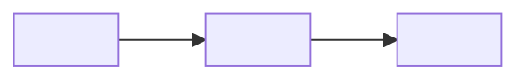

# ✅ Close (<KEY>): <short title>

## ⚡ 1 min

> 🔥 <the result in one line>

> **TL;DR:** <max 3 lines: what we fixed and what you now know>
>
> **What I need from you:** GO on Learned?. After GO, I write the wiki pages and archive the ticket folder.

**❓ Decisions needed**

1. <max 3 one-line items with the recommended answer, or "None (GO only)">

## ☕ 5 min

### 🏆 Result

| | |
|---|---|
| 🎯 Goal | <one line> |
| ✅ Result | <one line, with a number> |
| 🔗 Change request | <link> |
| ⏱️ Duration | <start date> → <end date> |

### 🧭 Affected areas

| Area | Key files | Role |
|---|---|---|

### ⚠️ Remember these

> 💡 **Tip:** <the most important gotcha or decision>

1. <gotcha or decision; max 5 items in total, including the tip>

## 📖 10 min

### 🗺️ How the feature lives in the code

### 🎯 What it is for, and who uses it

<3 to 5 lines>

### 📚 Wiki changes

| Page | Action | Key lines |
|---|---|---|
| `<area>/<page>.md` | create \| update | <lines> |
| `tickets/<key>.md` | create | summary |

## 🔬 15 min

### 📝 Ticket summary (goes to tickets/<key>.md)

<problem, root cause, fix, knowledge links>

## 📂 Appendix

- Code map: [map.md](map.md)
- Decisions: [decisions.md](decisions.md)
- Evidence Testing: [evidence-testing.md](evidence-testing.md)
