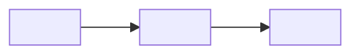

# ✅ Close — <KEY>: <short title>

> 🔥 <the result in one line>

> **TL;DR:** <max 3 lines: what we fixed and what you now know>
>
> **What I need from you:** GO on Learned?. After GO, I write the wiki pages and archive the ticket folder.
>
> **Reading time:** about <n> minutes.

## 🏆 Result

| | |
|---|---|
| 🎯 Goal | <one line> |
| ✅ Result | <one line, with a number> |
| 🔗 Change request | <link> |
| ⏱️ Duration | <start date> → <end date> |

## 🎓 What you now know

### 🧭 Affected areas

| Area | Key files | Role |
|---|---|---|

### 🗺️ How the feature lives in the code

### 🎯 What it is for, and who uses it

<3 to 5 lines>

### ⚠️ Remember these

> 💡 **Tip:** <the most important gotcha or decision>

1. <gotcha or decision; max 5 items in total, including the tip>

## 📚 Wiki changes

| Page | Action | Key lines |
|---|---|---|
| `<area>/<page>.md` | create \| update | <lines> |
| `tickets/<key>.md` | create | summary |

**📂 Ticket summary (goes to tickets/<key>.md)**

<problem, root cause, fix, knowledge links>

## ❓ Decisions needed

1. <max 5 items, or "None — GO only">
