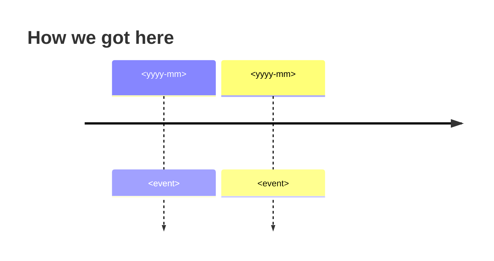

# 🧭 Context — <KEY>: <short title>

> 🔥 <the most surprising fact or the stakes, with a number when one exists>

> **TL;DR:** <max 3 lines>
>
> **What I need from you:** GO on Understood? for the displayed context and evidence revisions, or tell me what I got wrong.
>
> **Reading time:** about <n> minutes. Nothing here is a decision yet.

## 📊 At a glance

| | |
|---|---|
| 🎯 Problem | <one line> |
| 👥 Who feels it | <users, customer environments (count), jobs> |
| 📈 Size | <frequency, count, duration> |
| 🧩 Areas | <1 to 3 areas> |
| ❓ Open questions | <n> (<m> for colleagues) |

## 🎯 The ticket in one paragraph

<The ticket in one paragraph: what is wrong, for whom, and why now.>

**📂 Full history**

<Detailed history: what happened, when, with links to tickets, change requests, and evidence.>

## 🔎 Why it happens (what earlier work shows)

<2 to 4 sentences. Link each claim to evidence or code.>

> 💡 **Tip:** <A pattern, an earlier fix, or a tool that we can reuse.>

## 🧩 Related work

| Item | Type | Status | How it links to this ticket |
|---|---|---|---|

## 🛠️ What the code and tools say today

| Fact | Evidence |
|---|---|

**📂 More facts**

<Long lists of facts. Code details go to [map.md](map.md).>

## 🧪 Existing tests and regression risks

| Test or behavior to preserve | Coverage and evidence | Gap or regression risk |
|---|---|---|

## 🚧 Unavailable sources

| Source | Why unavailable | What remains unknown and how to check |
|---|---|---|

<Write "None" when there are no gaps. Missing evidence is not proof of safety.>

## ❓ Open questions

| # | Question | Ask whom | Status | Impact if the answer differs |
|---|---|---|---|---|

Status values: `draft`, `asked`, `answered`, `no reply`. Open colleague questions do not block GO.

## 👥 Colleagues to ask

| Person | Why | What to ask |
|---|---|---|

Drafts: [outbox/colleague-questions.md](outbox/colleague-questions.md). You send them.

## 💬 Colleague answers

<empty until an answer arrives>

## ❓ Decisions needed

1. <max 5 items, or "None — GO only">
