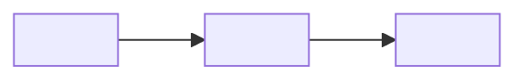

# 🔬 Evidence Testing — <KEY>: <short title>

> 🔥 <the result in one line, for example "Waiting-too-long event seen in the telemetry of the deployed branch">

> **TL;DR:** <max 3 lines: which behaviors we proved, with which evidence, and what is left>
>
> **What I need from you:** <approve a deploy, a database write, or a CI job \| nothing — all checks verified>
>
> **Reading time:** about <n> minutes.

This step is not a gate. It must be complete before any merge proposal.

## 📊 At a glance

| Item | Value |
|---|---|
| Environment | <deployed branch, run link \| local> |
| Commit tested | <hash12> |
| Checks | <n> 🟢 verified · <n> 🔴 failed · <n> ⚪ not possible |
| Regression | 🟢 \| 🟡 <pre-existing failures only> \| 🔴 <new failures> |
| Automated QA test | ➕ added: <project, test name, CI job> \| ➖ manual evidence only (user choice <yyyy-mm-dd>) \| ⏸️ not now |

## 🧪 Functional checks

One row for each changed behavior. Include the unhappy path (error, threshold, empty input, toggle off).

| # | Behavior | Action or input | Expected | Observed | Evidence | State |
|---|---|---|---|---|---|---|
| 1 | <what changed> | <exact steps> | <result> | <result> | [evidence file](evidence/<yyyy-mm-dd>-<topic>.md) | 🟢 \| 🔴 \| ⚪ <why> |

## 🔀 Flow tested

## 🛡️ Regression evidence

| Run | Job and build | Result | Notes |
|---|---|---|---|
| Unit tests | <command> | 🟢 <n> passed | |
| End-to-end | <job #build> | 🟢 \| 🟡 \| 🔴 | <link> |
| Suite or integration | <job #build> | 🟢 \| 🟡 \| 🔴 | <pre-existing failures with first failing build> |

**📂 Evidence detail**

<queries, outputs, screenshots, links. Aggregated or masked data only.>

> ⚠️ **Warning:** <test data, database writes, or toggles that need clean-up. Remove the box otherwise.>

## ❓ Decisions needed

1. <max 5 items, for example "Accept check 3 as ⚪ not possible because …", or "None — GO only">
