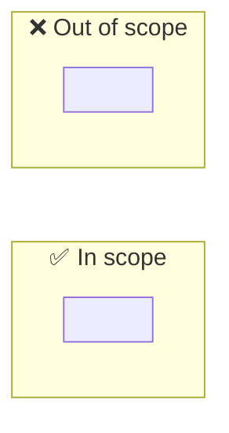

# 🎯 Scope interview — <KEY>: <short title>

> 🔥 <the one scope choice that changes the plan most>

> **TL;DR:** <what we agreed, in max 3 lines>
>
> **What I need from you:** GO on Agreed? (or Briefed? in track M).
>
> **Reading time:** about <n> minutes.

## 📊 At a glance

| ✅ In scope | ❌ Out of scope |
|---|---|
| <item> | <item> |

## 🗺️ Scope

## ❓ Questions

One block for each question. Round 2 questions go below round 1.

### Q1 — <question>

| | |
|---|---|
| 💡 Why it matters | <reason> — [context](context.md#<anchor>) or [evidence](evidence/<file>.md) |
| 🔀 Options | A: <option> · B: <option> · C: <option> |
| ⭐ Recommended | <option> — <reason> |
| ✅ Your answer | <empty until the user answers> |

**📂 Spike result behind this question**

<only when a spike answered a fact: link to evidence/<yyyy-mm-dd>-spike-<topic>.md>

## ❓ Decisions needed

1. <max 5 items, or "None — GO only">
