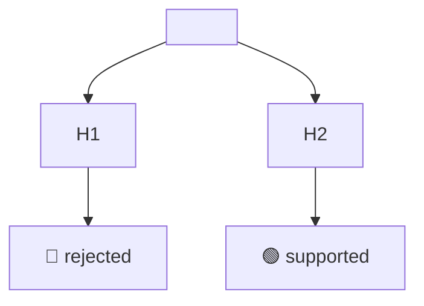

# 🔎 Investigation — <KEY>: <short title>

> 🔥 <the key finding in one line, for example "H2 holds: 1 call makes 312 queries">

> **TL;DR:** <max 3 lines: what we found and what it means for the plan>
>
> **What I need from you:** GO on Diagnosed? for the displayed investigation and evidence revisions. This gate is required before planning on every new ticket.
>
> **Reading time:** about <n> minutes.

## 📊 At a glance

| | |
|---|---|
| 🟢 Supported | <n> hypotheses |
| 🔴 Rejected | <n> |
| 🟡 Open | <n> |
| 🧪 Spikes | <n> |
| 📂 Evidence files | <n> |

## 🧭 Hypotheses

| # | Hypothesis | Status | Evidence |
|---|---|---|---|
| H1 | <text> | 🟡 open | — |

Status values: `🟡 open`, `🟢 supported`, `🔴 rejected`.

## 📌 Findings

### <yyyy-mm-dd> <finding title>

<fact in 1 to 3 sentences> — see [evidence](evidence/<file>.md)

**📂 Details and excerpt**

<tool, parameters, time window, sanitized excerpt>

## 🔀 Before and after

<only when the finding implies a change>

| 🔴 Today | 🟢 After the fix |
|---|---|

## 🧪 Spikes

- <yyyy-mm-dd> <question> → <answer> — [evidence](evidence/<file>.md)

> ⚠️ **Warning:** <a risk or data rule that the plan must respect, when one exists>

## ❓ Decisions needed

1. <max 5 items, or "None — GO only">
