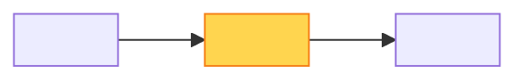

# 📝 Plan — <KEY>: <short title>

> 🔥 <the payoff in one line, for example "312 queries → 2 queries per call">

> **TL;DR:** <max 3 lines: what we change and why>
>
> **What I need from you:** GO on Designed?. After GO, the build starts in a new worktree.
>
> **Reading time:** about <n> minutes.

## 📊 At a glance

| | |
|---|---|
| 🧩 Steps | <n> |
| 📄 Files | <n> |
| 🧪 Tests | <unit n> · <integration n> · <end-to-end scope> |
| ⚠️ Risk | 🟢 low \| 🟡 medium \| 🔴 high — <one line> |
| ⏱️ Estimate | <hours or days> |

## 🗺️ Change map

## 🔀 Before and after

| | 🔴 Before | 🟢 After |
|---|---|---|
| Behavior | | |
| Cost (queries, time, calls) | | |

## 🛠️ Steps

| # | Step | Files | Why |
|---|---|---|---|
| 1 | <step> | [File.cs](<checkout>/path/File.cs) | <reason> |

**📂 Step details**

<code sketches, signatures, edge cases for each step>

## 🧪 Test plan

| Kind | Test | What it checks |
|---|---|---|
| Unit | | |
| Integration | | |
| End-to-end | | |

## ⚠️ Risks and rollback

| Risk | Chance | Impact | Mitigation | Rollback |
|---|---|---|---|---|

> ⚠️ **Warning:** <the biggest risk in one line, when one exists>

## 🤝 Assumptions for open colleague questions

| Question | Assumption | Fallback if wrong |
|---|---|---|

## ❓ Decisions needed

1. <max 5 items, or "None — GO only">
