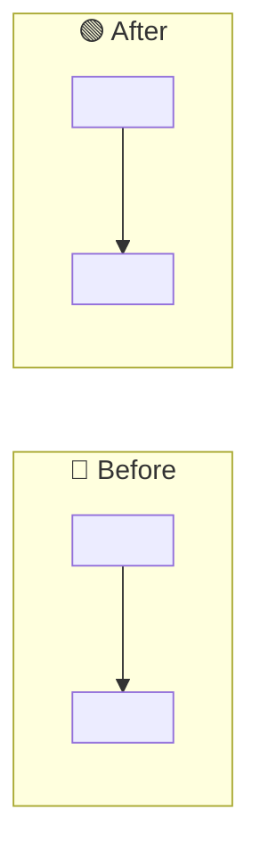

# 🧪 Code review — <KEY>: <short title>

> 🔥 <the result in one line, for example "All 48 tests green; 312 → 2 queries confirmed">

> **TL;DR:** <max 3 lines: what changed, how we tested it, what is left>
>
> **What I need from you:** GO on Shippable?. After GO, I push and create or update the change request. You merge in the web UI of the repository host.
>
> **Reading time:** about <n> minutes.

## 📊 Checklist

| Check | Result |
|---|---|
| 🔨 Build | 🟢 \| 🔴 <error> |
| 🧪 Unit tests | 🟢 <n> passed \| 🔴 <n> failed |
| 🌐 End-to-end | 🟢 <job #build> \| 🟡 not run: <why> \| ⚪ no test covers it |
| 🚀 Deployed QA | 🟢 <env, evidence link, control worked> \| 🟡 planned: <test-plan.md> \| ⚪ not possible: <why> |
| 🔍 Code review (subagent) | 🟢 <n> findings handled |
| 🥊 Adversarial review | 🟢 <model>: <n> findings, <n> fixed, <n> rejected with evidence \| 🔴 not run (blocks the change request) |
| 📏 Diff | <files> files, +<n> / −<n> |

## 🧭 Affected areas

| Area | Files | User impact | Tests | Risk |
|---|---|---|---|---|

## 🔀 Before and after

## 💡 Why each change

| Change | Why |
|---|---|

**📂 Test runs and logs**

<commands, test names, end-to-end job links, CI links>

> 🛑 **Caution:** <anything that can affect production, when it exists. Remove the box otherwise.>

## ❓ Open questions

<items, or "None">

## ❓ Decisions needed

1. <max 5 items, or "None — GO only">
