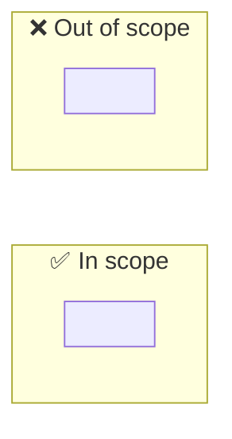

# 🎯 Scope (<KEY>): <short title>

## ⚡ 1 min

> 🔥 <the one scope choice that changes the plan most>

> **TL;DR:** <max 3 lines: what we will change, for whom, and what we will not change>
>
> **What I need from you:** GO on Scoped?. GO approves this scope with the displayed context, briefing, and interview revisions. Then I investigate.

**❓ Decisions needed**

1. <max 3 one-line items with the recommended answer, or "None (GO only)">

## ☕ 5 min

### 🎯 The problem

<3 lines from context.md: what is wrong, for whom, and why now.>

### ✅ In scope and ❌ out of scope

| ✅ In scope | ❌ Out of scope |
|---|---|
| <item> | <item> |

### 🏁 Done when

| # | Acceptance check | How we prove it |
|---|---|---|
| 1 | <observable result> | <test, query, or deployed check> |

## 📖 10 min

### 🎤 Your interview answers

| Question | Your answer | Link |
|---|---|---|
| <question> | <answer> | [interview.md](interview.md#q1) |

### ⚠️ Behavior to preserve and regression risks

| Behavior or test | Why it matters | Evidence |
|---|---|---|

### ❓ Open colleague questions

| Question | Ask whom | Status | Impact if the answer differs |
|---|---|---|---|

Open colleague questions do not block GO. The plan states an assumption for each one.

## 🔬 15 min

### 🕰️ How we got here

<Short history with links. The full history is in [context.md](context.md).>

### 🔎 What the code and tools say today

| Fact | Evidence |
|---|---|

## 📂 Appendix

- Context: [context.md](context.md)
- Visual briefing: [briefing.md](briefing.md)
- Interview: [interview.md](interview.md)
- Evidence: [evidence/](evidence/)
- Code map: [map.md](map.md)
